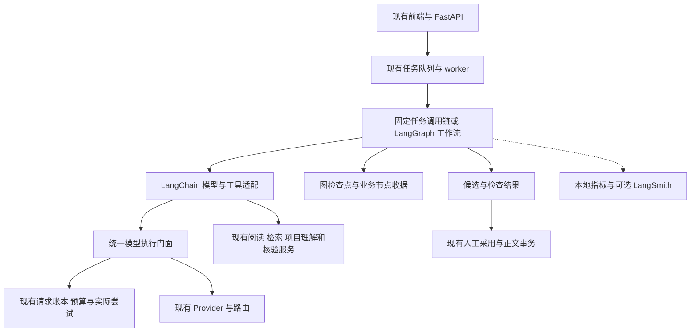
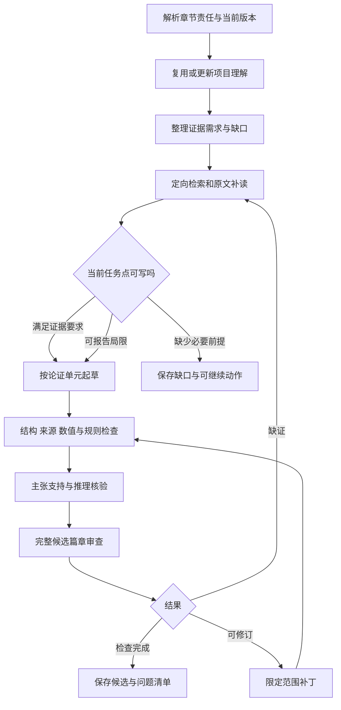

# 砚台 AI 系统全面优化整合实施方案

日期：2026-11-07。适用项目：`D:/桌面/论文/paper-workbench`。

本文整合前几版方案，是后续讨论、拆分任务和实施验收的统一依据。论文质量、使用效果、系统架构三项均为必需目标，按同一实施路线推进，分别提供验收证据。

当前状态：方案整合完成，代码迁移尚未开始。本文的新增对象、目录和接口均为拟议设计，不表示已经接入 LangChain、完成性能优化或取得质量提升。本次未操作用户数据库、启动后台任务或发起付费模型调用。

## 1. 目标、范围与总体决策

| 目标 | 必须完成的工作 | 验收关注 |
| --- | --- | --- |
| 论文质量 | 项目理解、章节内容责任、证据支持、规则应用、论证修订和整篇一致性 | 必需问题是否回答，事实与原文是否相符，结论是否超出证据 |
| 使用效果 | 生成速度、总成本、成功率、反馈与失败恢复 | 首个候选和最终合格候选耗时、单位合格成果成本、暂停与恢复表现 |
| 系统架构 | 全部受支持 AI 入口的共享契约、统一执行路径和阶段复用 | 入口覆盖、请求与费用完整性、重复路径退出及跨入口一致性 |

总体采用“现有领域服务与账本 + LangChain 适配 + LangGraph 有状态编排 + 本地评测与可选追踪”。翻译、短摘要等固定任务使用简单调用链；单章、整篇和持续修订使用明确的状态图；调查节点按需使用受限工具。

首个可交付场景是：给定真实项目、已发布规则和章节目标，产出有原文依据、说明条件与局限、问题可定位、可继续补证的章节候选。随后扩展整篇和其他 AI 入口。

实施路线统一为：**基线诊断 → 单章贯通 → 单章质量与性能优化 → 整篇扩展 → 全入口整合与交付**。每个阶段同时报告三项目标的进展，整体目标是三方面均获得可验证改善，不用综合分数掩盖单项退步。

费用、性能和语义质量目标在基线建立后确定；不沿用未经验证的固定提升百分比或工期。框架迁移与质量、性能策略分别开关和验收。现有作者决定、来源权限、预算和正文采用事务继续有效。

## 2. 当前基础与待验证问题

| 源码可确认的能力 | 具体依据 | 进一步工作 |
| --- | --- | --- |
| 项目问题映射、业务流程理解及有限补读 | `project_understanding.py:parse/prepare` | 将理解结果与章节责任、证据更新和核验结果连通，评估理解质量 |
| 论证卡、证据类型要求、结论强度限制 | `writing_argument.py:build` | 当前候选排序含词项重合与类型加权；评估其是否覆盖实际论证，不预设算法无效 |
| 静态实现、作者声明、执行结果和导入测量的区分 | `writing_evidence_quality.py:assess_result_evidence` | 保留现有分类，将其作为共享决策输入，逐项核对统计口径与适用条件 |
| 主张窗口核验、来源范围约束及受限补丁 | `writing_quality_protocols.py`、`writing_revision_patch.py` | 统一生产路径中的契约，防止不同入口使用不同完成标准 |
| 受影响主张的依赖闭包 | `dependency_shadow()`、`dependency_projection()` | 当前明确为 shadow，不能据此直接跳过核验；新增内容是验证闭包覆盖能力 |
| 整篇语义复核与采用约束 | `paper_writing.py:_run_whole_paper_review` 及采用路径 | 扩充论证覆盖和跨章事实一致性记录，不能重复声称首次加入全文审查 |
| 逻辑请求、实际尝试和旧 worker 写回隔离 | `request_execution.py`、`task_transitions.py` | 为 LangGraph 接入补齐与这些机制一致的节点提交协议 |
| 混合检索、RRF、重排和检索指标 | `retrieval.py`、`knowledge_service.py`、`knowledge_evaluation.py` | 复用当前管线，按任务责任评估证据覆盖 |
| 来源版本、实际阅读与外发检查 | `writing_retrieval.py`、`writing_tool_runtime.py`、`resource_refs.py` | 所有适配保留原始定位与权限语义 |
| 连接、提示块、查询向量及数值矩阵等复用 | `provider.py`、`ai_request_cache.py`、`retrieval.py` | 先测实际命中和重复工作，再决定性能改动 |
| 章节、整篇、聊天、翻译等多类 AI 入口 | `tasks.py`、`paper_writing.py`、`assistant_service.py`、`writing_ops.py` | 建立能力与入口清单，逐个决定是否需要状态图 |

以上属于源码能力与设计边界。尚未实测当前模型最常见的语义错误、真实成功率、最耗费阶段或首要性能瓶颈，不能将“可能改进”写成已定位根因。生产进程与便携包是否包含这些源码仍需按运行身份核对。

## 3. 总体架构与职责边界



| 层次 | 负责的内容 | 主要边界 |
| --- | --- | --- |
| 任务与领域契约 | 内容责任、证据要求、来源范围和检查结果 | 复用现有合同、论证卡和证据对象，不复制事实源 |
| LangChain 适配 | 消息、工具、结构化结果和检索器契约 | 模型请求继续经过现有执行与计费边界 |
| LangGraph 编排 | 阶段选择、有界补读、修订分支、暂停和恢复 | 一个有效 owner 推进；阶段服务不自行启动第二个协调器 |
| 执行与传输 | 来源和预算预检、逻辑请求、实际端点、网络尝试与费用 | 网络重试权保持唯一，未知结果不自动重发 |
| 业务持久化 | 候选、阅读、来源版本、节点收据和正文采用 | 业务库与采用事务为权威；图状态可重建 |
| 评测与观察 | 耗时、成本、质量比较及可选追踪 | 观察失败不影响账本，追踪不能替代业务状态 |

### 3.1 各任务的框架接入方式

| 工作类型 | 推荐接入方式 | 业务约束 |
| --- | --- | --- |
| 翻译、短摘要、固定分类 | 明确输入输出的 Runnable 组合 | 保留原数值、限定、引用与现有记账；通常无需独立持久化图 |
| 复杂研究问答与补读 | 检索器、StructuredTool，必要时局部 agent | 工具授权由服务端注入，搜索预览不能当原文 |
| 单章、整篇与有状态修订 | LangGraph 显式图 | 节点复用领域服务，恢复与版本规则见第 10 节 |
| 规则抽取 | 批次读取、候选抽取、原文校验、去重冲突处理 | 继续区分候选规则和当前已发布规则 |
| 图表与实验说明 | 结构化图表规格与现有渲染、数据服务 | 图中数值来自实际数据，渲染成功不证明结论成立 |
| 采用、导出与正文保存 | 现有确定性服务 | 图只提交明确请求和版本，不让 agent 决定事务一致性 |

## 4. 共享任务契约与完成状态

### 4.1 从现有任务书扩展一个共享视图

复用 `writing_ops`、章节合同、论证卡、规则应用对象，生成版本化 `TaskSpec` 视图，避免再复制一套独立事实表。

每个内容责任项至少声明：

```text
obligation_id             稳定任务点 ID，改写文字不自动创建新责任
question                 本段或本节必须回答的问题
required                 必需或可选，以及规则或作者决定的来源
evidence_requirements    所需证据类型、范围、条件和定位要求
claim_strength_cap       证据允许达到的结论强度
acceptance_checks        本地检查、语义核验与人工判断分别检查什么
depends_on               前提、来源与其他任务点的版本
gap_policy               缺失时补读、降为明确局限，还是暂停该结论
```

例如“解释访问控制机制”可以使用实际读取的实现代码；“证明高并发性能提升”必须有可追溯测量、基线和同口径条件。没有性能实验不必阻止描述静态设计，但必须阻止把静态实现写成实测提升。

适用规则先由服务端范围和条件匹配，再交模型解释；存在规则冲突时保留冲突和来源，不能靠模型自行挑选较容易满足的规则。

### 4.2 完成状态分别表达

对任务点记录 `pending / evidence_missing / ready_to_draft / drafted / verified / needs_review / blocked`。状态需满足相应前置条件，例如：

- `ready_to_draft`：已有符合类型要求的原文与允许写出的命题，或该任务本身明确要求报告缺口。
- `verified`：候选已绑定真实位置，所需检查覆盖完整且没有该责任项的阻断问题。
- `needs_review`：有可读候选，但存在语义分歧、覆盖不足或需作者判断的问题。

这些状态作为业务对象的派生视图；在首次接入时不替换现有任务、会话和候选状态枚举。禁止再造一套彼此独立的“完成”定义。

## 5. 项目理解、上下文与可追溯记忆

| 层级 | 内容 | 更新条件与限制 |
| --- | --- | --- |
| 项目定位 | 作者确认的题目、研究问题、边界 | 作者或明确授权更新；自动理解不覆盖 |
| 项目事实 | 已读取实现、真实执行、测量和术语 | 原始证据或版本变化时重新核对 |
| 章节计划 | 内容责任、依赖、已有正文版本 | 目标、规则或基础正文变化时重新生成 |
| 工作上下文 | 当前论证单元的原文、数值、条件和邻接正文 | 按当前动作选择，保存实际提供范围 |
| 派生摘要 | 阅读导航与跨章定位 | 可重建，失效可追踪，不作为唯一事实依据 |

项目理解继续使用当前问题映射、实际代码范围和有界补读。理解输出记录覆盖问题、机制、依据、限制和定位缺口；代码、测试定义、执行记录及测量保持各自证据类型。

先去除重复序列化 和重复证据副本，再比较上下文选择策略。减少输入不能丢失当前核验必须看到的前提、否定条件或强制规则。比较全文与局部模式时，同时报告省略范围和错误情况。

缓存键应包含任务内容、原始范围、证据版本、规则版本、提示与输出契约、实际模型配置等必要因素；权限和取消在复用前重新验证。模型响应缓存、提示块缓存和向量缓存分别统计，缓存命中不能推导为候选可采用。

外部资料、代码注释、旧稿和工具输出一律作为数据，不能改变工具权限、项目归属或预算；相关字段由服务端上下文注入。追踪只按当前来源外发政策记录，私有全文默认留在本地。

## 6. 证据契约、检索与补读

### 6.1 明确三种不同关系

1. 检索相关：内容与问题相似，只能帮助找到阅读位置。
2. 阅读有效：服务端实际提供了原文范围、版本和可用权限。
3. 命题支持：原文在给定对象、条件和口径下支持当前具体表述。

保留项目已有的预览与原文区分。在 `Document.metadata` 中传递来源和范围，不能把加入 LangChain Document 本身视为新增阅读证明或语义支持。

检索结果适配为 LangChain Document 时，至少保留当前来源元数据：

```text
project_id, source_id, file_id, source_version, parse_id
page, char_start, char_end, content_hash, source_ref
read_scope, evidence_kind, conditions, origin_type
```

区分搜索预览、实际原文阅读和派生上下文；研究文献、教学示例、指导意见与原始实验资料保持各自用途。

建议将既有 claim/evidence links 适配为一个证据支持视图，包含：

```text
claim_ref + claim_text_hash
evidence_ref + source_version + read_range_hash
relation: supports / contradicts / qualifies / background / unresolved
applicability: object, conditions, time_scope, measurement_scope
checked_by, check_version, coverage, unresolved_reason
```

这里的 `relation` 是待核验的结构化判断，不能把模型返回的 supports 标签自动提升为确认事实。尽量增加共享投影和必要字段；先对现有表作映射，再决定迁移，避免建立平行知识库。

### 6.2 证据强度按命题类型判断

| 希望写出的命题 | 最低需要核对的依据 | 证据不足时的合理产出 |
| --- | --- | --- |
| 某功能存在静态实现 | 相关调用或实现范围、当前快照、必要前提 | 描述已读取范围内的实现，注明未验证运行 |
| 某业务流程正确完成 | 对应执行记录、输入、状态变化与原始产物 | 仅描述设计和测试定义，保留运行缺口 |
| 性能或效果优于基线 | 实际测量、可比基线、单位、样本和实验条件 | 不写提升比例；明确缺少比较实验 |
| 文献支持某方法结论 | 原文结论、对象、条件、研究局限 | 缩小命题范围或报告证据不足 |
| 跨文献归纳或系统比较 | 多个原始来源、共同维度、差异与可比性 | 报告已有比较维度，保留不可比项 |

没有检索到反例不等于没有反例；代码未出现某字段也不等于整个系统不存在该行为。否定性断言需要单独审查覆盖范围。

### 6.3 检索规划与材料选择

保持现有混合检索作为基线，在其后增加按责任项进行材料选择的策略：

1. 将问题拆为有限责任项，确定每项缺少的证据类型。
2. 对缺口生成定向查询；单一定位问题直接检索，不增加规划调用。
3. 召回、RRF、重排后按责任覆盖、来源多样性和条件完整性去重选材。
4. 读取精确片段；需要理解结论条件时扩展到对应父段、表注或相邻页面，保存实际范围。
5. 对矛盾、数值和实测结论追加定向核对；输出明确缺口。

不同检索器的原始分数不直接作为统一支持阈值。材料选择先采用可解释贪心策略：每增加一个片段，报告它补齐了哪个任务点及增加多少上下文。是否需要模型参与选择由实验决定。

首轮实验可将复杂问题的查询变体限制为最多 3 个，补读轮数不高于现有配置；这是可调整的实验上限，不是最佳参数结论。

强制证据要求逐项满足，不能由其他任务点的高覆盖分数抵消。覆盖率的分母来自冻结的任务书，不能随模型少写内容而缩小。

## 7. 单章写作与修订闭环



所有回路受总预算、轮数和当前执行状态共同限制。图中的“检查完成”表示检查过程完整，不表示论文已获得学术认可。

LangGraph 负责明确分支和工作流状态。需要自由选择阅读工具的调查节点，可使用局部 agent；起草、核验、补丁和采用优先使用明确输入输出的节点。这样可以定位某条结论究竟在哪一步失去依据。

### 起草和修订的具体约束

- 起草单位按论证责任划分，字数作为范围约束。一个单元必须增加一个解释、机制、比较或有依据的结论，不能仅换说法补字数。
- 每个事实性主张绑定当前原文位置和条件，正文不暴露内部编号。映射随候选保存。
- 区分事实、基于事实的解释和作者拟议观点，避免模型把推断写成观察结果。
- 语义核验先独立看原始证据和命题，再比较起草者的说明，降低对生成理由的依赖。
- 修订优先复用现有受限补丁协议；没有授权扩大范围时，不改变问题之外的正确命题、引用和作者保留内容。
- 对不支持的结论，依次考虑补证、缩小范围、保留局限、删除无依据断言；不能只通过降低语气掩盖错误数值。

新增事实、改变条件、移动段落或改变指代都可能影响核验范围。本文不授权基于 shadow 依赖分析跳过既有完整检查。

## 8. 整篇论证、一致性与增量核验

整篇继续复用既有论证边、章节合同与全文审查，扩展一个全篇责任视图：

```text
研究问题 → 研究任务/贡献 → 方法与实现 → 实际证据 → 结果 → 结论与局限
```

每个箭头需要具体链接和覆盖说明，不能只检查章节有没有出现相同关键词。

### 8.1 章节责任与统一事实

为每章明确承担的问题、引入的定义、使用的前提、应提供的依据以及不能重复宣称的贡献。跨章共享术语、关键数值、实验对象和已确认事实，始终附当前原始来源。

摘要和结论根据已接受的全篇事实与结果生成。它们出现的贡献和实验数值必须回查正文；不能反过来用摘要给正文提供事实依据。

项目理解与章节摘要属于可重建派生记录，记录覆盖范围和版本。作者确认的研究定位、自动归纳和原始事实分别保存，更新摘要不得覆盖作者决定。

### 8.2 按依赖生成与定向修订

无相互前提的材料整理可以并行；依赖实验结果的讨论等待结果可用。存在论证依赖环时先报告环和缺失前提，不能把互相引用的两个结论视作彼此证明。

全文审查至少核对：研究问题有没有回答；贡献有没有对应证据；方法与实验对象是否一致；章节间数值、术语、图表和结论是否冲突；局限有没有被后文扩大抹去。

### 8.3 增量核验的实际路线

现有依赖闭包为 shadow。先同时计算“预测受影响范围”和完整核验发现范围，建立以下对照：

```text
来源/规则/正文变更
  → 预测影响的主张、段落、前提、图表、摘要和结论
  → 与完整检查实际发现比较
  → 记录漏判、额外检查和节省的候选工作量
```

只有覆盖相关变更类型、人工复核漏判并通过预先规定的验收后，才讨论启用有限跳验。全局规则、论文身份、来源权限和基础版本改变仍触发相应全局检查。观察集没有漏判不代表所有未来变更均安全。

## 9. 模型、工具与结构化输出统一

### 9.1 模型执行门面与受限工具

先以薄适配器和 Runnable 封装当前模型执行路径，普通生成与 agent 工具传输共用逻辑请求边界。需要原生消息和工具循环时，再实现完整 `BaseChatModel` 兼容；测试角色映射、tool_call_id、工具回执、结束原因、实际模型身份与使用量。

首次贯通先验证同步调用；流式适配另测工具参数分片、部分输出、断线、取消和未核验草稿展示。若采用新的 SDK 传输，须接回所有请求钩子、端点预检和账本，并明确禁用与原传输重叠的自动重试。

调用携带服务端执行上下文：

```text
project_id / task_id / task_attempt
writing_session_id / writing_step_id / lease_epoch
run_id / action_id / plan_revision / stage / unit_id
input_manifest_hash / prompt_version / graph_version / schema_version
source_versions / permission_stamps
logical_request_id / generation_run_id / provider_attempt_id
```

身份、权限与预算从服务端注入，不能由模型工具参数指定。工具 schema 仅开放当前阶段允许的搜索、阅读、项目资料和规则能力；调查节点取材，起草节点使用冻结材料，采用仍走现有正文事务。

LangChain middleware 用于相应 agent 循环；普通工作流节点使用显式包装。网络重试、格式修复和语义修订分别计数，统一管理总次数和费用，禁止 SDK、图节点与 provider 各自重复尝试。

### 9.2 输出 schema 与分层校验

为以下阶段逐步定义 Pydantic 输出模型：`ProjectUnderstanding`、`ResearchPlan`、`ClaimEvidenceMap`、`RuleReview`、`SemanticReview`、`RevisionPatch`。

校验分三层：

1. 结构层：字段、类型、枚举、长度、完整覆盖声明。
2. 引用层：ID 存在、项目归属、来源版本、位置范围、逐字引用可定位。
3. 语义层：证据是否支持命题、条件和否定是否保留、规则是否正确应用。

按实际端点能力选择 provider 原生结构化输出、工具结构化输出或 JSON + 本地校验。通过中转站时，应实测“端点 + 模型 + 协议”组合，不能只凭模型名字认定支持。

当前 `provider_adapter.finish_structured()` 已有最多五次完整 JSON 尝试。迁移时统一管理修复次数和费用上限，避免叠加 LangChain 的格式修复、图节点重试与 provider 重试。完整但格式错误的结果优先尝试本地重解析；重发也必须计费和留痕。结构合法不能直接判为内容通过。

不在本轮默认增加新的向量数据库、图数据库、训练流水线或全局多角色自由讨论。额外组件须由实际需求、质量和成本对照支持。

## 10. 持久化、调度与恢复一致性

### 10.1 图状态与大对象引用

建议状态包含：

```text
run_id, project_id, session_id, section_id
graph_version, state_schema_version, input_manifest_ref
stage, current_unit, research_round, revision_round
evidence_bundle_ref, candidate_ref, review_refs
outstanding_intent_ids, pause_reason, next_action
```

正文、原文和大型阅读上下文存为已有不可变对象，图状态存对象引用及哈希。预算字段即使出现在图状态中也只作展示，发送前始终重新读取账本和当前政策。

### 10.2 明确唯一权威

| 对象 | 权威来源 |
| --- | --- |
| 谁正在执行，是否取消，允许哪个代次提交 | 现有 task 租约、attempt 与条件写回 |
| 模型请求是否发送、结果是否已知、真实费用与预留 | 现有 request_intents / provider_attempts / generation_runs 与预算服务 |
| 节点业务结果是否已保存 | 业务对象及与之同事务写入的节点完成收据 |
| 下一步走哪个分支、局部临时状态 | LangGraph 状态；必须可由已提交结果重建 |
| 正文是否已采用 | 当前采用事务、版本与幂等收据 |

### 10.3 调度与租约隔离

首期在现有队列增加 `ai_graph_run` 任务类型来驱动新图，沿用当前 worker 心跳和取消检查。一个图 run 同时只允许一个有效 task owner 推进；图内不再调用旧协调器的后继入队逻辑。旧入口继续运行冻结的旧路径。

图检查点命名空间包含 `run_id + graph_version + task_id + execution_epoch`。旧 worker 的迟到检查点只能写入旧代次命名空间，不能成为新代次的恢复入口。新的 owner 根据业务收据重建有效状态，在新命名空间继续。

同一次执行内部仍沿用同一图命名空间。新 owner 重建时按已提交的分支结果和动作顺序前进，不重新调用模型决定已经完成的分支；所有恢复输入先通过当前业务版本检查。计划修改需留下父版本与差异，并在修改影响研究目标或作者决定时沿用现有确认机制。

这一方案优先使用标准 SQLite 检查点后端，避免首期自研完整 checkpointer。独立检查点文件列入备份清单，但业务完成收据保存在现有业务库；它们不能依靠跨库事务保持一致，恢复按下一节处理。

### 10.4 一个业务节点的提交协议

建议增加最小节点收据表，关联已有对象，不复制原文、响应和账单：

```text
run_id, action_id                      稳定逻辑动作；联合唯一
node_name, unit_id, plan_revision
input_fingerprint, execution_epoch
result_ref, result_hash, request_intent_refs
committed_at
```

`action_id` 在计划中持久化，恢复时沿用，不能每次领取任务随机生成。收据存在前，运行状态和在途请求由已有任务、检查点及请求账本表达；新表记录已完成业务提交。

执行顺序：

1. 验证当前 owner、任务状态、来源版本、权限与预算政策；查找动作收据和相关在途请求。
2. 若收据存在且输入匹配，读取业务结果；输入不匹配则报告计划冲突，不覆盖原收据。
3. 若请求已发出而结果未明，保持暂停；同一 run 的自动重计划不能绕过它。
4. 执行当前动作。模型调用继续经过原账本；阅读或候选创建同样有稳定动作身份和去重边界。
5. 在业务库短事务内再次验证 owner 与输入，将业务结果和节点收据一起提交。大对象先保存为不可变对象，事务保存引用；未被引用的对象由既有清理政策处理。
6. 节点返回已提交的引用，图再保存检查点并确定下一步。

第 5 步要求被复用的领域服务支持同一事务或明确的幂等保存接口。原服务若各自提交，需要先改接口并测试；不能仅在外层加一个收据就声称原子性成立。

### 10.5 崩溃窗口与处理

| 故障窗口 | 恢复行为 |
| --- | --- |
| 尚未发送 HTTP | 按已有明确未发送政策继续 |
| HTTP 已发出，未保存完整结果 | 维持未知；不自动重复请求 |
| 完整响应已入账，解析或节点提交未完成 | 读取保存的响应继续解析 |
| 业务结果及节点收据已提交，图检查点未保存 | 从收据重建节点输出，不重复模型或业务写入 |
| 图输出引用不存在或哈希不符 | 判为恢复不一致，停止推进并报告 |
| 旧 worker 在新 owner 开始后返回 | 保存原始响应证据；禁止提交当前业务结果，检查点隔离 |

切换模型、修改 prompt、递增图重试次数、换任务代次，都不能解除已有未知请求。格式修复或语义修订要创建可追溯的新动作，并保留父动作、费用和次数上限。对新计划创建新的动作前，先核对已有未决动作；不能借计划版本变化隐藏历史未知。

图检查点的存在不提供远端恰好一次执行保证。目标是本地结果幂等、迟到写入隔离、已知结果可复用、未知结果不自动重发。

## 11. 性能、成本与使用效果优化

### 11.1 耗时与资源基线

给任务及阶段增加统一的时间与资源观察，复用当前事件、检索 timings 和运行诊断：

```text
queue_wait                       排队至有效领取
context_build                    数据读取、权限检查、去重和上下文构造
embedding / retrieval / rerank    本地模型冷启动、召回和重排分别计时
provider_wait                    实际请求发送至服务商响应
first_model_content              实际首个模型正文片段，区别于心跳或状态消息
draft_available                  完整候选第一次持久化
required_checks_complete         必要检查完成
resume_recovery                  恢复开始至可继续推进
total_elapsed                    提交至最终状态，失败和暂停也纳入分布
```

按任务类型、篇幅、模型、硬件、冷/热缓存和并发数分组。先找关键路径，再选择优化项；不能只凭总时间判断网络、本地推理或框架是瓶颈。

### 11.2 分层性能优化与并发边界

| 层级 | 具体动作 | 必须同时验证 |
| --- | --- | --- |
| 上下文构造 | 批量读取重复记录；复用当前不可变材料块；减少同一证据反复序列化 | 内容与权限检查未缺失，输出 manifest 一致 |
| 模型加载与检索 | 复用现有模型缓存、查询向量、矩阵和重排结果；按源版本更新必要索引 | 冷热缓存分开测量，峰值内存受控，失效后不复用旧结果 |
| 连接与调用 | 复用当前受控连接池，限制总请求并发和端点速率，处理明确限流 | 实际身份、请求钩子、上下文与费用归属完整 |
| 工作流 | 对独立只读检索和互不依赖的检查做有界并行 | 各分支输入冻结、预算原子预留、合并确定、取消能传播 |
| 模型输入 | 去重证据，按当前任务选择必要上下文；避免每阶段携带无关全文 | 必要前提、原始条件和强制规则保留，质量比较通过 |
| 模型调用数量 | 复用已完成理解与核验，限制无收益补读和格式重发 | 不跳过必要检查，未知请求保持原处理方式 |
| 用户反馈 | 复用现有任务观察通道，分阶段显示进展；支持时展示草稿流 | 状态消息不冒充正文，未核验文本明确标记，断线不重建任务 |

项目已经有连接池、本地模型缓存和多类计算缓存，首先测量覆盖范围与未命中的原因。需要新增或扩大缓存时，说明具体重复工作，避免多层缓存保存同一对象却增加失效复杂度。

并发上限同时受项目、端点和本地资源约束，先从串行基线做小范围试验。每个并发分支显式传递独立执行上下文与实际模型作用域；验证现有 ContextVar、账本事务和数据库连接在所选并发方式中的行为。

### 11.3 预算、模型分工与有效动作选择

成本策略关注“接下来最值得做什么”，同时继续服从现有执行政策与预算预检。

每个可选动作记录解决的缺口、预估输入输出、费用估计来源和可能改变的结论。优先处理强制任务点缺证与高影响错误；来源已经充分时，避免反复改写查询和重读相同内容。

计划生成时单列起草、必要核验和可选优化预算。费用估计来源于实际端点价格与同类历史样本；未知时显示未知或保守预留，不能伪造精准预测。可选润色和额外候选只能使用完成必要检查后的可用额度，发送前仍重新读取真实账本。

从单候选起步；多候选比较仅用于明确需要的难题或受控评测。若补读已连续无法增加有效证据，停止该补读动作，保存缺口。预算不足时保存“候选存在、核验未完”，不能显示为合格成果。

模型 profile 可按任务和风险配置，但自动切换要经过质量和协议验证；无法判断的网络结果不因换模型而重发。同一模型换角色的意见一致，也不能当作独立事实验证。

### 11.4 恢复与用户反馈效果

恢复优化采用第 10 节的收据与代次隔离，另测恢复时间、重复工作量和用户继续操作次数。继续复用当前取消、租约、错误分类和回执能力，避免把失败统一重试。

验收同时报告首个候选、最终合格候选、总费用、成功率与恢复表现。提前显示草稿改善的是反馈时间，不能直接宣称最终任务耗时下降。

## 12. 面向用户的写作与审阅体验

用户应看到以下可操作结果：

- 写作前：本章要回答的问题、现有依据、缺少的材料、允许写到的程度及预算范围。
- 写作中：已经完成的内容责任、当前正在核对的依据、暂停原因与继续动作。
- 候选后：正文及可定位的来源；按缺证、事实冲突、规则、论证、表达分类的问题。
- 修订时：改动范围、修订前后差异、已修复与仍未完成的问题。
- 整篇审查：研究问题与贡献的覆盖、章节间矛盾、摘要和结论超出的范围。

不把内部图节点、token 分块或模型角色名直接变成产品步骤。进度按真实业务责任显示，不能把调用完若干次模型当作论文质量达到某个百分比。

## 13. 对照评测与三方面联合验收

### 13.1 两个开关，四组实验

新增质量策略放在可复用领域服务中，执行引擎独立开关：

| 组别 | 执行方式 | 质量策略 | 回答的问题 |
| --- | --- | --- | --- |
| A | 当前执行路径 | 当前策略 | 现有基线 |
| B | LangChain / LangGraph 接入 | 保持当前策略 | 框架迁移是否改变结果、开销和可靠性 |
| C | 当前执行路径 | 新证据与论证策略 | 质量改进是否来自新策略 |
| D | 新执行路径 | 新策略 | 最终组合是否值得发布 |

固定来源、规则、任务与模型配置，记录实际端点和模型切换。B 的请求渲染应尽量与 A 一致；任何内容、协议或额外调用差异必须单列解释。历史响应回放只验证兼容和恢复，真实质量对照需要另外安排有预算的评测任务。

性能策略另设独立开关，在选定基线或新组合上逐项比较开启与关闭效果，不穷举全部参数组合。最终完整组合再做端到端评估，检查局部改善是否互相抵消。

### 13.2 数据集先小而有代表性

先整理 30—50 个经过人工核对的高价值任务，另列故障注入与隔离用例。覆盖真实项目理解、机制解释、跨文献比较、未执行实验、矛盾资料、条件否定、强制规则、长段衔接及跨章冲突。

按来源/项目划分开发与保留集合，增加必要的重复生成，匿名人工评分。主张支持标注必须读取原文，分歧单独裁决；模型评审用于筛查和辅助定位，不能作为唯一金标。

任务数量不足以支持稳定比较时扩充样本，报告不确定性。不能以少量通过样本声称 95% 语义准确率。

### 13.3 指标与反作弊约束

| 指标 | 计算或解释要求 |
| --- | --- |
| 责任完成率 | 已满足冻结内容责任数 / 必须内容责任数；同时列出未完成项 |
| 语义支持 | 经人工核对的事实主张支持情况，单列错误数值、条件遗漏和证据升级 |
| 无依据新增主张 | 检查草稿中未绑定或新引入的事实，不只统计模型主动标注的 claim |
| 推理完整性 | 必要前提是否出现，结论是否超出证据，矛盾是否解决或披露 |
| 引用有效性 | ID、位置、版本与归属有效；与“原文支持这句话”分别报告 |
| 规则与全篇一致性 | 必需规则违规数、范围误用、全篇矛盾与缺少回答的研究问题 |
| 任务成功率 | 在预算内形成满足内容责任且完成必要检查的候选；有文本不算成功 |
| 单位合格成果成本 | 所有对应尝试、失败、补读、修复及核验费用 / 合格候选数 |
| 请求费用完整性 | 已核实费用与未知预留分别报告，未知费用不能按零计算 |
| 延迟 | 合格候选的 P50/P95；同时展示失败、暂停和总任务分布，避免幸存者偏差 |
| 检索与材料 | Recall@10、MRR、nDCG，以及真实阅读后的责任覆盖；检索分数与语义支持分开 |
| 恢复效果 | 恢复耗时、重复工作、继续操作次数和未知请求处理正确性 |
| 架构整合 | 冻结入口清单的统一契约与账本覆盖、重复路径减少和跨入口一致性 |

防止靠少写事实、删除难点、拆成多个简单 claim 或频繁拒答提高表面支持率。内容责任、独立事实检查、合理篇幅与支持情况共同判定。

### 13.4 发布判据

先要求关键契约与故障用例通过、没有已知阻断错误。框架接入 B 要满足预先约定的业务非回归标准；质量策略 C/D 通过配对比较，证明主要目标改善且其他关键指标没有不可接受退步。

非劣界限、主要指标和停止条件在看结果前确定；采用配对差值与区间分析，必要时用配对 bootstrap 描述不确定性。证据不充分时保留试点，不强行给出提升百分比。

### 13.5 三方面联合验收

联合验收遵循：

- **质量**：必需内容、证据支持和关键规则达到事先约定的标准，不能靠减少责任或隐去失败获得更高分。
- **使用效果**：同类工作负载下，反馈时间、最终耗时、合格成果成本、成功率和恢复表现分别对照；目标及可接受波动在读取实验结果前确定。
- **架构**：冻结清单内所有受支持生成入口具备统一契约、执行记账与对应测试；新任务不存在双调度，旧路径退出有明确证据。

整体目标是三方面均获得可验证改善。若某个策略只能提高质量却显著增加时间或费用，单列收益与代价继续调整；不能用加权总分将退步隐藏为“综合提升”。不满足任一必需交付项时，保留试点状态并记录剩余工作。

## 14. 全部 AI 入口的整合与旧路径退出

建立入口登记表，每项记录路由、任务类型、执行服务、模型传输、提示协议、工具、账本、缓存、输出契约、维护者及迁移状态。清单经代码审计和实际入口验证后冻结，作为整合覆盖率分母。

| 能力 | 当前主要落点 | 统一后的职责 |
| --- | --- | --- |
| 普通生成、扩写与定向修改 | `tasks.py`、`writing_flow.py`、`writing_ops.py` | 共用任务契约、阶段服务和质量结果 |
| 有据写作 | `writing_agent/coordinator.py`、`provider_adapter.py` | 新任务由图推进，保留当前证据和核验服务 |
| 整篇与全篇修订 | `paper_writing.py`、`writing_agent/paper_pipeline.py` | 共用单章能力和全篇责任视图，统一恢复和采用边界 |
| 规则抽取与复核 | `rule_ai.py`、规则相关管线 | 使用同一模型执行门面，保留规则领域状态与原文校验 |
| 资料总结 | `material_summary.py` | 明确输入输出链，保留独立配置、来源与费用归属 |
| 知识问答、阅读和研究助手 | `knowledge_router.py`、`assistant_service.py` | 共用来源保真工具与检索契约，按需要使用局部 agent |
| 翻译、润色、图表等 | `assistant_service.py`、`studio_ai.py`、对应领域模块 | 固定操作契约，复用现有编辑、数据和渲染服务 |

这张表是待核对入口清单的起点，不代表仅列出的文件包含全部调用。实施时须扫描所有实际生成调用，并核实条件分支、备用协议和后台自动任务。

架构交付包括：

1. 所有清单内受支持生成调用进入统一执行门面，并关联原始逻辑请求和实际尝试；模型目录、余额与回执查询保留其各自只读契约。
2. 消息、工具输入、输出 schema、来源元数据、错误分类和使用量映射共享定义，避免入口各自解释。
3. 领域阶段服务提供无后继调度副作用的接口，普通写作、有据写作和整篇复用同一能力。
4. 传输层负责网络尝试，执行层负责预算与请求事实，工作流负责阶段选择，领域服务负责内容规则，采用服务负责正文事务。
5. 针对每个迁移入口运行契约和集成检查，记录仍由旧路径运行的原因、在途任务数量及退出条件。
6. 旧版本任务完成或有明确恢复方案后，再删除重复实现与失效依赖；兼容适配器不得永久成为第二套事实或第二个调度器。

整合完成率、重复实现的实际减少、跨入口一致性与变更影响范围分别报告。引入多少框架类、增加多少新文件，均不作为架构改善指标。

## 15. 统一实施路线、交付物与代码落点

按依赖逐步扩展，每个阶段同时形成质量、使用效果和架构证据。阶段 1 先保持当前生成策略以验证框架兼容；阶段 2 才逐项启用新策略，避免混淆收益来源。

| 切片 | 质量产物 | 使用效果产物 | 架构产物 |
| --- | --- | --- | --- |
| 0：统一基线 | 代表任务与人工标注 | 阶段耗时、费用、成功与恢复分布 | 完整入口及重复路径清单 |
| 1：单章贯通 | 当前质量标准保持一致 | 连接、缓存和重复调用观测；恢复故障通过 | 统一执行门面、节点收据、图驱动兼容 |
| 2：单章实质优化 | 证据责任、支持核验与定向修订 | 上下文去重、独立分支并行、费用策略对照 | 共享阶段服务与质量契约 |
| 3：整篇扩展 | 全篇责任、矛盾和结果回查 | 依赖调度、跨章复用、总任务成本 | 单章与整篇共用能力和恢复协议 |
| 4：全入口交付 | 各任务专属内容约束 | 各任务速度、成本和失败恢复结果 | 清单覆盖验证、重复路径退出和便携交付 |

### 15.1 首批任务及依赖

| 编号 | 具体任务 | 依赖 | 完成依据 |
| --- | --- | --- | --- |
| T01 | 冻结 AI 入口、代表任务、内容责任与三方面指标 | 无 | 基线报告、来源可追溯样本、实际调用路径图 |
| T02 | 梳理现有阶段服务与共享契约，确定 TaskSpec、证据和质量映射 | T01 | 对象映射、schema、输入输出与版本失效规则 |
| T03 | 建立统一模型执行适配，验证原协议、工具和费用归属 | T02 | 请求渲染对比、契约测试和实际尝试记录完整 |
| T04 | 加入动作身份、节点收据、租约隔离和恢复；贯通单章图 | T03 | 故障矩阵通过，A/B 非回归报告，旧新协调器不同时推进 |
| T05 | 逐项接入证据覆盖、定向补读、修订和可测性能策略 | T04 | C/D 及性能开关对照，包含失败、暂停和全部费用 |
| T06 | 扩展整篇与其他入口，退出重复实现并完成打包 | T05 | 全篇样本、入口覆盖清单、旧路径退出与运行身份验证 |

T02 的质量契约与 T01 的性能观察可在任务依赖允许时同步开展；任何试验仍遵守预算与当前运行约束。每项交付列明负责人、输入版本、产物、检查结果与剩余问题，具体负责人在实施开始时确定。

### 15.2 建议代码边界

```text
backend/app/ai_contracts/      # 现有任务、证据和质量对象的共享视图
backend/app/ai_runtime/        # 执行门面、LangChain 适配、工具、收据与恢复
backend/app/ai_graphs/         # 单章与整篇图、精简状态；不复制领域算法
tests/                        # 契约、恢复、隔离、性能与评测入口
```

主要改动边界包括 `tasks.py`、`writing_flow.py`、`writing_agent/coordinator.py` 的阶段接口，`writing_argument.py` 的内容责任视图，`writing_retrieval.py` 的材料选择，以及 `paper_writing.py` 的全篇质量投影。继续复用现有请求、预算、权限、采用和依赖模块。

领域服务先拆出没有后继入队副作用的调用接口，再接入新图。现有方法若独立提交事务，需要明确幂等或事务接口后才能纳入节点原子提交。

### 15.3 依赖与工期

按实际功能范围固定 `langchain`、`langgraph` 与选定检查点后端的兼容版本；`langsmith` 可选，`langchain-openai` 仅在采用其传输时加入。验证实际 Python 运行时、锁文件和便携包，不假设任意版本直接兼容。

基线和首条兼容调用通过后再估算工期与后续评测预算。方案不预设准确率、降本幅度或固定完成天数，也不将工作量估计视为交付承诺。

## 16. 兼容测试、发布与回滚

必须覆盖：Chat Completions 与已支持协议的实际行为、工具结果 ID 对应、格式错误、输出耗尽、部分流响应、端点切换后的用量归属、取消与费用预留、来源撤回、规则更新、基础正文冲突、迟到 worker、业务提交后检查点失败、恢复时尚有未知请求。

任务创建时冻结引擎、图版本、schema、提示、工具契约和计划版本。新发布只影响新任务。回滚关闭新图入口，保留能完成旧图任务的对应版本和依赖，或显式暂停其恢复；不强制把新图任务交给旧协调器解释。

LangGraph 状态可以因 schema 变化失去直接兼容，因此跨版本恢复依赖已提交业务收据和明确迁移规则。人工采用必须沿用当前版本校验、权限检查与幂等事务。

验收先进行历史响应回放、协议契约、隔离数据库测试和故障注入，再在明确预算范围内开展真实端点兼容及质量评测。回放验证协议和恢复，不能代替真实生成质量测试；受控评测不得隐式复制生产任务产生费用。

发布前核对 server、worker、前端、源码和便携依赖的加载身份。检查点文件与业务库分别列入备份清单，并验证从业务收据恢复图状态的能力。

验收按切片运行与改动相称的测试。代码存在、模拟测试通过、模型自评或接入框架，都不能单独证明真实论文质量提升。

## 17. 资料来源与文档地位

以下资料沿用前几版列出的官方来源，实施时按选定依赖版本再次核对。本轮仅整合既有方案，未新增在线查证：

- [LangGraph Persistence](https://docs.langchain.com/oss/python/langgraph/persistence)：thread、checkpoint 与状态恢复。本文额外设计代次命名空间和业务收据。
- [LangChain Structured output](https://docs.langchain.com/oss/python/langchain/structured-output)：原生和工具结构化策略；结构契约与事实支持分开核验。
- [LangChain Retrieval](https://docs.langchain.com/oss/python/langchain/retrieval)：固定检索、agentic 与混合 RAG；按任务类型选择。
- [LangChain Runtime](https://docs.langchain.com/oss/python/langchain/runtime)：运行上下文与工具上下文；项目身份和权限由服务端提供。
- [LangChain Middleware](https://docs.langchain.com/oss/python/langchain/middleware/overview)：agent 调用钩子。普通节点需显式适配。
- [LangGraph Streaming](https://docs.langchain.com/oss/python/langgraph/streaming)：图状态与模型输出的流式反馈；具体 API 按锁定版本接入。
- [LangGraph Graph API](https://docs.langchain.com/oss/python/langgraph/use-graph-api)：并行分支、状态合并与循环边界。
- [LangSmith Evaluation](https://docs.langchain.com/langsmith/evaluation)：可选的实验评估能力。
- [LangSmith Observability](https://docs.langchain.com/langsmith/observability)：可选追踪；费用与业务状态继续以本地账本为准。

前版核对时 `durable-execution.md` 返回的标题和内容为 Persistence，因此以 Persistence 页面为持久化能力依据。本文的节点收据、远端请求处理和代次隔离属于本项目拟议协议，不将其归因于框架默认保证。

历史设计记录：

- [初版方案](LangChain与LangGraph深入优化方案_2026-11-07.md)。
- [V2/V2.1 修订记录](LangChain与LangGraph深入优化方案_V2_2026-11-07.md)。

历史文档用于追溯，不再单独决定实施优先级、工期或验收数字。后续方案维护集中在本文，避免继续追加平行版本。当前阶段只完成文档整合，未开始业务代码迁移或收费测试。
