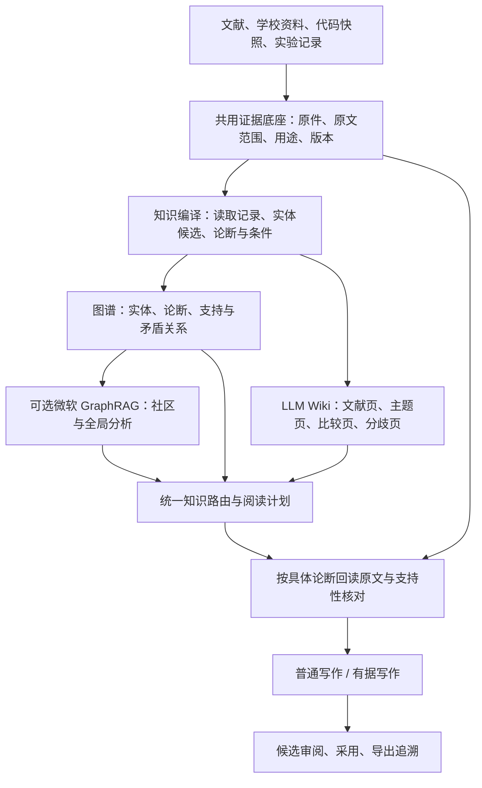

# GraphRAG 与 LLM Wiki 双知识库详细实施方案

日期：2026-10-27。适用项目：砚台论文工作台，当前应用版本 0.6.1、数据库版本 9。

本文是基于当前工作区代码、实际数据库只读快照和官方资料形成的设计方案。文中的新表、新接口、参数及排期均为实施建议，尚未实现；已存在的功能和实际统计单独列出。本文不把官方框架的能力说明等同于本项目已经通过验证的效果。

**建议结论：建设共享证据底座的 GraphRAG 与 LLM Wiki。复用现有论断、证据、阅读、权限和写作机制；图谱承担关系检索，Wiki 承担持续综合，最终写作回到具体原文核对。微软 GraphRAG 作为可替换计算后端，通过 BYOG 接入项目已经治理的图，按需提供社区与全局分析。**

## 1. 方案边界与依据

### 1.1 本次核查范围

本次读取了知识检索、结构单元、按问题阅读、普通写作、有据写作、论断证据、上下文装配、预算、过期传播、备份同步和便携打包等代码。对实际数据库使用 SQLite `mode=ro`、`query_only` 和只读事务；没有调用应用初始化或执行迁移。

实际库统计时间为 **2026-10-27 18:56，Asia/Shanghai**。汇总及关键源码哈希保存在 [项目只读快照](../.runtime/graphrag-wiki-research-20261027/project-snapshot.json)。该文件属于本机审计材料，未包含原文正文、接口配置或密钥。

当前工作区存在大量未提交修复。后续开发基线必须包含这些已存在的改动，并记录其版本或快照，不能通过重置工作区或直接从旧 HEAD 重建而丢掉修复。

### 1.2 官方资料与选型结论

| 核验事项 | 官方资料说明 | 对项目的决定 |
| --- | --- | --- |
| GraphRAG 的组成 | 标准索引包含实体、关系、可选论断抽取，以及社区、报告和嵌入；默认表格产物采用 Parquet。[O1][O2] | 区分知识治理、图计算和检索生成；无需以新增图数据库为前提 |
| 当前维护情况 | 官方仓库说明项目主要处于维护模式，继续酌情修复问题和依赖，不接受新增功能类贡献。[O3] | 通过适配层隔离，不让学校规则、书目和采用机制依赖上游内部结构 |
| 候选版本 | 本次官方 Releases 页面显示 Latest 为 v3.3.0。[O4] | 将 3.3.0 作为兼容试验候选；锁定整个依赖集后才接入，不自动追随 main |
| Python 范围 | 本次主分支包声明为 Python >=3.11、<3.14；本项目实测为 3.12.14。[O5] | 解释器版本处于声明范围内；Windows 原生依赖、实际安装及运行兼容性仍需试验 |
| 中文抽取 | FastGraphRAG 默认抽取主要面向英文，关系来自共现。[O2] | 首版采用保留中文条件的结构化抽取；共现只用于发现关联 |
| 自带图接入 | BYOG 支持传入实体、关系，按查询需要补充原文单元和嵌入。[O6] | 复用现有证据与论断，避免重新抽一套失去来源联系的事实 |
| 模型接入 | 官方文档要求模型可靠返回目标结构；支持自定义完成与嵌入实现的注入，但这条注入路线需要库方式，CLI 不支持。[O7] | 使用 Python 库及模型桥接，统一经过本项目权限与费用账本 |
| LLM Wiki 的定位 | Karpathy 原文是个人知识库模式说明，提出不可变原始资料、持续维护的 Wiki 和维护约定，包含入库、查询和检查流程。[O8] | 在工作台内实现编写、版本和检查机制；具体数据库、审核与证据协议由项目设计 |

**实施前仍需核实的内容：** 3.3.0 发布标签下的具体协议签名、依赖锁、Windows 安装、所配置中转的结构化输出和取消行为，以及本机峰值资源。在线文档可能随 main 更新，不能只凭在线示例认定与固定版本完全一致。

## 2. 项目当前基础与真正缺口

### 2.1 实际数据库快照

| 对象 | 当前统计 | 解读 |
| --- | ---: | --- |
| 原始文件 | 57 | 主用途为研究 30、示例 3、规则 24，均为 active / ready |
| 可用于研究的原件 | 31 | 还包含追加研究用途的文件，不能只按主用途计数 |
| 书目记录 | 31 | 登记数量不等于有效引用数量 |
| 当前解析头下的原文单元 | 2,905 | 包含全部用途，当前均为 pending |
| 研究范围的当前原文单元 | 1,364 | 合计 2,234,283 字符；是解析文本规模，不是语义已核验规模 |
| 全版本原文单元 | 13,049 | 包含解析历史，不能全部重新作为当前资料入库 |
| 原文人工核对 / 论断支持性核对记录 | 0 / 0 | 指 `knowledge_reviews` / `knowledge_claim_checks` 中没有记录 |
| 按问题阅读 / 已读范围记录 | 0 / 0 | 指 `document_readings` / `document_reading_passages` 中没有持久记录 |
| 证据对象 | 47 | 当前登记为作者说明 2、代码观察 1、资料观察 44 |
| 论断版本 / 论断证据关联 | 69 / 97 | 论断均为 candidate；关联均标为 supports，不能当成支持性已经通过 |
| 代码单元 / 代码关系 | 158,933 / 510,824 | 为库内全量登记数，可能包含不同快照，不代表当前唯一节点数 |
| 当前有文本的正文章节 / 正文引用 | 0 / 0 | 此快照没有可用于真实正文质量对照的已保存论文 |
| GraphRAG / Wiki 专门表 | 未发现 | 现有代码结构图、论证边与拟建文献知识图需要分别表达 |

记录为 0 不证明用户未在其他位置阅读或核对过资料；说明当前数据库中没有对应可追溯记录。pending 也不证明材料错误。

### 2.2 可以直接复用的机制

| 现有模块 | 已有职责 | 新方案的接入方式 |
| --- | --- | --- |
| `knowledge_service.py:21` | 原始片段与结构单元混合检索、融合、重排及权限过滤 | 保留底层原文检索；上层增加图谱与 Wiki 路由 |
| `knowledge_units.py:200` | 读取完整原文或明确范围，返回条件、争议及版本信息 | 图谱和 Wiki 回读证据的统一入口之一 |
| `document_reading.py:67` | 按问题建立阅读，记录实际范围、研究方法、条件、结果和局限 | 写作时继续建立与当前章节问题绑定的阅读记录 |
| `document_preparation.py:6` | 为普通写作准备文献阅读内容 | 补充多文献阅读编排，接入综合计划 |
| `writing_agent/claims.py:5` | 论断版本及 supports / limits / contradicts 证据关系 | 作为统一论断对象，新增元数据而非复制另一套论断 |
| `writing_agent/evidence.py:7` | 区分代码、文献、测试执行、部署等证据来源 | 原文证据继续使用现有类型；Wiki 不自动变成 literature 证据 |
| `writing_agent/contracts.py:13` | 校验论证依赖与循环；保存章节任务 | 接入拟采用的论点和缺口，保持论证依赖约束 |
| `writing_agent/context.py:6` | 组装证据、章节、版本与请求清单 | 加入图谱和 Wiki 读取快照及依赖 |
| `writing_agent/tools.py` | 文献定位、原文阅读和调查工具 | 新增图谱与 Wiki 导航工具，继续要求读取原文 |
| `tasks.py:63` | 模型请求、费用预留、任务与输入校验 | 知识编译和微软插件的模型请求也接入该治理路径 |
| `writing_continuity.py:20` | 已保存论文全文和术语上下文 | Wiki 补充知识组织，继续保留论文全文输入政策 |
| `literature_refresh.py` | 批量文献解读、来源检查及请求管理 | 可复用分页、任务和结果校验机制；解读结果作为待核验派生产物 |
| `writing_agent/impact.py`、`knowledge_units.py:102` | 来源变动后的依赖复查 | 扩展到实体描述、图谱论断、Wiki块与社区报告 |
| `exports.py`、`synchronization.py:76` | 冻结引用和阅读快照、完整备份、阻止不完整同步 | 扩展知识追溯包；不绕开旧同步的完整性限制 |

上述行号基于本次工作区，后续开发以保存的源码哈希和实际函数为准。

### 2.3 需要一起解决的问题

第一，当前知识已有“定位与阅读分离”的机制，但实际库尚未形成问题阅读记录。需要将检索、阅读、整理与采用连成日常流程。

第二，在没有章节阅读记录、没有人工选择文献时，`document_preparation.py` 存在选择首篇检索候选并尝试提供其完整解析文本的路径。它不能保证跨文献问题所需的来源覆盖。应增加按研究问题、比较对象、条件和反证选择多篇文献的阅读计划。

第三，现有论断和证据关系具有结构基础，但 supports 目前是登记关系。新方案必须另行记录支持性判断，避免把“有链接”解释成“已证实”。

第四，代码结构关系数量很大，文献仅为数十篇规模。把全部历史代码图、全部解析历史和当前文献混在一个全局摘要任务里，会削弱范围控制。应按当前代码快照和章节需要投影。

第五，Wiki 与图谱都会形成派生内容。依赖和修订机制是首版核心功能，不能留到页面生成完以后补做。

## 3. 总体架构与分工



| 层 | 主要对象 | 负责的问题 | 权威边界 |
| --- | --- | --- | --- |
| 证据底座 | 原件、解析版本、实际读取范围、代码及运行记录 | 具体内容从哪里来 | 提供可检查依据，不自动授予任意论断支持性 |
| 图谱 | 带出处、条件和归属的关系与论断 | 谁研究什么、采用什么、何处相同或矛盾 | 所有自动抽取均保留候选身份 |
| Wiki | 主题综合、比较、解释、研究分歧 | 已经整理出什么认识、还缺什么 | 属于综合与导航；事实仍链接到底层依据 |
| 写作层 | 章节目标、论证计划、正文、引用 | 当前论文如何表达与论证 | 正文采用由现有流程管理，知识更新不自动改正文 |

“两个知识库”体现为两个可独立浏览和检索的知识层，数据共用稳定来源。原始 RAG 仍承担定位原文的工作。

具体实现分成两个可独立验收的能力：

- **项目原生图谱检索与 Wiki**：基于现有 SQLite、全文、向量和模型路由，提供实体检索、论断关系、范围受限的图遍历及持续综合。
- **微软 GraphRAG 插件**：在兼容试验通过后，使用 BYOG 生成社区和报告，按需调用官方全局或探索查询。界面和报告必须标明是否实际使用了微软组件。

项目自行实现的邻接遍历不标成“已完整集成微软 GraphRAG”。如果交付范围要求首版必须使用微软库，插件兼容及 BYOG 验收就是首版发布条件。

## 4. 资料分类、知识范围和来源约束

### 4.1 三个逻辑命名空间

| 范围 | 包含内容 | 典型用途 |
| --- | --- | --- |
| `literature` | 研究文献及明确允许研究用途的部分 | 研究现状、方法、比较、文献结论 |
| `project` | 当前代码快照、项目事实、测试执行和实际结果 | 项目设计、实现和验证 |
| `guidance` | 学校规则、评分说明、正例和反例 | 写作要求及表达指导 |

三者可相互引用，但不能替换证据等级。教学正例中的“系统性能提升”不能成为本项目测试结果；源代码中定义测试也不能成为测试已执行。现有规则发布、资料用途和证据类型限制继续生效。

实体、论断、页面、检索缓存和 GraphRAG 产物都记录 `project_id`、逻辑范围与来源集合。跨项目共享须经过显式导出与导入，不能只靠名称合并。

### 4.2 构建时的来源范围

默认只处理有效原件的当前解析头；已有人工修订和范围争议继续保留。历史版本可浏览和回溯，不自动重复参与当前综合。

代码采用当前目标快照，并按章节相关的模块或符号生成投影。现有 `code_units`、`code_edges` 继续保有独立的解析与关系状态；不要把全部历史记录重新交给模型概括。

对于示例与规则文件，知识编译读取 `material_policy.py` 的实际用途与语境，保留正例、反例、要求对象、等级、例外条件和出处。模型从材料提取出的句子不获得执行权限或学校规范的发布身份。

### 4.3 阅读观察分为两种

**资料编译观察**记录后台确实读过的原文范围、版本和用途，服务于实体与论断抽取。它不绑定某个章节目标，也不代填人工核对。

**写作问题阅读**继续使用 `document_readings`，绑定当前问题与章节，记录方法、条件、结果、局限和实际读取范围。全局 Wiki 已整理过一篇文献，不代表当前章节已经读到了所需依据。

两种观察共用位置校验和原文读取逻辑，但不能把章节阅读的“语义充分”状态直接推广给整个知识库。

## 5. 图谱设计：以有条件的论断为中心

### 5.1 实体类型

首版使用有限本体：文献、研究问题、概念、方法、系统或模块、数据集或样本、指标、实验环境、结果记录。章节和规则作为关联目标接入，避免首轮无限扩张实体类型。

每个实体包含稳定实体键、版本、类型、名称、别名、范围、描述、来源集合、提取方式和状态。文献直接关联 `file_id` / `bibliography.id`，代码符号关联快照、路径和符号定位。

实体消歧优先级为：明确稳定编号 → 本项目术语表或人工别名 → 有出处的名称与类型匹配 → 模型建议。模型仅提出归并候选。同名系统、同名缩写和不同版本方法不得仅凭向量相似度自动合并。

归并和拆分均形成新版本及重定向记录，旧引用仍能解析。归并后保留原实体各自的描述与归属，不能把不同来源结论抹平。

### 5.2 论断继续复用 `claim_versions`

新增元数据附着在既有论断版本上，建议包含：

```json
{
  "claim_version_id": "已有论断版本ID",
  "namespace": "literature",
  "subject_entity_id": "方法或系统实体",
  "predicate": "reports_improvement_under",
  "object": {"metric": "某指标", "value": "保留原文值或未知"},
  "attributed_to": "具体文献或项目记录",
  "conditions": {"dataset": "原文限定", "environment": "原文限定"},
  "polarity": "positive",
  "modality": "reported",
  "evidence_ids": ["已有证据ID"],
  "extraction_state": "candidate",
  "support_state": "not_checked",
  "lifecycle": "current"
}
```

以上为本项目建议对象，不是官方 GraphRAG 的表结构。未知字段保留未知；不能由常识补齐样本、数值、比较对象或限定条件。

同一方法在不同数据集上的结果保存为不同论断；“文献报告某结果”带文献归属。purpose、transition 等非事实论断可以保留其用途，不强行伪装成文献事实。

### 5.3 关系分为事实陈述、证据关系与发现关系

| 类型 | 示例 | 处理 |
| --- | --- | --- |
| 有出处的事实陈述 | 文献研究问题、方法用于任务、某结果在某环境取得 | 由论断投影为关系，携带证据和条件 |
| 证据与限定关系 | 支持、限制、矛盾 | 复用现有论断证据链接；支持性结论另存 |
| 发现关系 | 共现、文本相似、疑似别名 | 用于扩展检索，不作为证明 |

关系数量、权重、社区中心性和相关性得分都不能变成“可信度”。微软 BYOG 的图权重用于社区计算，项目应单独定义和记录其计算方式。[O6]

描述性知识图允许实际存在的循环关系；用来证明论文结论的依赖仍经过现有论证循环检查。不能把知识图有环直接判成资料错误，也不能允许论断循环自证。

### 5.4 支持性状态

支持、部分支持、矛盾、依据不足、待判断分别记录。每条评估绑定：论断版本、证据版本、原文范围、条件、判断方法、模型或核对人、时间和理由。

提取成功、原文转录核对、模型支持性评估、人工评估和当前有效性是不同维度。另一个模型同意某结论，也不自动形成“人工已确认”。

## 6. LLM Wiki 设计：可维护的综合知识

### 6.1 页面类型

| 页面 | 主要内容 | 默认来源 |
| --- | --- | --- |
| 文献页 | 研究问题、方法、条件、结果、局限与可引用范围 | 原文观察与该文献论断 |
| 概念或方法页 | 定义、不同用法、适用范围、相关方法 | 多篇文献与术语表 |
| 主题页 | 研究路线、共同结论、分歧、资料覆盖范围 | 多文献论断集合 |
| 比较页 | 按一致维度比较方法、数据与条件 | 显式可比的论断与原文 |
| 分歧页 | 哪些观点不一致、条件是否相同、仍缺什么 | 支持及反对来源 |
| 项目实现页 | 模块、代码观察、已登记结果和待验证项 | 当前代码快照与项目证据 |
| 写作指导页 | 规则说明、示范语境、易错点 | 已发布规则和明确用途的资料 |

首版数量随有效主题生成，建议先做 31 个文献页及约 10—20 个有实际写作用途的综合页面。后者是试点工作量建议，不是必须凑齐的数量，也不代表全部资料已语义读懂。

### 6.2 页面按块保存

每个块有稳定 ID、内容类型、文字、论断版本、原文观察、引用对象、依赖版本与状态。事实、比较、综合推断、待解问题和人工备注分别标记。

一个综合句涉及多篇资料时，需要保存各部分分别由哪些来源支撑。不能用页面末尾一长串参考文献冒充逐项对应，也不能把“当前收录资料未覆盖”写成“该领域从未研究”。

比较表对样本、指标定义、单位和实验环境不一致的项目显示不可直接比较或缺失，不能凭标题相似排出优劣。

### 6.3 与作者编辑协作

自动编写部分和人工备注记录各自作者与版本。新增资料形成更新候选及差异；用户在后台生成期间改过页面时，通过基础版本校验拒绝覆盖，保留两份候选用于合并。

知识页面通过检查后可以发布到当前知识视图，不要求逐页人工确认后才允许任何检索。页面上的模型判断、来源核对状态和人工记录仍分别显示，重要数字、否定和关键结论优先进入复核队列。

### 6.4 存储与 Markdown 导出

建议 SQLite 保存页面、块和不可变版本，Markdown 作为可导出、可阅读的投影。这样能与工作台事务、追溯和备份集成。该存储选择是对原始 LLM Wiki 模式的工程调整，不声称作者原文规定使用数据库。

导出可采用以下目录：

```text
knowledge-export/
  manifest.json
  index.md
  log.md
  sources/
  concepts/
  topics/
  comparisons/
  disagreements/
  project/
  guidance/
```

维护约定采用应用内版本化模板 `wiki_schema`，定义页面类型、出处格式、更新策略和检查项目。不要让导入文献中的 AGENTS.md、提示词或文字指令改变应用维护规则。外部编辑的 Markdown 经显式导入形成新版本，避免数据库和文件系统双向静默覆盖。

### 6.5 查询积累与维护检查

用户查询得到的新比较或综合，可保存为页面更新候选，保留本次实际来源、问题和生成版本。答案重新入库后仍是派生产物；不能因此获得一个新的“独立证据”身份。

每次增量发布执行确定性的链接与版本检查；用户可单独运行语义维护任务。检查项包括失效来源、无出处事实块、断链、孤立页面、重复概念、被新资料限制的旧结论和不可比的比较项。确定性问题直接定位，语义问题提出候选与理由，不能自动删掉异议。

## 7. 入库、编译与发布流程

### 7.1 首次构建

1. **冻结输入清单**：选定原件、当前解析、用途、权限、代码目标快照和本体版本；生成源内容与使用范围哈希。
2. **检查解析缺口**：缺失位置、表格表注、否定文字、阅读顺序和 OCR 争议进入问题清单。允许正常部分继续编译。
3. **按结构读取**：为每批原文生成真实读取观察，记录实际范围；表格必须带相关表头、单位和表注，条件跨段时继续读取。
4. **抽取候选**：输出实体、带归属的论断、条件、原文引句和来源定位。模型只能引用本次实际提供的 ID。
5. **做确定性校验**：检查 ID 所属、引句与范围、数值及单位、类型、用途、版本和结构。定位成功仍不等于含义正确。
6. **做语义评估**：检查是否扩大范围、删除否定、改变结论强度或混淆示例与实绩。记录模型判断及分歧。
7. **消歧与关系投影**：确定可解析实体，保留待归并项；从论断生成可回溯的关系。
8. **更新 Wiki 候选**：先文献页，再受影响的主题、比较和分歧块；与人工编辑进行版本比较。
9. **可选社区计算**：导出有效子图给微软 GraphRAG，记录运行版本与输入映射。
10. **检查并发布知识版本**：验证依赖闭合、有效来源、内部链接和权限范围，原子切换当前知识发布指针。

所有派生产物按单文件、单批和单页面保存检查点。失败不清空已完成结果；新输入在构建中发生变化时，旧结果留作历史，不能发布到新输入名下。

### 7.2 增量更新

幂等标识建议由项目、原件哈希、解析版本、实际读取范围、用途、本体、提示词、输出协议、模型路由及生成参数共同计算。人工修订与编辑版本另记。

新增来源只抽取新增部分，再更新依赖到的综合块；已有缓存是否可复用按相同版本与实际权限重新判定。Wiki 综合可能仍需读取多篇原文，不能承诺新增一页只产生一次模型调用。

### 7.3 来源变更与失效传播

| 事件 | 立即处理 | 后续处理 |
| --- | --- | --- |
| 原文/OCR修订、解析头切换 | 旧来源依赖标为过期 | 重抽受影响论断，更新页面及社区报告 |
| 文件归档或页面排除 | 退出当前使用范围 | 页面标记缺口；可重新综合剩余来源 |
| 用途变更 | 按用途立即限制派生产物 | 分别重建研究与指导视图 |
| 外发权限撤销 | 阻止所有受影响派生产物外发 | 为允许范围重新生成综合，不能只删引用脚注 |
| 文献新增反例 | 建立矛盾或限制候选 | 保留原结论归属，更新分歧页 |
| 实体归并或拆分 | 更新实体头与关系投影 | 复查受影响描述与页面链接 |
| 正文或章节目标修改 | 原文事实不因此改写 | 使相关写作计划、问题阅读充分性和候选复查 |

传播链为：原文版本 → 读取观察 → 论断及实体描述 → Wiki块 / 社区报告 → 写作计划与候选 → 正文引用复查。

失效事件与来源变更在同一事务写入事件表；发布与读取再次核验当前来源，不能依赖异步队列一定先执行完。描述性链接可以成环，构建版本的来源依赖必须有终止于原文的路径，防止摘要互相自证。

## 8. 微软 GraphRAG 的具体接法

### 8.1 采用 BYOG

官方 BYOG 允许外部先完成图抽取，再执行社区与报告；局部及 DRIFT 等查询还需要原文单元及相应嵌入。[O6]

项目导出时必须建立以下映射：

| 导出对象 | 项目映射要求 |
| --- | --- |
| 实体 | 稳定实体版本及其有出处描述；名称不能充当全项目唯一 ID |
| 关系 | 对应论断版本、关系类型和条件；同端点的不同结论保留差别 |
| 原文单元 | 映射到原文读取观察、文件和解析版本、字符区间及真实定位 |
| 社区与报告 | 保存运行清单、成员关系和可解析来源，作为派生综合 |
| 嵌入 | 记录模型与输入格式、向量维度和文本版本；不得将不同模型向量混用 |

即使官方某种查询可不提供原文单元，本项目为了论文追溯仍保留原文映射。官方输出中的人类可读编号通过该次运行的映射解析，不能直接当成应用已有 `source_id`。

### 8.2 图谱本体到官方格式的适配

项目权威结构保留论断节点、归属、条件及不同关系类型。官方计算需要的实体关系图由它投影得到，不反向覆盖原论断。

如果固定版本对同端点多关系、节点命名或关联字段有约束，适配层显式聚合并保存展开映射。不能静默删除关系差异。聚类所用权重与语义支持状态分别保存；代码调用图也不直接混入文献主题聚类。

### 8.3 统一模型调用与记账

建议使用官方库的自定义模型注入，由插件发出结构化请求，交给工作台模型桥接器处理。官方说明此注入路线不适用于 CLI。[O7]

桥接器应复用 `tasks.model_call` 及已有 provider / profile 的治理逻辑；必要时抽出共享请求服务供两种任务调用，不另建不记账的调用路径。要求：

- 每次请求有项目、任务、阶段、输入清单和费用预留；包括社区报告、消歧、修复和查询扩展。
- 请求前重新校验来源用途、外发范围、上下文和预算。
- 已确认在发送前失败的请求可以按现有政策重试；结果不明时保留未知状态和预留，不自动重复计费。
- 取消任务停止后续请求，保存已完成批次；不能声称撤回已经发送的远端请求。
- 当前 DeepSeek 或备选接口能普通对话，不代表能可靠完成该版本结构化协议。先做小样本能力试验。

插件在独立 Python 环境或隔离子进程中运行，模型请求可经受控本地通信交给主进程。通信限制到所属任务和允许操作，不把完整文件系统或明文密钥交给模型。确切接口在固定版本兼容试验中确定。

### 8.4 与 Wiki 避免重复生成

社区报告主要用于主题发现及跨范围检索；长期维护的主题和比较页面由 Wiki 管理。报告可提出更新页面的候选，但页面事实必须继续链接到原文论断。

同一份模型综合结果不能作为另一个模型结论的独立佐证。图谱、社区报告和 Wiki 引用同一文献，不构成三份独立证据。

### 8.5 插件失效后的行为

插件未安装、版本不兼容或社区生成失败时，界面显示实际能力，保留原生图谱、Wiki与原文检索。用户明确选择的官方全局任务失败时，返回失败或部分结果并说明范围；不得静默改跑局部查询后仍显示为全局完成。

## 9. 检索路由与上下文组织

官方将局部检索用于具体实体相关问题，全局检索利用社区报告综合，DRIFT 加入社区信息并进一步展开问题；全局综合有较高资源开销。[O9][O10][O11]

以下是项目建议路由，不是官方自动提供的业务规则：

| 用户任务 | 首选路线 | 必须补读的材料 |
| --- | --- | --- |
| 定义、某篇文献或具体数字 | 原文混合检索 + 文献页导航 | 定义所在上下文；数字的表头、单位、条件和表注 |
| 方法与模块关系 | 实体解析 + 有界图谱扩展 | 关系对应论断的原文 |
| 研究现状、方法比较 | Wiki主题/比较页 + 图谱反查 | 多篇文献的方法、条件、结果与局限 |
| 文献分歧 | 分歧页 + 支持/矛盾关系检索 | 双方实际条件，避免把不可比误作冲突 |
| 全库研究路线 | Wiki覆盖检查；必要时官方全局检索 | 形成正文论断所依赖的具体来源 |
| 尚不明确的探索问题 | 预算允许时采用 DRIFT | 扩展得到的子问题对应来源 |
| 本项目实现或测试 | 当前代码/项目证据图 + 项目Wiki | 代码观察或真实执行记录，按主张等级匹配 |
| 修改与润写已有正文 | 当前完整论文及规则优先 | 仅为新增事实补充知识检索 |

### 9.1 默认规模限制

初始建议：图遍历深度 1—2 跳、最多 60 个节点和 100 条关系；Wiki 每次读取 2—4 页中的完整相关块；沿用现有原文候选池和一次最终重排；调查扩展先限制在 2 轮。

这些数值是试点保护参数，不是微软默认值，也不是已实测最优值。达到上限时返回未展开范围与缺口；不能以截断后的结果宣称全库覆盖。

路由结合任务、章节目标和问题类型，允许用户指定范围。记录各通道召回、去重依据、实际阅读和缺口，不能把 Wiki、原文和图谱的原始分数直接相加作为可信度。

### 9.2 先形成论证计划

写作准备产出结构化计划：拟回答的问题、候选论点、支持与限制来源、比较维度、反证、需要读取的范围及仍缺材料。

文献选择考虑主题、方法类别、结论分歧和适用条件的覆盖；只增加 Top-K 或重复调用重排不等于完成综合。检索可以自动提出计划，执行阅读后才能生成相应证据对象。

## 10. 两个写作入口的接入

### 10.1 普通写作

在 `knowledge_service.prepare_writing` 之上增加统一知识准备服务：

1. 获取章节目标、规则、术语及现有论文上下文。
2. 查询适用 Wiki 与图谱，生成候选论证及阅读计划。
3. 按计划建立或复用当前问题的文献阅读，读取所需原文。
4. 保存实际输入清单，把派生综合与原文证据分别放入上下文。
5. 生成正文候选；逐项校验论断、书目、知识追溯和实际读取范围。
6. 使用现有支持性核对、差异审阅和采用事务。

预算不足时先减少非必需的图谱说明和 Wiki 综合，保留必要限定条件及已锁定论断的证据。论文完整正文和强制规则继续按当前政策处理；仍放不下时分步调查或提示缩小任务，不能偷偷用 Wiki 摘要替换全文。

### 10.2 有据写作

章节 bootstrap 使用同一知识服务获取定位候选，不在每个章节初始化时自动启动一次社区重建。

新增工具建议：`search_graph`、`read_graph_assertion`、`search_wiki`、`read_wiki_page`、`get_knowledge_lineage`。工具返回派生对象身份、当前状态及底层定位，接着继续通过现有文献工具实际读原文。

`evidence_items` 不接收“模型写了一页 Wiki”作为新的文献或执行证据。Wiki 若引用实际测试结果，应保留并使用原始 `test_run` 或 `data_result` 的身份。

### 10.3 生成清单和采用校验

在既有 manifest 上增加：知识发布版本、页面及块版本、实体或论断版本、GraphRAG运行 ID、实际读取范围、依赖集合哈希、用途与权限范围，以及未完成的阅读计划。

正文段落保存其论断版本和知识使用追溯；真实引用继续绑定 `bibliography`、原文单元和阅读快照。知识 ID 与来源 ID 使用类型化字段，不能互相冒充。

采用时重新验证：正文基础版本、章节与规则、来源当前版本、知识依赖及权限。知识版本发生变化只影响相关候选，不因无关页面更新就使全篇失效。

### 10.4 本项目的示例工作流

写“研究现状”：主题页提出研究路线 → 图谱找出各路线文献及不同结论 → 原文读取方法、条件、结果和局限 → 比较表标出不可比维度 → 生成有具体引用的论述。

写“系统实现”：项目Wiki定位模块 → 当前代码图找到实现符号 → 读取代码观察；要写“运行成功”或“性能提升”，再读取真实执行及测量记录。材料不足时保留待验证项。

## 11. 数据模型与版本设计

### 11.1 复用的权威对象

继续使用原件、书目、解析、原文单元、`evidence_items`、`claim_versions`、`claim_evidence_links`、阅读记录、任务、请求账本与正文引用表。

现有模块大量使用按列位置插入。首阶段优先添加关联表，避免直接扩展旧表后破坏旧插入逻辑；确需修改旧表时，必须将相关插入改成显式列名并完成兼容回归。

### 11.2 建议新增逻辑表

| 表 | 主要字段与用途 |
| --- | --- |
| `knowledge_observations` | 编译时原文读取观察：项目、文件/代码版本、原文区间、用途、读取方式、内容哈希 |
| `kg_entities` | 项目内稳定实体身份、逻辑范围、实体类型、当前版本ID、归并重定向 |
| `kg_entity_versions` | 实体名称、描述、来源清单、内容哈希、父版本和创建方式；不可变 |
| `kg_aliases` | 实体别名、归并/拆分决策、重定向、来源及决策版本 |
| `kg_assertions` | 与 `claim_versions` 一对一的主语、谓词、对象、归属、条件、抽取及生命周期元数据 |
| `kg_support_assessments` | 论断和证据版本、范围、支持性结果、模型/人工方法、理由与时间 |
| `wiki_pages` | 项目、稳定页面ID、范围、类型、唯一slug、当前发布头 |
| `wiki_versions` | 不可变页面版本、基础版本、内容哈希、维护约定版本、作者及状态 |
| `wiki_blocks` | 页面版本内的稳定块ID、块类型、文字、编辑归属及对应论断 |
| `wiki_links` | 页面块到实体、论断、原文观察和页面的类型化链接 |
| `knowledge_dependencies` | 下游对象及版本、上游对象及版本、关系类型、范围与有效性 |
| `knowledge_events` | 来源改变与失效事件、处理游标、尝试次数和错误 |
| `knowledge_build_items` | 关联已有任务，按文件/页面/批次保存输入哈希、阶段与检查点 |
| `knowledge_releases` | 一次发布的版本清单、来源范围、构建配置、状态及当前发布指针 |
| `knowledge_artifacts` | GraphRAG表、报告、Wiki导出等产物的路径、哈希、schema与来源运行 |

图谱边可优先由论断投影为视图；性能确需物化时再增加可重建索引。构建任务与模型运行复用现有表，不另造一套费用账本。

以上为逻辑设计。实体身份和不可变描述版本分表保存，`kg_entities.current_version_id` 指向所属实体的一个版本。页面和页面版本使用同样的身份与版本分离方式。

块以 `(wiki_version_id, block_key)` 保持版本内唯一；同时有独立块行ID供来源链接引用，跨版本用 `block_key` 对照差异。别名索引允许一个名称对应多个实体候选，只有明确的归并决策才改变解析结果。

普通来源链接使用明确目标类型及对应外键；跨类型依赖通过受限的对象注册和所属检查解析。多态依赖不能只写一个字符串 ID 就假定外键已保证正确。

### 11.3 约束与索引

- 所有对象按项目验证所属，实体和页面稳定键在项目内唯一；来源对象类型使用白名单。
- 不可变版本的内容不原地更新；当前头通过事务和预期版本比较切换。
- 主体/客体、论断/证据、页面/块不能跨项目引用；服务层检查与数据库可表达的约束共同实现。
- 引文区间必须在具体原文版本内，且关联实际读取观察；不会凭存在一个文件 ID 就通过。
- 建立项目+状态、实体键+版本、实体名称/别名、论断主语/客体、依赖上游及下游、页面slug和任务输入哈希等索引。
- 人工评估不被模型结果覆盖；不同模型评估可以并存，当前采用决策另存。

### 11.4 状态维度

对象生命周期使用 candidate / current / stale / excluded / superseded 等状态；构建任务使用 queued / running / partial / completed / failed / cancelled 等状态，并复用已有预算阻塞、结果不明语义。

转录核对、抽取有效性、支持性、人工评估和来源当前性各自独立。只有来源和结构校验合格，才能发布到对应范围；发布不等于人工认可每个论断。

## 12. 后端与接口改造清单

### 12.1 新模块建议

| 模块 | 职责 |
| --- | --- |
| `knowledge_graph.py` | 实体、别名、论断投影、有界遍历 |
| `knowledge_compiler.py` | 原文读取、抽取协议、结构校验与分批编译 |
| `knowledge_wiki.py` | 页面/块版本、差异、人工备注、发布和Markdown投影 |
| `knowledge_router.py` | 任务路由、多文献阅读计划、通道融合及上下文准备 |
| `knowledge_lineage.py` | 类型化依赖、变更事件、权限派生与失效 |
| `knowledge_builds.py` | 已有任务中心中的构建检查点与恢复 |
| `graphrag_adapter.py` | 固定版本BYOG输入输出、来源映射、可选查询 |
| `knowledge_model_bridge.py` | 插件模型协议与现有请求治理的桥接 |
| `knowledge_wiki_checks.py` | 断链、无出处块、过期依赖、孤立页面及综合分歧候选 |

### 12.2 现有代码修改范围

知识服务增加统一准备入口；普通写作与 agent bootstrap / tools / context / packing 通过该入口接入。`impact` 和采用检查增加知识依赖；`main.py` 注册接口；迁移与导出包含新增对象；打包脚本管理可选插件与资源诊断。

现有 `knowledge_evaluation.py` 扩展消融评测和语义记录；`literature_refresh.py` 复用已校验解读时仍核对输入版本，不能把历史摘要直接提升为原文。

### 12.3 API 草案

以下为本项目拟新增 API，所有路径位于 `/api/v1/projects/{pid}/knowledge`：

| 操作 | 方法与路径 | 返回 |
| --- | --- | --- |
| 能力与状态 | `GET /status` | 实际后端、版本、索引、构建、问题与插件状态 |
| 构建计划 | `POST /builds/preview` | 输入清单、预计调用量与缺口，不产生模型请求 |
| 构建与续接 | `POST /builds`、`POST /builds/{id}/resume` | 复用已有任务ID与检查点 |
| 图谱检索 | `POST /graph/search` | 实体、论断、关系、真实展开范围及证据定位 |
| 实体与论断 | `GET /entities/{id}`、`GET /assertions/{id}` | 当前版本、历史、来源与支持性记录 |
| 归并或支持性评估 | `POST /entities/merge-proposals`、`POST /assertions/{id}/assessments` | 候选或显式决策，不覆盖历史 |
| Wiki目录与页面 | `GET /wiki`、`GET /wiki/{id}` | 类型化页面及块、来源与状态 |
| Wiki更新与发布 | `POST /wiki/{id}/revisions`、`POST /wiki/{id}/publish` | 需基础版本，返回差异及冲突 |
| 知识查询准备 | `POST /query` | 路由、综合候选、阅读计划、实际读取和缺口 |
| 追溯 | `GET /lineage` | 到原件的类型化依赖路径 |
| 知识检查与导出 | `POST /checks`、`POST /exports` | 问题或冻结导出任务 |

错误应能区分来源过期、读取范围不足、来源禁止外发、预算不足、插件不兼容、输出协议无效和结果不明。沿用应用现有响应规范，避免前端只能看到一个通用“生成失败”。

## 13. 前端与操作流程

在“文献与术语”工作区扩展知识入口，保留原件、阅读和证据的直达路径。页面职责建议如下：

| 页面 | 主要操作 |
| --- | --- |
| 知识概览 | 当前有效来源、待处理问题、构建计划、费用、版本与最近变更 |
| 主题Wiki | 浏览和搜索页面、比较表、分歧、原文出处、修改差异及人工备注 |
| 关系探索 | 从具体实体/问题开始展开，查看关系的论断、条件和来源 |
| 阅读与核对 | 原页、原文区间、当前问题、条件和支持性并排查看 |
| 版本与影响 | 来源修订影响哪些关系、页面、候选和正文引用 |
| 章节准备 | 拟写论点、覆盖文献、反证、已读范围和缺口，继续生成候选 |

图谱默认展示选定问题的局部关系，并提供列表形式；不自动把大量代码节点画成整屏网络。关系线点击后必须看到原文和状态，不能只显示一段模型解释。

“已解析”“模型已整理”“人工核对”“当前论断受支持”“版本过期”使用明确文字。得分用于相关性排序，不显示为事实准确率百分比。

导入或点击构建后持续显示单文件阶段、已保存部分、失败原因与续接入口。正常资料自动整理，重点风险进入问题队列；不要求用户为每个节点手工填表。

正式视觉实现前根据工作区设计规范完成方案选择和响应式检查；本方案只定义信息与交互职责。

## 14. 预算、性能与本机部署

### 14.1 当前环境与部署建议

本次本机实测总内存约 15.7 GiB，查询时空闲约 4.4 GiB；空闲值会变化。实际数据库文件约 651 MiB，包含用户资料与历史数据，不是发行包大小。

首版复用现有 SQLite、本地检索与模型组件；微软插件单独锁依赖并按需启动。将社区报告放入后台任务，不要求常驻新增图数据库和向量数据库。

默认同时运行一个知识构建任务，模型并发从 1 开始；与现有文献重排、OCR、图片解析争用资源时降低并发。固定版本的安装包体积、Windows依赖和峰值内存均需实测，不能在此承诺整套插件仍装入原500MB发行包。

### 14.2 费用模型

```text
首次构建费用 = 抽取 + 消歧 + 支持性辅助检查 + Wiki综合
             + 可选社区报告 + 可选嵌入 + 发生的协议修复

增量费用 = 变化来源的抽取 + 受影响综合/报告的更新

单次写作费用 = 知识规划/探索 + 必要原文阅读推理 + 正文生成 + 核验
```

按当前所配服务实际输入/输出计费规则估算，不在方案中预设固定人民币价格。先用少量文献测量单位消耗，分别给出首次构建、增量与单次写作的预留。

本地全文、向量与重排的计算耗时和模型费用分别报告。缓存命中记录其来源，不能把构建费用隐藏后宣称查询成本为零。

### 14.3 性能验收

记录冷/热查询、P50/P95、索引构建耗时、峰值内存、增量范围、模型请求次数、输入输出规模及总费用。图谱和Wiki可以减少重复整理，也增加维护成本；净收益由相同任务对照得出。

官方 Global 和 DRIFT 仅在任务需要且预算允许时启用。页面已有当前有效综合时，先读综合和原文缺口，不自动对每个问题重新执行全局生成。

## 15. 权限、缓存与输入信任边界

派生对象的可用范围由实际依赖共同决定。在包含仅本地来源的 Wiki 段落、实体描述或社区报告里删掉一个引用链接，并不能消除其文字中的来源信息。

外发时应：校验所有参与综合的源文件及产物；范围不允许时整块退出，或使用获准来源重新生成；嵌入请求和图谱描述同样检查。权限变化后，旧综合、检索缓存、模型缓存和导出权限重新判定。

缓存键包括项目、知识发布、内容版本、问题、用途、读取范围、模型与提示词，以及有效权限范围。不能使用只有查询文本的全局缓存。

第三方资料中的指令始终作为资料内容读取。插件和Wiki编写工具仅能访问当前任务允许的对象；生成内容不能修改系统维护约定、学校规则发布状态或应用执行政策。

## 16. 迁移、发布、备份与回退

1. 保存当前工作区基线与源码指纹；采用 SQLite 备份机制取得一致数据库备份，不直接复制正在写入的数据库文件冒充完整备份。
2. 在数据库副本上新增版本化表并回填来源登记，核对旧文件、书目、正文、引用、规则及人工记录指纹。
3. 导入既有69个论断版本时保留其候选状态和原始链接；不足字段列为待补，不批量推定已支持。
4. 以少量文献建立图谱、Wiki与阅读链路；再覆盖31篇研究用途原件，规则和代码按范围逐步接入。
5. 原生知识层先作为可选入口，对同一组任务保存基线；插件兼容通过后增加社区能力。
6. 对新发布版本运行引用、依赖、权限和失效检查，再切换当前知识指针。
7. 回退通过关闭新入口、切换知识发布版本或计算后端完成。保留用户在升级后新增的正文和记录，不回滚整库覆盖它们。

预计需要后续数据库版本；若实施时仍为9，可规划10承载基础知识对象、再按需要增加集成迁移。迁移文件序号与版本必须在开发时检查冲突后确定，不修改已应用迁移的内容或校验和。

应用备份应覆盖新增表、原文/证据对象、人工Wiki修订、维护约定、冻结映射和必要插件清单。可重建向量和社区索引是否纳入备份可配置，但恢复后不能误用不匹配版本。

普通论文导出继续使用现有流程，并附加“知识使用追溯”JSON；Wiki单独导出为Markdown。旧的正文同步不能承载完整新知识对象，继续阻止不完整传输；完整知识同步另做有版本的资源清单协议。

## 17. 验收：证明论文任务改善

### 17.1 四组消融对照

| 组 | 配置 | 回答的问题 |
| --- | --- | --- |
| A | 当前证据库与阅读流程 | 当前真实基线 |
| B | A + 图谱 | 图关系是否带来有效增益 |
| C | A + Wiki | 持久综合是否带来有效增益 |
| D | A + 图谱 + Wiki | 二者结合是否值得维护成本 |

官方社区能力在D组中再记录启用/关闭子对照，避免把多个同时变化的因素混成“GraphRAG有效”。

使用相同原件版本、当前模型、生成参数和任务预算上限；记录实际消耗，分别报告构建和查询费用。当前没有已保存正文，先建立真实章节任务及人工金标准；合成流程样本单独保存，不混为真实论文验收结果。

### 17.2 建议80个真实任务

| 任务类 | 数量 | 重点 |
| --- | ---: | --- |
| 原文定位和引用 | 18 | 原页、条件、否定、数字、表注 |
| 实体关系 | 14 | 别名、同名、方法/任务与版本 |
| 跨文献综合 | 14 | 多路线、多来源覆盖、不可比条件 |
| 矛盾和限制 | 10 | 真冲突、条件不同、部分支持 |
| 教学与规则语境 | 8 | 正反例、规范等级、用途隔离 |
| 项目实现与执行证据 | 8 | 代码与运行、文献与项目效果区分 |
| 更新、权限和失效 | 8 | 改原文、排除、撤权、变更后拒绝旧依据 |

金标准保存问题、允许的等价原文范围、必要条件、支持/矛盾与不可推出项。不同合理分段可以对应同一标准范围，不能把某个切片ID作为唯一正确理解。

### 17.3 指标

检索指标包括 Recall、MRR及必要来源覆盖；内容指标包括事实论断支持率、限定条件保留、错误引用、无依据扩写、矛盾识别和比较有效性。另记用户修订次数、完成时间和费用。

支持率分母采用实际需要外部依据的论断，区分模型评估与人工盲审。关键事实按句或可核验主张检查，不靠引用数量或页面总量打分。

### 17.4 发布门槛建议

- 确定性追溯、项目隔离、权限撤销、失效阻止和候选采用版本检查通过率为100%。
- 验收样本中伪造来源ID、将教学示例认作本项目实绩、将代码定义认作执行结果均为0。
- 人工评估的关键事实支持率可暂以95%为目标，同时公布样本量、不确定性及各类错误；这是拟定目标，尚未达到或验证。
- D组在跨文献覆盖或有效综合上优于A，且引用支持性不下降；没有达到时定位到图谱、Wiki或编排环节，不预设提升百分比。
- 峰值资源、端到端时间和费用在经试点确定的预算内；不能仅以最终模型文字更流畅判定通过。

### 17.5 测试层次

机制测试覆盖范围验证、实体消歧、派生权限、变更传播、幂等续接、并发编辑、快照发布、未知费用与回退。适配测试使用固定版本的真实小型表数据验证BYOG与来源映射。

浏览器验收覆盖原文直达、阅读与出处、页面差异、知识过期、任务恢复及窄屏。最后使用真实资料与人工标准检查语义质量。模拟模型测试只证明机制，不能代替真实综合效果。

## 18. 分阶段实施与工作量

下表为工程估算，不是已实测工期；付费模型兼容、复杂解析修复和人工语义标注等待可能增加总历时。

| 阶段 | 交付内容 | 退出条件 | 估算人日 |
| --- | --- | --- | ---: |
| P0 基线与兼容试验 | 工作区/数据快照、真实问题、固定版本和模型协议小试验 | 明确可运行范围与成本，不把安装成功当语义通过 | 1—2 |
| P1 来源与依赖底座 | 编译观察、依赖、事件、发布版本及副本迁移 | 原文变更与撤权能使派生内容立即退出使用 | 2—3 |
| P2 有据图谱 | 实体、别名、论断元数据、支持性记录和有界检索 | 所有事实关系可追到论断和原文，代码/示例不越级 | 3—5 |
| P3 持续Wiki | 页面与块、来源链接、增量修订、人工备注和检查 | 新资料只更新受影响内容，编辑冲突不丢数据 | 3—5 |
| P4 路由与写作接入 | 多文献阅读计划、两个写作入口、候选与导出追溯 | 从计划、阅读到正文引用形成完整可核对链路 | 3—5 |
| P5 微软插件 | 固定版BYOG、模型桥接、社区及按需全局分析 | 调用全记账、映射完整、失败可独立停用 | 2—3 |
| P6 验收与发行 | 80任务对照、实际库迁移、便携部署、备份恢复 | 满足确定性检查与人工语义门槛 | 3—5 |

合计约17—28人日。P0做最小适配探针，P5完成插件；不能把P5安装和兼容工作推到发行当天。优先可交付里程碑为P1—P4的闭环，再通过实测确定社区功能的默认启用范围。

## 19. 首版交付清单与后续范围

首版完整交付应包含：版本化来源与编译观察、有据实体关系、别名与归并记录、带来源的Wiki块、增量更新与失效、问题阅读编排、两个写作入口、费用与权限一致治理、导出追溯和真实任务评测。

微软插件应单列其实际启用功能及验证版本。只实现主题页面和可视化关系网络，不足以宣布整个方案完成。

初期不默认扩展全互联网抓取、自动执行材料中的指令、全历史代码图的全局概括或不受限的自动探索。后续扩展根据真实任务覆盖不足提出，而非根据节点和页面数量扩张。

**优先实施顺序：把原文—阅读观察—论断—综合块—正文引用这条依赖链做通，再增加更复杂的社区与全局搜索。现有证据库、论断版本和代码图是新方案的基础资产，新增的两个知识层应让这些资产更容易被正确使用。**

## 20. 官方资料与核验记录

以下资料均于2026-10-27核验，仅使用官方项目文档、官方仓库与作者原始说明作为技术依据。资料说明与本文提出的工程设计分别表述。

- [O1：Microsoft GraphRAG 索引概览](https://microsoft.github.io/graphrag/index/overview/)
- [O2：索引方法：Standard / FastGraphRAG](https://microsoft.github.io/graphrag/index/methods/)
- [O3：官方仓库与维护说明](https://github.com/microsoft/graphrag)
- [O4：官方 Releases](https://github.com/microsoft/graphrag/releases)
- [O5：官方包声明与Python依赖范围](https://github.com/microsoft/graphrag/blob/main/packages/graphrag/pyproject.toml)
- [O6：Bring Your Own Graph](https://microsoft.github.io/graphrag/index/byog/)
- [O7：模型选择、代理与自定义模型注入](https://microsoft.github.io/graphrag/config/models/)
- [O8：Karpathy 的 LLM Wiki 原始说明](https://gist.github.com/karpathy/442a6bf555914893e9891c11519de94f)
- [O9：GraphRAG 查询概览](https://microsoft.github.io/graphrag/query/overview/)
- [O10：Global Search](https://microsoft.github.io/graphrag/query/global_search/)
- [O11：DRIFT Search](https://microsoft.github.io/graphrag/query/drift_search/)
- [O12：CLI 参数与增量索引方法](https://microsoft.github.io/graphrag/cli/)

官方CLI列出更新方法，但本项目的删改、用途、权限和旧正文追溯仍需要自己管理；不能据此认定框架已处理应用全部失效需求。[O12]

本次直接HTTP读取并保存了多份微软文档；GitHub原文直连曾超时，后通过网页检索工具读取官方仓库和作者Gist。原文快照与请求记录在 `.runtime/graphrag-wiki-research-20261027/`，其中直连失败项保留失败状态，不能当成成功下载。官方协议、BYOG和中文抽取均未在本机安装或运行验证；本次未调用付费模型。
