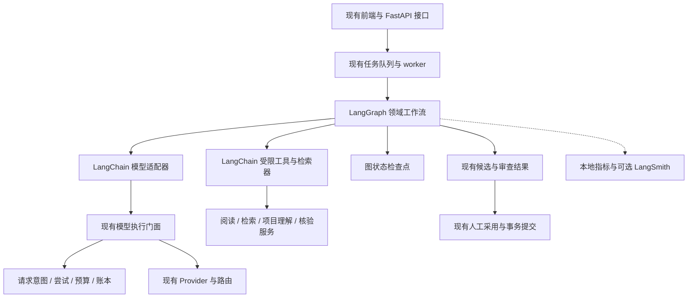

# 砚台论文工作台：LangChain 与 LangGraph 深入优化方案

> 历史方案：后续讨论、实施与验收统一以 [AI 系统全面优化整合实施方案](AI系统全面优化整合实施方案_2026-11-07.md) 为准。本文保留作设计过程记录，其中旧优先级、工期及收益数字不再作为实施依据。

日期：2026-11-07。范围：`D:/桌面/论文/paper-workbench` 当前工作区源码，包括尚未提交的现有实现。本次为代码阅读与方案设计，没有安装依赖、修改运行逻辑、读取密钥、启动模型请求或执行付费测试。

## 1. 核心判断

建议采用“现有领域服务 + LangChain 模型和工具契约 + LangGraph 显式工作流 + 可选 LangSmith 评测观察”的渐进式架构。

目标是提高论文事实准确性、规则遵循、跨章一致性、任务恢复可靠性和单位合格候选的成本效率。引入框架本身不构成质量提升；每一项迁移都必须与当前流程做可重复比较。

首个试点选择单章有据写作。先验证适配层和执行语义，再迁移整篇、规则提取、资料总结及研究问答。既有 HTTP API 和前端流程优先通过适配维持兼容。

## 2. 当前项目已有的基础

以下是当前源码可确认的能力，不表示正在运行的进程或便携安装包已加载这些实现，也不表示所有能力在当前项目配置下均已开启。

| 能力 | 源码依据 | 对本方案的影响 |
| --- | --- | --- |
| DeepSeek 主路由、GPT 备选、多端点与请求错误分类 | `provider.py`、`model_routing.py`、`deepseek_pool.py` | 模型传输与切换继续通过当前服务执行 |
| 逻辑请求、实际尝试、来源与预算预检、有效账户身份 | `tasks.py`、`request_execution.py`、`provider_identity.py`、`budget_usage.py` | 框架调用必须穿过现有执行和计费边界 |
| 分阶段调查、判断、起草、标注、语义和篇章复核 | `writing_agent/coordinator.py`、`writing_flow.py` | LangGraph 接管阶段编排，节点复用当前服务 |
| BM25、Dense、RRF 和 Cross-Encoder 路径，以及分阶段检索指标 | `retrieval.py`、`knowledge_service.py`、`knowledge_evaluation.py` | 先包装现有检索器，再评估查询规划与证据选择 |
| 搜索预览与真实阅读区分、来源版本和外发权限检查 | `writing_retrieval.py`、`writing_tool_runtime.py`、`resource_refs.py` | LangChain Document 与工具结果必须保留这些语义 |
| 分单元检查点、缓存、跨进程相同阶段互斥 | `writing_flow.py`、`ai_request_cache.py` | 与图检查点分清职责，恢复时复用已知响应 |
| 项目理解、结构化规则应用、完整候选篇章审查 | `project_understanding.py`、`project_grounding.py`、`writing_rule_use.py`、`writing_flow.py` | 纳入写作子图，不重复另做一套 |
| 候选采用事务、版本冲突检查、幂等收据 | `writing_agent/adoption.py` | 继续由当前采用服务提交正文 |
| 现有检索评测、写作诊断和人工评分入口 | `knowledge_evaluation.py`、`writing_agent/evaluations.py` | 扩展为框架迁移的对照基线 |

当前抽查的后端与主依赖文件中未发现 LangChain / LangGraph 接入。当前代码同时存在普通写作、整篇写作及有据写作协调路径，统一编排具有价值，但需要先建立入口与阶段映射，避免迁移后运行两套协调器。

## 3. 建议架构及职责边界



- LangChain：统一消息、模型响应、工具参数及结构化结果契约；适配当前检索能力。
- LangGraph：决定下一阶段、分支、有限补证与修订、暂停和恢复。
- 现有执行服务：继续管理实际请求、真实端点身份、预算预留、失败分类及费用记录。
- 现有领域数据库：继续保存正文、候选、来源、阅读记录、版本和采用收据。
- LangSmith：可选的追踪和实验比较工具；项目本地账本继续作为费用与请求状态依据。

## 4. P0：统一模型调用契约，并保护执行一致性

### 4.1 增加模型执行适配层

建议先抽出一个 `ModelExecutionGateway`，让普通生成与已有 agent 传输共用逻辑请求边界，再实现面向 LangChain 的模型适配器。需要 agent 工具调用时，可实现自定义 `BaseChatModel`，把消息和工具定义转换成现有传输格式。

适配层至少覆盖：消息角色、原生工具调用和工具回执、结构化结果、结束原因、用量、取消、实际模型身份及运行编号。首次试点先保证同步调用完整；流式适配单独验证分片工具参数、部分输出和断线状态。

每次调用应携带服务端执行上下文：

```text
project_id / task_id / task_attempt
writing_session_id / writing_step_id / lease_epoch
stage / unit_index / revision_round
input_manifest_hash / prompt_version / graph_version
source_versions / permission_stamps
logical_request_id / generation_run_id / provider_attempt_id
```

这些字段由服务端生成或读取，不能让模型通过工具参数指定任务、项目、预算或权限。

默认让现有 provider 层拥有网络重试权。若后续采用 `langchain-openai` 或其他 SDK 直接传输，需要明确关闭其自动重试，并完整接回现有请求钩子、端点预检和账本；通过兼容性验证之前不切换生产传输。

### 4.2 结构化结果分层校验

为以下阶段逐步定义 Pydantic 输出模型：`ProjectUnderstanding`、`ResearchPlan`、`ClaimEvidenceMap`、`RuleReview`、`SemanticReview`、`RevisionPatch`。

校验分三层：

1. 结构层：字段、类型、枚举、长度、完整覆盖声明。
2. 引用层：ID 存在、项目归属、来源版本、位置范围、逐字引用可定位。
3. 语义层：证据是否支持命题、条件和否定是否保留、规则是否正确应用。

按实际端点能力选择 provider 原生结构化输出、工具结构化输出或 JSON + 本地校验。通过中转站时，应实测“端点 + 模型 + 协议”组合，不能只凭模型名字认定支持。

当前 `provider_adapter.finish_structured()` 已有最多五次完整 JSON 尝试。迁移时统一管理修复次数和费用上限，避免叠加 LangChain 的格式修复、图节点重试与 provider 重试。完整但格式错误的结果优先尝试本地重解析；重发也必须计费和留痕。结构合法不能直接判为内容通过。

## 5. P0：用 LangGraph 统一单章写作流程

推荐流程：

```text
输入与版本预检
  → 项目理解 / 当前理解版本复用
  → 章节论证计划
  → 定向检索
  → 原文阅读与证据冻结
  → 分单元起草
  → 本地确定性检查
  → 主张与引用核验
  → 规则适用及遵循复核
  → 篇章表达审查
  → 候选待采用

证据缺口 → 有界补读 → 回到证据冻结
可修复问题 → 定向补丁 → 重新执行受影响的核验
预算不足 / 来源变化 / 请求结果未知 → 保存状态并暂停
```

每个节点复用已有服务，主要改动是将阶段判断和分支迁移为显式状态图。`writing_flow.py` 与 `writing_agent/coordinator.py` 的迁移应先按能力拆分，避免把超长函数原样包成单个节点。

### 5.1 图状态保持精简

建议状态包含：

```text
run_id, project_id, session_id, section_id
graph_version, state_schema_version, input_manifest_ref
stage, current_unit, research_round, revision_round
evidence_bundle_ref, candidate_ref, review_refs
outstanding_intent_ids, pause_reason, next_action
```

正文、原文和大型阅读上下文存为已有不可变对象，图状态存对象引用及哈希。预算字段即使出现在图状态中也只作展示，发送前始终重新读取账本和当前政策。

### 5.2 队列和检查点只能各有一个执行责任

现有 worker 继续负责领取、租约和取消。对试点任务只允许图协调器或旧协调器中的一个推进阶段；节点复用当前处理服务，禁止同时触发旧阶段入队和图后继调度。

图检查点保存编排位置与中间引用；`request_intents`、`generation_runs`、`provider_attempts` 保存远端执行事实；现有候选和正文版本保存业务结果。三者用稳定 ID 关联。

采用 SQLite 检查点后端前，验证与现有 worker 的并发写入、事务时长、备份和恢复行为。建议独立检查点文件并建立备份清单；独立文件不能提供跨库原子提交，因此恢复逻辑必须能从业务对象和请求账本重建节点输出。不要对模型 HTTP 持有数据库写事务。

### 5.3 恢复执行的规则

| 已知状态 | 恢复动作 |
| --- | --- |
| 节点业务结果已持久化，图检查点未推进 | 读取结果并补齐图状态 |
| 请求完成且响应已保存，解析未完成 | 从原响应继续解析和核验 |
| 请求已发出，结果未知或仅收到部分输出 | 保留未知状态，进入现有核实流程 |
| 明确未发送或允许重试的明确失败 | 在原逻辑请求范围内按已有规则尝试 |
| 来源、权限、基础正文或租约改变 | 暂停并重新验证输入 |

图恢复不等于远端请求恰好执行一次。模型调用、创建阅读记录、保存候选、提交正文都需要明确幂等边界；沿用已有互斥、收据、代次校验，并覆盖“业务保存成功但图保存失败”的崩溃窗口。

人工采用继续使用当前候选界面和 `adoption.py`。如果使用 LangGraph `interrupt()`，暂停与提交节点应分开，恢复提交前再次核对正文版本、来源与幂等收据。

## 6. P1：增强检索规划与证据选择

### 6.1 把当前检索管线包装为统一契约

现有 BM25 + Dense + RRF + 重排保留为基线。实现统一检索入口，将结果适配为 LangChain Document，并保留：

```text
project_id, source_id, file_id, source_version
parse_id, page, char_start, char_end
content_hash, source_ref, read_scope
evidence_kind, conditions, origin_type
```

需要区分 `search_preview`、`original_read` 和 `derived_context`，继续由服务端真实阅读和当前版本检查产生依据。对教学示例、指导意见、原始研究证据与派生摘要维持现有用途约束。

### 6.2 按问题复杂度选择检索路径

- 定位单一事实：直接执行现有混合检索和原文阅读。
- 综述或比较问题：先生成有限数量子问题，按主题和来源覆盖取材。
- 项目实现章节：先读当前项目理解与代码证据，再定向补读实现细节。
- 冲突和局限问题：同时寻找支持、反例、适用条件和研究限制。

查询规划、问题改写和补读属于新增成本。只对证据不足或复杂问题启用，通过对照评测决定是否保留。避免默认给每个简单检索增加模型调用。

### 6.3 以“证据覆盖”决定是否结束取材

评估每张论证卡是否具有可定位原文、适用条件和所需项目事实。缺口生成具体补读动作，例如“核对某文献第 6 页实验规模”，而非循环执行宽泛搜索。

检索分数用于排序，不能当作命题成立概率。通过现有 `max_research_rounds`、`max_tool_calls` 和预算共同限制循环。到达上限时保留缺口及候选状态。

## 7. P1：优化上下文、工具和模型分工

### 7.1 分层上下文

建议输入分为稳定项目块、章节任务块、已冻结证据块、本轮操作块。复用现有 prompt layout 与版本指纹，明确每个块的失效条件。

- 项目记忆：研究问题、系统模块、术语、已确认事实，附来源与版本。
- 章节记忆：论证卡、已完成内容、待回答问题、依赖章节版本。
- 当前上下文：本轮必须核对的原文、精确数值、否定条件、强制规则。

对 `argument_scoped` 与当前全文模式做同题比较。章节摘要和检索压缩可用于导航；用于引用的原文、数值、限定条件、强制规则和当前审查所需正文必须完整可用。输入不足或覆盖不全时明确记录。

### 7.2 工具按职责开放

为搜索、阅读、取项目资料、查规则等现有服务提供 `StructuredTool` 包装。工具参数使用受限 schema；项目和权限从执行上下文注入。调查节点开放阅读工具，起草节点使用冻结材料，审查节点读取候选与依据，采用操作继续由现有服务处理。

并行只用于彼此独立的查询或审查，且需要验证 provider 上下文传播、取消、预算预留和 checkpoint reducer 的合并语义。对相同章节的正文写入串行提交。

### 7.3 模型分工由评测决定

可分别配置规划、起草和核验 profile。小型分类或抽取任务可试用成本更低的配置；复杂论证和高风险核验保留通过评测的配置。实际模型可能因切换而改变，因此追踪 requested 与 actual 身份。

核验使用独立提示与原始证据。配置为另一角色或再次调用同一模型不代表已获得独立正确性；必要时比较不同模型，并保留人工语义评分。

## 8. P1：评测、追踪与优化闭环

### 8.1 先建可比较基线

利用当前评测入口建立 120—200 个经过人工核对的样本，覆盖事实定位、跨文献比较、项目理解、规则应用、长章节写作、无证据问题、来源变化与恢复故障。

当前 `knowledge_evaluation.samples()` 明确将自动样本标记为待人工改写与标注。继续遵循这一点：从原文截取的问题适合定位测试，不能替代真实写作问题和语义支持标准答案。

按来源或论文划分开发集和保留测试集，防止同一材料的近似问题跨集合泄漏。比较时冻结材料、规则、模型配置和提示版本，逐项改变查询规划、上下文或工作流策略。对代表性生成样本重复试验并做匿名人工比较。

### 8.2 建议验收指标

以下是试点目标或发布门槛，需要建立基线后确认，不是本次已取得的结果。

| 维度 | 指标与建议门槛 |
| --- | --- |
| 结构与引用有效性 | 输出通过 schema；采用时引用 ID、来源版本、位置可解析率 100% |
| 语义支持 | 人工标注主张支持率；试点争取达到 95%，同时报告无证据主张与条件遗漏 |
| 无证据处理 | 无依据样本明确标记缺口或拒绝编造，建议目标不低于 95% |
| 检索 | 分别报告 Recall@10、MRR、nDCG，以及原文阅读后的论证卡覆盖率 |
| 规则 | 强制规则违规数；条件和范围误用率；复核覆盖率 |
| 写作 | 人工评价论证完整、具体性、跨段衔接、术语与事实一致性 |
| 成本 | 每个合格候选的总费用、总 token、修复和补读费用、失败成本 |
| 延迟 | 首个候选和最终合格候选的 P50/P95，区分本地检索和模型时间 |
| 恢复 | 故障注入用例通过；已完成响应不重复生成；未知结果不自动重发 |
| 隔离 | 过期租约不提交；撤回权限后不再读取、外发或采用受限来源 |

成本优化可先以同等质量下输入 token 或合格候选费用下降 10%—20% 作为实验目标；若质量、成功率或覆盖下降则不判为优化。

### 8.3 追踪策略

每个 run、节点、工具和模型调用关联当前任务、步骤、请求意图、实际尝试与候选编号。记录耗时、版本哈希、实际模型、缓存是否命中、暂停原因和核验覆盖。

先用本地事件与指标完成闭环。需要 LangSmith 时再按项目策略启用，默认仅记录脱敏元数据；论文全文和原始资料的上传必须遵守当前外发权限。追踪失败不影响业务账本写入，追踪服务也不负责释放预算。

## 9. 分阶段实施与代码落点

以下为熟悉代码的开发者工作量粗估，不是工期承诺；付费模型评测与人工标注时间另计。

| 阶段 | 建议范围 | 交付与退出条件 | 粗估 |
| --- | --- | --- | --- |
| A：基线与契约 | 入口阶段映射、固定样本、模型/工具适配、结构化输出 | 一条调用链完整进入原账本；能力兼容和未知请求语义通过 | 3—4 个工作日 |
| B：单章子图 | 项目理解、取材、起草、核验、修订、待采用 | 旧新路径可切换；崩溃恢复、版本和采用语义通过 | 4—6 个工作日 |
| C：质量优化 | 查询规划、证据覆盖、上下文分层、模型 profile 对照 | 质量不降低，至少一个主要指标改善，有完整成本记录 | 4—6 个工作日 |
| D：扩展与交付 | 整篇、规则、总结、问答、追踪、依赖与便携包 | 扩展回归和运行身份检查通过；旧任务按旧版本完成 | 4—7 个工作日 |

建议新增目录如下，文件名表示拟议职责，并非本次已实现：

```text
backend/app/ai_runtime/
    execution_gateway.py    # 当前模型执行边界的统一门面
    chat_model.py           # LangChain 消息和响应适配
    schemas.py              # 分阶段结构化输出
    tools.py                # 既有领域工具包装
    retrievers.py           # 既有混合检索包装
    tracing.py              # 本地指标与可选追踪
backend/app/ai_graphs/
    state.py                # 版本化状态结构
    chapter.py              # 单章工作流
    paper.py                # 后续整篇工作流
    recovery.py             # 图与账本恢复协调
tests/
    test_langchain_gateway.py
    test_chapter_graph_recovery.py
    test_graph_source_permissions.py
```

依赖按实际使用范围引入并固定兼容版本：`langchain`、`langgraph`、选定的持久化后端；`langsmith` 作为可选能力。仅在决定采用其传输适配时加入 `langchain-openai`。版本以实施时实际 Python 运行时、锁文件解析和回归结果为准。

## 10. 发布与回滚设计

增加按项目或任务类型选择的执行引擎开关，例如 `legacy` / `langgraph_v1`。任务创建时冻结执行引擎、图版本、schema、提示协议和工具 schema；不要让恢复中的任务随全局开关切换执行语义。

先做不产生模型费用的历史响应回放、领域服务契约测试和故障注入，再用明确预算的小样本真实调用验证中转站能力与结果质量。真实对照测试不能暗中对同一生产任务同时运行两次模型生成。

重启、重新打包前，确认 server、worker、前端和依赖包的运行身份一致。回滚关闭新任务入口即可；新图任务继续用冻结版本恢复或显式暂停，已有正文与请求账本保持可追溯。

本次没有运行测试或质量基准，因此不声称 LangChain 已提升项目效果，也不对论文通过率、外部 AIGC 检测分数作承诺。

## 11. 官方资料核对

以下页面于 2026-11-07 通过官方文档 Markdown 入口读取，作为能力边界参考；实施时再次核对对应版本的 API。

- [LangGraph Persistence](https://docs.langchain.com/oss/python/langgraph/persistence)：检查点与长期存储的职责。
- [LangGraph Interrupts](https://docs.langchain.com/oss/python/langgraph/interrupts)：暂停、人工输入与恢复。
- [LangChain Structured output](https://docs.langchain.com/oss/python/langchain/structured-output)：ProviderStrategy、ToolStrategy 和结构校验。
- [LangChain Middleware overview](https://docs.langchain.com/oss/python/langchain/middleware/overview)：调用过程的钩子与定制。
- [LangChain Retrieval](https://docs.langchain.com/oss/python/langchain/retrieval)：固定检索、Agentic RAG 与混合流程。
- [LangSmith Evaluation](https://docs.langchain.com/langsmith/evaluation)：离线实验与线上评测。
- [LangSmith Observability](https://docs.langchain.com/langsmith/observability)：调用追踪与诊断。

注意：核对时 `durable-execution.md` 返回了 Persistence 内容，因此本方案使用 Persistence 入口，恢复语义与费用幂等另以本项目请求账本设计约束，未假设框架提供远端恰好一次执行保证。
