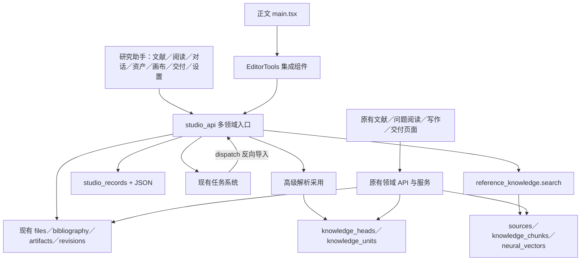
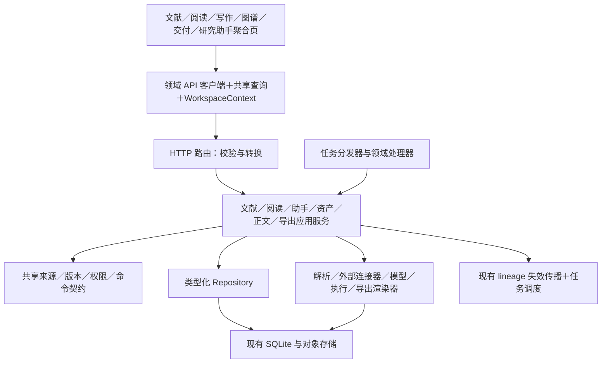

# 新增功能架构集成评估与改进方案

评估日期：2026-11-02

待评估项目：砚台论文工作台，`D:/桌面/论文/paper-workbench`，当前源码版本 0.8.1。

评估对象：此前为补齐 PaperSpark 功能而增加的研究助手及其关联改动。PaperSpark 仅作为功能参考，不是本次待改造项目。

## 1. 结论与评估口径

当前新增功能已经接入项目基础设施，但还没有充分融入原有业务架构。整体形态更接近“原工作台旁边增加一套研究工作台”：共享数据库、项目身份、文件、模型调用和任务系统，却另建了文献入口、阅读入口、资产管理、交付入口、设置和局部状态。

因此，问题不能简单概括为“耦合度低”。更准确的描述是：**领域契约和工作流衔接不足，同时存在对页面实现、JSON 字段和回调约定的过度依赖**。应当增强业务协作，减少实现细节之间的直接耦合。

此前功能对照报告主要验证“有无实现路径”，不能据此认定已经实现跨页面复用、统一生命周期和一致的业务语义。这里对这些维度单独评估。

本次采用源码调用链、数据表、API、前端组件和既有测试检查；另对任务返回值误判条件进行了独立 JavaScript 验证。没有修改业务代码，也没有重新运行全套测试、真实外部服务或桌面安装包。下文分别标明：

- **已确认缺陷**：现有代码存在直接冲突的生产者与消费者契约。
- **已确认断点**：两个流程使用不同服务或模型，缺少共享入口或转换链。
- **设计风险**：存在重复责任或隐式约定；不等于每次操作都会失败。

### 集成程度

| 维度 | 当前评价 | 依据与实际含义 |
| --- | --- | --- |
| 项目、存储、鉴权、模型费用 | 基础集成较好 | 路由并入原应用；导入复用 files/bibliography/对象存储；AI 复用任务与模型计费。 |
| 本地组件复用 | 部分实现 | StudioChat 同时用于研究助手、阅读器和正文工具；CanvasEditor 同时用于研究助手和正文。 |
| 业务服务复用 | 不充分 | 多种领域操作集中于 studio_api；原有文献、交付等入口仍使用另一条业务链。 |
| 原文与检索一致性 | 存在关键断点 | 高级解析写入 knowledge_units，助手知识库搜索仍以 sources/knowledge_chunks 为主。 |
| 来源、版本与派生关系 | 局部较好，体系未统一 | 译文/批注有解析版本与哈希；消息/随记/资产关系另以 JSON 保存，未完整纳入公共追溯。 |
| 跨页面操作和状态 | 偏弱 | 新增页面使用局部 state、手工刷新、回调和 localStorage 接力。 |
| 交付与历史 | 存在契约缺陷 | TeX 共用 exports 表，但原历史页假定每条记录都有固定 DOCX 文件。 |
| 备份与协作 | 备份已覆盖，协作协议有限制 | 完整知识包可采集新增表；旧同步协议明确拒绝含 studio_records 的项目。 |

### 已经存在、应保留的集成成果

1. [路由注册](D:/桌面/论文/paper-workbench/backend/app/api/routers.py:5)将新增接口挂入同一个应用；前端也通过公共传输层访问，没有另建 HTTP 客户端栈。
2. [文献导入](D:/桌面/论文/paper-workbench/backend/app/studio_imports.py:69)写入原有 bibliography，URL 导入调用 register_file/parse_file，保留稳定文件和书目身份。
3. [助手模型调用](D:/桌面/论文/paper-workbench/backend/app/studio_ai.py:15)使用 tasks.model_call，费用与执行记录能够进入任务基础设施。
4. [高级解析采用](D:/桌面/论文/paper-workbench/backend/app/studio_parsing.py:142)接入 knowledge_parses/knowledge_units/knowledge_heads，不只是保存不可消费的外部结果。
5. [助手正文采用](D:/桌面/论文/paper-workbench/backend/app/studio_context.py:86)检查基础正文版本和权限，最终调用 documents.save；不是直接覆盖文件。
6. [TeX 导出](D:/桌面/论文/paper-workbench/backend/app/studio_exports.py:22)复用 export_checks.freeze，已经共享正文快照基础。
7. [完整知识包](D:/桌面/论文/paper-workbench/backend/app/knowledge_transfer.py:40)按项目所属和外键关系采集数据，新增记录有保全路径。

这些基础足以支持渐进重构，无需重写技术栈或拆成微服务。

## 2. 当前主要依赖关系



图中两套内容视图本身有合理用途；问题在于“当前有效解析”没有贯穿所有消费者，而不是必须删除 pages/sources。

## 3. 具体问题、影响与改造建议

### A01：业务记录被误识别为任务失败

**类型：已确认缺陷。优先级：P1。**

[useStudioTask](D:/桌面/论文/paper-workbench/frontend/src/studio/shared.tsx:16)根据 `id + kind` 判断结果是否为任务；只要 status 不是 queued/running/succeeded，就抛出任务失败。

但是 [store.save](D:/桌面/论文/paper-workbench/backend/app/studio_store.py:49)也返回 `id + kind + revision + data` 的普通业务记录，没有 status。[画布 persist](D:/桌面/论文/paper-workbench/frontend/src/studio/CanvasEditor.tsx:32)把该记录原样返回，[保存按钮](D:/桌面/论文/paper-workbench/frontend/src/studio/CanvasEditor.tsx:53)又通过 task.run(persist) 执行。

直接结果是：后端保存成功，组件先更新“已保存”，Hook 随后显示任务失败。独立执行现有判断条件，普通 canvas 记录得到 `savedCanvasIsMisclassifiedAsFailure=true`。此验证针对返回值分类条件，不等同于完整浏览器复验。

**改造：**将查询、普通命令和后台任务分开；任务提交显式返回 task 类型或 task_id，不以字段外形推断。普通记录保存使用 useCommand，任务观察使用 useTask(taskId)。兼容旧接口时，在 API 适配层转换一次。

**验收：**保存画布后返回类型明确、版本加一、刷新可读、界面无错误提示；真正失败/取消/预算阻断的任务仍有正确状态。

### A02：TeX 写入公共导出历史，但历史消费者不认识其产物

**类型：已确认缺陷，并伴随导出策略不一致。优先级：P1。**

[TeX 导出](D:/桌面/论文/paper-workbench/backend/app/studio_exports.py:121)生成 latex-project.zip，并写入 exports 表。[公共列表](D:/桌面/论文/paper-workbench/backend/app/main.py:592)返回项目全部导出记录；[原交付历史](D:/桌面/论文/paper-workbench/frontend/src/main.tsx:3520)却为每条记录固定生成“论文.docx”“检查报告.md”“论文交付包.zip”三个下载链接。因此，TeX 记录出现在该列表时，这些链接指向它未生成的文件。

此外，DOCX [export_project](D:/桌面/论文/paper-workbench/backend/app/exports.py:33)运行审查并处理写作策略与格式规则；TeX 虽共享 freeze，但另有模板与 manifest，未共享完整的交付策略。当前 TeX 明确属于工程导出，不应在界面上被当成已经通过相同正式交付检查。

**改造：**建立 ExportService 与 ExportArtifact 契约，至少包含 format、mode、snapshot_id、checks、artifacts[]；产物项声明文件名、角色、媒体类型和下载地址。DOCX/Markdown/TeX 渲染器消费同一份冻结数据和共同检查结果；各自保留格式检查。历史按实际产物渲染。将 TeX 生成入口放入现有“排版与交付”，研究助手保留快捷入口。

**验收：**连续生成 DOCX 与 TeX，历史中每条记录的按钮都能下载实际存在的文件；正式模式采用相同的项目级准入规则，草稿保留明确的未核验状态。

### A03：高级解析与知识库检索使用不同内容路径

**类型：已确认断点。优先级：P1。**

[高级解析采用](D:/桌面/论文/paper-workbench/backend/app/studio_parsing.py:153)写入 knowledge_units 及对应全文索引，再调用 activate_parse。现有 [activate_parse](D:/桌面/论文/paper-workbench/backend/app/knowledge_units.py:198)切换当前解析并使旧知识依赖失效；没有把新结构单元投影到 sources/knowledge_chunks。

阅读器及助手直接选定文献时，通过 [file_units](D:/桌面/论文/paper-workbench/backend/app/studio_store.py:109)读取当前结构单元；助手勾选知识库时，[chat](D:/桌面/论文/paper-workbench/backend/app/studio_ai.py:129)转而调用 reference_knowledge.search。[sync_document](D:/桌面/论文/paper-workbench/backend/app/reference_knowledge.py:43)仍从 sources 构建知识库块，[search](D:/桌面/论文/paper-workbench/backend/app/reference_knowledge.py:116)使用该集合及其关键词/向量索引。

**影响：**某段内容只有高级 OCR 正确识别时，直接阅读和知识库检索可能看到不同文本；结构化结果中的表格、公式等改进未必进入原检索链。这是路径差异导致的具体可能性，并非声称每次查询都会返回错误结果。普通按页资料总结也有自身 pages 读取路径，需要一并核对；已有基于阅读的总结不应被误判为完全未集成。

**改造：**在现有 knowledge_units 之上提供 DocumentContentView/ContentIndex 服务，让所有消费者显式选择“当前有效解析”或“历史解析”。搜索索引记录内容类型、对象 ID、解析版本和内容哈希，索引构建消费该视图。pages 保留为原页预览，旧 sources 保留历史身份，通过映射连接当前单元；不能为统一而覆写旧证据和引用。

**验收：**构造仅在高级解析结果中出现的短语：采用后能被公共搜索、助手搜索和写作检索找到；切换解析后旧结果被排除或标明历史；原文跳转仍正确。

### A04：同一书目有多条修改链，图谱更新语义不同

**类型：已确认断点。优先级：P1。**

[新增导入 upsert_reference](D:/桌面/论文/paper-workbench/backend/app/studio_imports.py:92)更新版本后调用 knowledge_lineage.changed，并在启用图谱时 enrich。[新增标签修改](D:/桌面/论文/paper-workbench/backend/app/studio_imports.py:119)也有独立的失效与图谱逻辑。

原有 [patch_reference](D:/桌面/论文/paper-workbench/backend/app/main.py:495)保存书目历史并调用 documents.fact_changed，但没有相同的知识图谱 changed/enrich 链。图谱读取时的其他校验可能发现版本不一致，但这不能替代统一的变更通知和重建策略。

**影响：**同样修改作者、标题或标签，后续图谱刷新和派生失效行为取决于从哪个页面操作。仅把新增按钮复制到旧页面不能消除这种差异。

**改造：**集中到 ReferenceService 的 create/update/upsert_external/set_tags/remove 操作；共享校验、版本、书目快照、变更通知和幂等逻辑。URL、Zotero、OpenAlex、手工登记作为不同输入适配器。复用现有 knowledge_lineage.changed 和任务队列，让元数据图谱重建有明确触发点；保留书目元数据关系与论文论证关系的区别。

**验收：**从原文献页和新增入口修改同一条文献，版本、引用影响、图谱失效/重建结果相同；重复导入仍保留稳定 ID。

### A05：studio 成为跨领域入口，且出现反向依赖

**类型：已确认结构问题。优先级：P2；小范围依赖修正可提前。**

[studio_api](D:/桌面/论文/paper-workbench/backend/app/studio_api.py:7)覆盖文献接入、标签、阅读、通用记录、资产、评论、改写、画布、导出、删除、缓存、解析和执行；其中还有资产创建与版本保存等业务 SQL。[update_asset](D:/桌面/论文/paper-workbench/backend/app/studio_api.py:163)甚至通过先创建临时资产、删除临时行、再更新原资产完成修改。

[任务分发](D:/桌面/论文/paper-workbench/backend/app/tasks.py:912)导入 HTTP 路由模块 studio_api.process；[知识编译器](D:/桌面/论文/paper-workbench/backend/app/knowledge_compiler.py:242)依赖 studio_graph；[原解析器](D:/桌面/论文/paper-workbench/backend/app/parsers.py:64)依赖 studio_parsing.convert_doc。这使基础领域与页面来源命名的模块绑定。

**改造：**保留模块化单体，把具体责任归入文献、阅读、助手、资产、解析、执行、导出服务。将 process 移到不依赖 HTTP 的任务处理器；路由只做输入/输出适配。将 convert_doc 放入解析适配器、元数据图谱构建放入知识域。新旧 API 共用应用服务，而不是相互调用路由函数。

**验收：**任务执行无需导入 studio_api/FastAPI 路由；领域模块无需依赖 frontend 页面来源对应的 studio 命名空间；API 与任务调用相同操作可得到等价业务结果。

### A06：通用 JSON 记录承担过多领域模型

**类型：设计风险。优先级：P2。**

[迁移文件](D:/桌面/论文/paper-workbench/backend/migrations/020_research_studio.sql:1)中的 studio_records 只有 kind、owner_id、revision、data 等通用字段；owner_id 没有类型或外键。[KINDS](D:/桌面/论文/paper-workbench/backend/app/studio_store.py:9)同时覆盖 14 类对象。file、conversation、reference、section 等所有者语义由调用者约定；不同关系位于 JSON 内。

专用入口已经为画布、智能体、选区等做了部分校验，不能说“完全无校验”。问题在于这些约束分散在路由和各函数中，[store.save](D:/桌面/论文/paper-workbench/backend/app/studio_store.py:49)只掌握很弱的通用契约；前端又大量以 Record<string, any> 消费，难以在新增页面接入时提前发现错误。

**影响：**查询关联、追溯、删除影响分析、对象迁移和权限继承需要重复解析 JSON；调用者很容易拿错记录类型或遗漏生命周期处理。

**改造：**先增加每种记录的类型化 DTO、schema_version 和专用 Repository，让外部调用者不再直接操作 kind/data；按查询与关联需要逐步把关键字段和关系迁入专表。JSON 适合保存画布场景和 provider 原始扩展，不宜作为全部关系的唯一载体。

**验收：**前后端能静态或运行时拒绝错误类型；跨项目所属、版本冲突和无效关联统一校验；版本历史完整迁移且可恢复。

### A07：来源标识、派生记录与知识工作流未形成统一契约

**类型：已确认断点。优先级：P2。**

[助手上下文](D:/桌面/论文/paper-workbench/backend/app/studio_ai.py:123)把 knowledge_units.id 与旧 sources.id 都放进名为 source_id 的字段；[回复保存](D:/桌面/论文/paper-workbench/backend/app/studio_ai.py:162)只保留该 ID、file_id、name、locator，没有统一携带来源类型、解析版本和内容哈希。文件权限和资产上下文已有校验，但与可验证的具体原文版本追溯仍是不同层次。

译文、导读、批注、消息、随记存在 studio_records 中；公共 [knowledge_lineage](D:/桌面/论文/paper-workbench/backend/app/knowledge_lineage.py:9)及其依赖传播没有为这些记录建立完整适配。原文检索也不会自动把随记当作搜索对象。[消息来源展示](D:/桌面/论文/paper-workbench/frontend/src/studio/ChatNotes.tsx:19)当前主要是名称与页码文本，未复用统一的可跳转来源卡片。

**改造：**复用现有 lineage 的 type/id/version 形式，扩展统一 ResourceRef/SourceRef 和来源解析器；原文选区加 parse_id、hash、字符范围、定位信息。为派生内容建立明确关系：derived_from、supports、discusses 等不能互相替代。增加“批注转随记”“随记关联章节”“从原文建立候选证据”等显式命令，共享来源卡片与跳转。

译文、模型答复和个人随记可进入单独的派生内容检索范围，但必须保留类型与核验状态，不能因可检索就自动成为原文证据。此边界应沿用项目已有证据原则。

**验收：**从消息、笔记、图谱和正文均能回到相同版本的原文选区；切换解析后旧锚点显示过期；派生内容不会被错误标为人工确认或原始证据。

### A08：助手改写另建采用链，正文编辑也依赖集成大组件

**类型：设计风险及复用断点。优先级：P2。**

[studio_context.adopt](D:/桌面/论文/paper-workbench/backend/app/studio_context.py:86)有自己的候选版本、权限和采用记录，然后直接 documents.save。原 [writing_agent.adoption](D:/桌面/论文/paper-workbench/backend/app/writing_agent/adoption.py:67)的提交链还处理采用后的分析、依赖与回执等语义。两者共享底层保存，却未共享完整的应用级提交契约。

前端 [EditorTools](D:/桌面/论文/paper-workbench/frontend/src/studio/EditorTools.tsx:9)同时负责 Tiptap 选区、评论加载、公式、画布、助手、自动补全、资产插入和跨页接力；[main.tsx 集成](D:/桌面/论文/paper-workbench/frontend/src/main.tsx:2503)通过长回调直接同步版本 ref、编辑器内容和资源缓存。组件可渲染到另一处，不代表这些业务行为也能独立复用。

**改造：**抽取 DocumentCommandService，统一保存前的版本/锁定校验、提交后的分析与依赖通知、采用回执和幂等处理；不同候选通过适配器进入。助手改写继续保留 draft/unverified 状态，不能通过共用提交入口获得严格核验身份，也不必强行走完整长篇写作流程。

前端定义 EditorPort，只暴露读取选区、保存、插入资产、采用候选等操作；将 CommentPanel、AssistantPanel、FormulaTool、CanvasTool、CompletionTool 分开组合。Tiptap 与 main.tsx 细节由适配层实现。

**验收：**不同入口采用相同修改时产生一致的版本与影响通知；旧候选不能覆盖新正文；评论和公式不被破坏；另一个正文视图可复用功能而无需复制 main.tsx 回调。

### A09：跨页面交接依靠局部状态和隐式浏览器键

**类型：已确认断点及设计风险。优先级：P2。**

[Studio.tsx](D:/桌面/论文/paper-workbench/frontend/src/studio/Studio.tsx:38)维护自己的文献、资产、章节、阅读文件和 ask 状态；[图片交接](D:/桌面/论文/paper-workbench/frontend/src/studio/Studio.tsx:41)仅把 artifact_id 写入按项目命名的 localStorage，再调用打开章节回调。[EditorTools](D:/桌面/论文/paper-workbench/frontend/src/studio/EditorTools.tsx:15)在项目变化时读取该值。

已有 [sourceNavigation](D:/桌面/论文/paper-workbench/frontend/src/workspace/sourceNavigation.ts:3)则只覆盖 materials/rules/references。[原文献工作区](D:/桌面/论文/paper-workbench/frontend/src/references/ReferencesWorkspace.tsx:63)使用公共 SourceWorkspace 与资源 Hook；新增页没有完整沿用这一上下文和导航体系。

**影响：**当前原件、选区、目标章节和返回位置难以连续传递；刷新、换页、换章节与多个页面实例下行为依赖时序。图片接力记录本身没有目标章节、操作 ID 和预期正文版本，不能独立表达一次完整插入意图。

**改造：**在现有导航上演进 WorkspaceLocation/WorkspaceContext，显式传递 project、file、parse、unit、selection、section、revision 和 returnTo。图片跨页操作保存为带目标、版本与消费状态的 InsertArtifactIntent；同页优先调用 DocumentCommand。存储只用于恢复导航与待办，不作为未经校验的业务执行依据。

公共资源查询增加领域键与失效表。文献、资产、正文变更后统一通知相关查询刷新；可先扩展 useWorkspaceResource，无需立即引入新的状态管理库。

**验收：**从任意来源卡片打开翻译/助手/正文时保留选区；刷新可恢复；图片不会被误插到其他章节，已消费意图不会重复执行。

### A10：后台任务复用存在，但任务观察与上下文策略仍各自封装

**类型：已确认复用限制。优先级：P2。**

[useStudioTask](D:/桌面/论文/paper-workbench/frontend/src/studio/shared.tsx:6)同时处理提交、状态轮询、错误展示和结果解释；未完成结果的提示还直接读取 attachment_failures，混入 Zotero 领域语义。观察状态保存在组件内部，卸载后停止轮询；后端任务仍可继续，并不意味着任务数据丢失，但重新进入页面缺少统一的观察和回填机制。

[studio_ai](D:/桌面/论文/paper-workbench/backend/app/studio_ai.py:112)另行组装选中文献、检索、资产和正文上下文；已有写作助手拥有自己的工具、上下文和策略模块。两类交互可以不同，但底层来源读取、权限、预算和工具能力不应长期各维护一份。

**改造：**任务中心与页面共用 TaskRepository/useTask，区分“观察任务”和“提交任务”；任务记录或命令回执保留目标对象与输入版本，页面重新打开后按目标恢复观察。未完成状态由结构化 result/errors 表达，再由 Zotero 等功能解释。将原文读取、资产展开、来源校验、模型配置解析抽为共享能力；自由对话与阶段式写作保留各自编排。

**验收：**翻译/解析任务运行时切页或刷新，再进入能恢复进度并使用已保存结果；不重复扣费、不重复入库；局部完成提示与具体功能匹配。

### A11：资产和配置具备共享基础，但责任仍留在 studio 中

**类型：设计风险和入口断点。优先级：P2/P3。**

自由画布和 Python 图片已进入 artifacts，这是正确基础。[画布发布](D:/桌面/论文/paper-workbench/backend/app/studio_api.py:224)用 studio_canvas_id/scene_revision 关联场景；[执行产物](D:/桌面/论文/paper-workbench/backend/app/studio_execution.py:50)有代码和输入哈希等元数据。但富文本资产、画布场景、生成图片、旧图表各有不同编辑与历史约定，尚未成为同一个可发现、可回编辑、可追溯的资产契约。

[studio_store](D:/桌面/论文/paper-workbench/backend/app/studio_store.py:83)还管理密钥保险库，而 parsing/execution 的设置藏在研究助手内部；原设置页另有 provider 设置。这里应保留解析与执行提供商的差异，但统一配置生命周期、作用域与能力查询。

**改造：**AssetService 管理元数据、权限、不可变版本、源场景与输入关系；正文引用明确记录使用哪个资产版本。按 editor_type 打开原编辑器，重编辑后生成新版本，由用户决定更新哪些正文引用。将凭证读写交给公共凭证服务，解析/执行暴露配置与能力接口，在统一设置页管理；其他页面直接消费能力状态。

**验收：**在研究助手、原图表入口、正文里能找到同一资产；重新编辑能回到原场景；新版本不静默替换历史正文图片；配置一次即可供各入口一致使用。

### A12：数据保全与跨端协作仍是两种不同能力

**类型：已确认限制。优先级：P3；应在界面说明能力边界。**

[sync_bundle.make](D:/桌面/论文/paper-workbench/backend/app/sync_bundle.py:28)对存在 studio_records 的项目返回 409，要求使用完整知识包或本地备份。此行为避免了静默丢数据，是正确保护；但意味着新增记录不能复用旧的增量合并工作流。该协议本来也限制部分旧版知识对象，不能把全部同步限制归因于本次新增代码。

[CLI 在线查询](D:/桌面/论文/paper-workbench/scripts/yantai-data.mjs:34)直接组合 studio 与旧知识库接口；[离线查询](D:/桌面/论文/paper-workbench/scripts/yantai_data_offline.py:29)另用 SQL/LIKE 搜索 sources，查询范围和结果语义没有公共契约。

**改造：**为可迁移资源建立显式类型、引用和版本描述，扩展完整包导入/分叉校验；增量同步另设计消息追加、可编辑记录的乐观锁、删除墓碑和冲突策略。CLI 使用公共领域查询投影，并声明离线可用的检索模式和范围，不能让在线向量与离线 LIKE 冒充完全等价。

**验收：**完整包恢复后关联可解析；未来同步发生冲突时保留两侧历史；CLI 同一过滤范围与资源字段一致，检索算法差异有说明。

## 4. 各功能族的归属与复用方式

| 功能族 | 当前主要位置 | 建议业务归属 | 应复用的页面/流程 |
| --- | --- | --- | --- |
| 本地/URL/Zotero/OpenAlex 导入、标签、摘要翻译、删除 | studio_imports、studio_api、Studio | 文献服务＋连接器；翻译由阅读/助手能力提供 | 文献目录、资料管理、文献发现、助手、CLI |
| 对照翻译、结构导图、引用回跳、进度、原文高亮 | studio_reading、Reader | 阅读服务＋共享原文视图 | 问题阅读、原文预览、资料总结、写作来源面板 |
| 导读与交互网页 | studio_ai、Reader | 阅读产物服务，显式派生来源 | 阅读、资产库、知识导航、交付附件 |
| 连续对话、智能体、检索上下文 | studio_ai、ChatNotes | 助手编排＋公共上下文/工具能力 | 阅读侧栏、正文侧栏、图谱问答、项目助手 |
| 随记、整理候选、评论线程 | studio_records、ChatNotes、EditorTools | 随记服务、评论服务，各自保留语义 | 阅读、对话、章节笔记、正文审阅 |
| 补全、纠错/改写采用、版本 | studio_context、EditorTools | 正文命令与候选服务 | 所有正文编辑入口、写作助手、审阅 |
| 公式、画布、Python 图片、富文本资产 | EditorTools、CanvasEditor、studio_execution、assets | 编辑器工具＋资产服务＋执行适配器 | 图表页、正文、对话输出、资料处理、导出 |
| 元数据与自动图谱 | studio_graph、knowledge_compiler | 知识域图谱构建与生命周期 | 原文献修改、导入、标签、知识页、跨文献导航 |
| Markdown、DOCX、TeX 交付 | exports、studio_exports、两个交付入口 | 统一导出服务＋格式渲染器 | 排版与交付、正文快捷导出、历史、CLI |
| pdf/Word/Surya/MinerU 解析 | parsers、studio_parsing | 解析 provider 接口＋内容索引 | 资料管理、阅读、检索、图谱、助手 |
| RAG 与全文搜索 | reference_knowledge、knowledge_units 等 | 公共检索门面，区分原文和派生内容 | 助手、写作、图谱、知识库、CLI |
| 快照、CLI、缓存与资源回收 | scripts、studio_exports、knowledge_transfer | 查询/迁移服务、资源生命周期 | 设置、交付、协作、运维 |
| Docker、桌面包、发布工作流 | deployment、scripts、workflows | 公共运行时和发布工程 | 各功能能力由同一应用提供，不重复维护业务实现 |

工程部署不是本次低复用的主要矛盾。需要增加对解析器、执行器、渲染器的统一能力描述，让浏览器、桌面和 Docker 根据真实能力显示入口，而不是另复制服务代码。

## 5. 建议的目标架构与契约

保持现有 React + FastAPI + SQLite + 任务系统，逐步形成“薄页面、领域应用服务、基础设施适配器”的模块化单体。目录名字可以沿用现有风格，关键是依赖方向。



### 5.1 七项共享契约

| 契约 | 必须解决的问题 | 建议承接点 |
| --- | --- | --- |
| ReferenceService | 所有书目变更产生一致版本、快照与派生影响 | 提取 main/reference_library/studio_imports 的公共操作 |
| DocumentContentView/ContentIndex | 阅读、检索使用同一有效内容版本 | 演进 knowledge_units、reference_knowledge，保留旧 source 映射 |
| ResourceRef/SourceRef＋ContextBuilder | 对象类型、来源版本、定位、权限可解析 | 扩展 knowledge_lineage、现有 writing provenance/context |
| AssetService | 图片/文本/场景统一发现、版本和回编辑 | 演进 artifacts 及图表、执行产物适配 |
| DocumentCommandService/EditorPort | 所有正文修改采用同一提交规则 | 提取 adoption 的共用提交钩子，前端隔离 Tiptap |
| ExportService/ExportArtifact | 冻结、检查、产物与历史一致 | 复用 export_checks，DOCX/TeX 做格式适配 |
| TaskHandle/TaskResult | 提交、观察、结果消费分离 | 公共任务 API 与 useTask/useCommand |

以下仅为拟议接口形状，不是声称项目当前已有这些类型：

```ts
type ResourceRef = {
  project_id: string;
  type: 'file' | 'source' | 'unit' | 'note' | 'artifact' | 'revision';
  id: string;
  version: string;
};

type CommandResult<T> =
  | { type: 'completed'; data: T }
  | { type: 'task'; task_id: string };

type ExportArtifact = {
  name: string;
  role: 'document' | 'report' | 'archive' | 'source';
  media_type: string;
  download_url: string;
  sha256: string;
};
```

SourceRef 在 ResourceRef 上增加 file/parse、locator、选区及内容哈希，并对不同 type 使用不同字段约束。优先兼容现有 lineage 的 type/id/version，避免再造一套无法互通的引用格式。契约可由后端类型模型生成前端定义；API v2 的路径归一化不能替代响应体契约。

### 5.2 一致的变更处理

以文献更新为例，应用服务在同一事务中检查输入版本、写书目与历史、记录影响；使用现有 lineage.changed 标记派生对象，并通过任务系统调度必要重建。提交后按 resource/version 通知前端失效相应查询。

不需要先引入通用事件总线。只有需要异步且不可丢失的工作，才补充可重试的事件/任务记录、幂等键和失败状态；不能在事务中成功保存数据却悄悄遗漏后续重建。

## 6. 分步实施顺序与交付标准

| 阶段 | 具体改造 | 依赖 | 可 review 的完成标准 |
| --- | --- | --- | --- |
| S1：先修契约缺陷 | 分离普通命令与任务；导出历史按产物渲染；声明格式与草稿/正式模式 | 无需大规模搬目录 | A01/A02 的回归通过；旧记录有兼容展示 |
| S2：统一内容与文献写入口 | ReferenceService；当前解析内容视图；搜索索引按版本投影 | S1 的基本响应类型 | 高级解析→公共检索；两个入口修改书目得到相同派生结果 |
| S3：统一来源和提交 | 类型化引用、派生关系、DocumentCommand；AssetService 首批适配 | S2 的版本来源 | 阅读→讨论→随记→章节候选→采用→导出，可追踪完整来源 |
| S4：让页面消费共享能力 | 文献页增加导入/翻译；问题阅读增加对照/批注/助手；图表页接画布/执行产物；交付页接 TeX；统一设置 | 对应服务先可复用 | 至少两个原有页面直接复用同一能力，不复制业务实现 |
| S5：收敛 studio 与迁移 | studio 成为薄聚合页/兼容路由；移走 worker→HTTP 依赖；按需迁移 JSON 关系 | 每个功能族有替代调用链 | 旧 API、历史数据继续可读；任务不依赖路由层；新记录不再自由散落 kind/data |
| S6：补齐协作和运维 | 完整包关系验证、离线查询协议、能力注册；按需求升级增量同步 | 类型化资源与稳定版本 | 恢复/分叉不丢关系；不把完整备份误当增量协作已完成 |

实施时每一批应交付一条完整工作流。不要以“目录搬完”或“所有页面出现按钮”作为完成标准。S2 内容一致性优先于界面整理；S4 也应按功能族逐步上线，不集中进行一次大改版。

建议第一批明确聚焦：任务返回值、导出历史、书目统一变更、当前解析进入检索。它们直接影响现有使用，且为后续复用提供正确基础。

## 7. 数据与 API 的兼容迁移

1. **先封装，后迁移。**为现有记录建立专用 DTO/Repository；新旧页面先共用服务，避免一边搬表、一边改交互、一边改变业务语义。
2. **新旧 API 共享实现。**现有 `/studio/*` 保留兼容适配，新领域路径遵循既有 API v2 约定。保留旧响应格式，通过新版客户端转换；不要要求所有调用者同一次升级。
3. **保留稳定身份。**迁移时保持 file/reference/record ID、历史 revision、task/run ID、对象哈希及删除墓碑；确需新 ID 时建立持久映射。
4. **显式迁移关键关系。**下表优先拆出跨功能引用，场景正文等可继续存 JSON。
5. **旧关联不可推断时标记 unknown。**不得仅凭 owner_id 或同名标题猜测来源，更不能把旧译文/随记提升为已核验知识。
6. **按版本适配与可回退。**新读路径先兼容旧数据，批量回填需可重复执行并有一致性检查；验证后再切换权威写入口。避免长期无事务的双写。

| 旧记录类型 | 第一阶段显式化内容 | 需要保留的历史语义 |
| --- | --- | --- |
| translation / annotation / guide / webpage | file、parse/unit、hash、language、anchor、run | 派生内容，解析变化会过期，原件不可覆写 |
| conversation / message | 所属会话、消息次序、任务关联、typed source refs | 追加消息与会话编辑分开，模型输出不自动核验 |
| note | 内容版本、消息/批注来源、章节关联 | 个人随记，整理候选不覆盖原稿 |
| comment | section、revision、node/选区、parent | 回复、解决与原锚点历史可追溯 |
| canvas | scene schema/version、渲染资产版本关系 | 源场景与图片版本相互可定位 |
| proposal | 基础正文、输入来源版本、操作、采用回执 | 待采用草稿与已提交版本明确区分 |
| parse_result | provider、输入哈希、输出对象、采用解析 ID | 原始结果与当前采用状态分开 |

完整知识包按外键采集，因此增加关系表时应同时补充导出、导入重映射和恢复验证；不能只验证记录数量相同。

## 8. 验收应覆盖的协作工作流

既有 studio 单元/浏览器测试已覆盖不少功能，也有备份、正文、公式等跨模块检查。它们值得保留，但并未证明下列全链路一致。尤其浏览器测试既要检查结果出现，也要检查错误提示、实际记录版本和关联变化。

| 编号 | 验收流程 | 关键断言 |
| --- | --- | --- |
| W01 | Zotero/URL 导入→原文献目录→高级解析采用→知识搜索→助手→写作检索 | 相同 file/reference；检索命中当前解析独有内容；来源版本可解析 |
| W02 | 原文献页修改作者/标签，再从研究助手修改同一条 | 历史连续；图谱和正文影响通知相同；不存在依入口不同的失效行为 |
| W03 | 问题阅读选区→对照翻译→批注→讨论→存随记→关联章节 | 同一锚点贯穿；派生来源保留；返回阅读位置不丢失 |
| W04 | 随记/对话提出改写→采用→原写作分析与交付 | 使用统一提交钩子；版本竞争受控；草稿不会获得严格核验状态 |
| W05 | 自由画布或 Python 图片→原图表/资产页→两个正文入口→回编辑→导出 | 资产可发现；源场景和版本明确；历史图片不被静默替换 |
| W06 | 同一项目连续生成 DOCX、TeX、Markdown | 导出历史按产物展示；每个下载可用；共享快照与检查策略清晰 |
| W07 | 翻译/解析执行时切页面、刷新、重新进入 | 任务可重新观察；完成结果能回填正确目标；没有重复提交或费用 |
| W08 | 切换解析、排除原页、撤销外发权限、移除文献 | 检索/锚点/派生对象正确过期；各入口一致执行权限；历史保留 |
| W09 | 完整知识包导出→隔离恢复/分叉→继续编辑 | 对话、批注、画布与正文关联完整；来源 ID 映射正确；原项目不变 |
| W10 | 在线/离线 CLI 查询同一资源范围 | 字段与过滤范围契约一致；检索算法和可用能力差异明确 |

架构约束可加轻量检查：任务模块不得导入 HTTP 路由；页面不得自行编排数据库级生命周期；新领域客户端不使用未分类的任意响应；新增 ResourceRef 类型必须具备解析、版本校验和迁移适配。检查用于防止已发现的问题回归，不必先建设庞大框架。

## 9. 对本轮工作的界定

本轮只增加这份评估与改进方案。业务代码、依赖和数据库均未修改；工作区已有改动予以保留。上面的服务、接口、迁移和阶段安排属于后续实施方案，并非已完成的重构。

下一轮实施应以 W01–W10 的具体工作流与 S1–S6 的验收门槛衡量完成度，而不是沿用“106 个功能均有源码路径”作为架构集成完成的证明。
