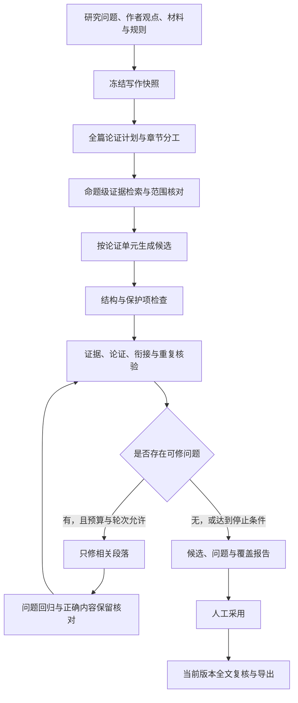

# 核心写作能力深度优化方案

日期：2026-11-03。对象：砚台论文工作台当前工作区，包含本来就存在的未提交修改。

本次交付为基于源码静态审计的改造方案。已核对整篇写作、有据写作、编辑器补全、上下文装配、检索、润写、核验、采用及评测相关实现；未修改业务代码，未调用收费模型，未对用户真实论文执行生成或检测。下文数值均为建议验收目标，不是当前项目实测成绩。

## 1. 总体判断与优化边界

项目已有较完整的写作基础：整篇候选、逐章任务书、全文上下文、证据关系、结构化引用、语义核验、人工采用、修订回归与严格交付。首要问题是这些能力分散在不同链路，整篇写作默认未获得有据写作同等深度的核验；其次是段落计划和重复检查还不能充分约束实际论证质量。

建议将核心链路升级为：**研究问题与作者观点 → 篇章论证计划 → 命题级证据准备 → 按论证单元生成 → 独立质量核验 → 局部修订与回归 → 人工采用 → 当前版本全文复核**。

工程重点：统一质量服务、强化论证状态、识别无新增信息的重复、保护研究结论与来源、降低合格输出成本。沿用当前模块化单体、任务队列、SQLite、对象存储及已有前端页面。

“原创性”拆成可核验的研究贡献、来源使用和表达质量。项目内相似度只能描述已检查语料范围内的重复风险，不能换算成知网、维普、Turnitin等外部系统的查重率。AIGC检测得分单列为平台相关的辅助观察值，不设“稳定低于某百分比”的承诺，也不以分数代替论文质量或学术诚信判断。Turnitin官方说明也明确区分AI检测与相似度，并要求结合人工判断，见文末外部依据。

## 2. 源码审计：已有能力和真实缺口

以下位置按本次审计时的文件行号记录；后续实施后可能变化。

| 范围 | 已有实现与源码依据 | 真正需要改造的部分 |
| --- | --- | --- |
| 常规整篇写作 | [paper_writing.py](D:/桌面/论文/paper-workbench/backend/app/paper_writing.py:586)组织逐章候选，在646行调用tasks.writing；550行的review调用本地paper_review_checks | 将逐句支持性、语义与篇章核验接入主入口；不把本地检查通过解释为论证成立 |
| 有据写作 | [coordinator.py](D:/桌面/论文/paper-workbench/backend/app/writing_agent/coordinator.py:190)已有调查、判定、起草、逐句标注、语义与衔接阶段 | 抽成可共享阶段服务，供整篇及局部写作消费；避免另建第三套流水线 |
| 写作任务书 | [tasks.py](D:/桌面/论文/paper-workbench/backend/app/tasks.py:600)装配writing_brief；[writing_checks.py](D:/桌面/论文/paper-workbench/backend/app/writing_checks.py:98)按brief_points统计覆盖 | 自填编号只能表示模型声称覆盖，需独立用正文核对任务点是否真正完成 |
| 全文连贯上下文 | [writing_continuity.py](D:/桌面/论文/paper-workbench/backend/app/writing_continuity.py:20)已读取全部保存章节；[context.py](D:/桌面/论文/paper-workbench/backend/app/writing_agent/context.py:169)超预算会阻止请求 | 增加论证状态和依赖定位；优化重复装载成本。分层上下文必须显式选用并声明覆盖，不静默替换全文 |
| 命题与论证图 | [claims.py](D:/桌面/论文/paper-workbench/backend/app/writing_agent/claims.py:5)已有版本化命题和supports/limits/contradicts证据关系；[contracts.py](D:/桌面/论文/paper-workbench/backend/app/writing_agent/contracts.py:13)已有argument_edges及supports/requires/derives环检测 | 将既有论证图落实到具体段落职责、前提、限制和承接，扩充缺少的关系语义 |
| 重复检查 | [writing_checks.py](D:/桌面/论文/paper-workbench/backend/app/writing_checks.py:38)对较长段落去空白后做跨章子串匹配；[paper_review_checks.py](D:/桌面/论文/paper-workbench/backend/app/paper_review_checks.py:117)检查长段落一致 | 补章内近似复用、跨章语义冗述及与已读来源的匹配；区分必要回顾和无信息增量重复 |
| 数值保真 | [writing_checks.py](D:/桌面/论文/paper-workbench/backend/app/writing_checks.py:57)已有事实数字漂移提示，但76行按数值集合有无交集判断 | 改成指标、对象、数值、单位、条件和时间逐项对应，避免一个正确数字掩盖另一个错误数字 |
| 润写 | [polishing.py](D:/桌面/论文/paper-workbench/backend/app/polishing.py:63)保护段序、引用、脚注、格式片段、数字单位与关键限定词 | 增加语义保真核对；论证调序、拆合段应使用单独的结构修订操作 |
| 全文复核与修订回归 | [paper_pipeline.py](D:/桌面/论文/paper-workbench/backend/app/writing_agent/paper_pipeline.py:60)已有分块全文复核；[revision.py](D:/桌面/论文/paper-workbench/backend/app/writing_agent/revision.py:31)已有旧新命题及原问题回归 | 接入未采用的整篇候选快照；补跨块论证关系和受预算限制的局部修订闭环 |
| 检索与打包 | [retrieval.py](D:/桌面/论文/paper-workbench/backend/app/retrieval.py:106)已有BM25、Dense、RRF与重排；[packing.py](D:/桌面/论文/paper-workbench/backend/app/writing_agent/packing.py:23)来源排序仍主要按词项交集 | 将混合检索用于命题级证据排序，保留固定证据、完整来源与用途约束 |
| 采用与版本 | [adoption.py](D:/桌面/论文/paper-workbench/backend/app/writing_agent/adoption.py:67)已有统一提交；[impact.py](D:/桌面/论文/paper-workbench/backend/app/writing_agent/impact.py:123)已有来源/版本复查 | 追加论证计划、质量报告与重复索引依赖，沿用既有幂等和事务 |
| 编辑器补全 | [assistant_service.py](D:/桌面/论文/paper-workbench/backend/app/assistant_service.py:226)验证正文版本和锁定，234行主要发送prefix/suffix | 补轻量章节目标、术语和已确认命题，避免补全与整篇写作遵循不同的事实与衔接约束 |
| 评测与交互 | [diagnostic_scoring.py](D:/桌面/论文/paper-workbench/backend/app/writing_agent/diagnostic_scoring.py:5)已有八维诊断、盲评和裁决；[PaperWriting.tsx](D:/桌面/论文/paper-workbench/frontend/src/paper/PaperWriting.tsx:802)已有审阅与修订入口 | 扩充长文连贯性与语义重复题集，显示可定位的质量依据及修订收益 |

## 3. 目标主链路与共享服务

共享服务建议放在现有writing_agent域内。职责分为：计划、上下文、生成、核验、修订五部分；现有HTTP入口和任务kind保留兼容适配。paper_writing负责整篇编排，tasks负责执行和计费，共享服务负责可测试的写作行为。

整篇、单章、定向修订、语言润写、短补全使用同一快照/命题/来源政策，但采用不同核验深度。短补全先跑轻量检查，进入章节候选或正文后再参加章节与全文检查，避免每次短续写触发整篇收费复核。

## 4. 核心模块改造

### 4.1 论证规划：从“段数安排”升级为“每段承担什么论证”

改造writing_ops、writing_brief、writing_agent/contracts、claims、models和judgment。

在现有章节任务书之上增加版本化ArgumentPlan，至少包含：研究问题、作者的核心主张、章节承担的问题、需要的前提、允许得出的结论、不可推导的内容、尚缺证据及段落之间的关系。复用现有claim_versions、claim_evidence_links、argument_edges及依赖环检测，重点补齐与段落计划的映射，不另建独立知识图谱服务。

段落任务卡建议字段：paragraph_id、role、claim_ids、evidence_ids、analysis_goal、relation_to_previous、terms_to_define、open_gaps、expected_information_gain。role区分背景、定义、主张、证据、解释、对比、局限与小结，按章节性质组合；不要求每段都重复同一模板。计划输出的是可审阅的任务和依据，不要求输出模型内部推理过程。

论证校验包括：结论是否有前提和支持材料；是否把相关性加强为因果；是否把设计或测试定义写成已验证结果；同一术语是否在不同章节改变含义；结论范围是否大于材料范围。反证和边界只在材料真实存在时纳入，不为凑结构虚构反方观点。

生成前先运行程序校验：ID有效、来源可用、依赖无环、关键主张有证据或缺口、章节职责无明显冲突。再对计划进行预算受控的独立核验。缺少材料时输出待补项及可以写到的边界。

### 4.2 上下文与证据：让模型知道“前面已经证明了什么”

改造writing_continuity、writing_agent/context、packing、knowledge_planning、writing_request和retrieval。

增加ManuscriptState，记录每章已建立命题、已使用证据、术语定义、关键数值、未解问题和下一章的依赖；每项绑定当前正文版本或未采用候选哈希，保存原文nodeId定位。未采用候选始终保持候选身份，不能因进入状态索引就升级成已核实事实。

保留当前full_manuscript模式。另加用户明确选用的argument_scoped模式：全篇论证状态＋当前章完整原文＋依赖章节所需完整论证范围＋相邻段落＋本次证据。原文范围应覆盖支持或限制命题所需的条件、上下文与表注；缺少关键前提则回读扩展原文或标记未完成。报告逐项显示实际提供、仅导航、未读和延后范围，不将摘要当作已经通读或证据支持。

以命题和段落问题生成检索查询，接入已有混合检索。排序在相关性之外考虑研究条件匹配、来源多样性、反证/局限和信息增量；固定证据仍必须保留，显式选择不因排名较低被删除。对待写作的“核心论断”，检索命中还需独立判断是否真正支持。

本章重复介绍旧概念时，优先引用前文定义并展开新问题；必要的摘要和结论回顾按其职责保留，不能仅因相似就删除。

### 4.3 生成编排：按论证单元生成，保留章级组织

改造tasks._writing、writing_agent/drafting、prompts、schemas及现有响应契约。

保留短章节整次生成，较长或论证复杂章节按若干完整论证单元生成，初期可从每单元2—4段试验。不要按固定字数把同一论证机械切开。每单元收到全章计划、前一单元实际结论、当前证据和下一单元职责；输出段落、命题/证据关联、任务点覆盖原句及新增缺口。

一轮单元完成后更新候选状态，后续单元只读取已保存的实际输出。章节完成后统一校验：是否遗漏任务点，段落之间是否递进，是否存在重复小结或机械过渡，结论是否得到本章支撑。拆批增加调用次数，因此默认批次大小必须通过“单位合格输出成本”实测选择。

把现有基础提示词与动态追加规则整理为版本化任务模板和明确数据契约，分别定义计划、写作、核验和修订的输入输出。现有提示词实际内容哈希、原响应保存、格式修复及费用记录继续保留。不要用不断加长系统提示词代替独立检查。

以现有schemas.CandidateParagraph和writing_agent.models.DraftParagraph为兼容起点归一段落契约，保留已有来源、命题、阅读范围和preserve_node_id字段，再追加计划段落ID、职责和论证关系；不引入第三种互不兼容的草稿格式。

模型选择按已有角色能力和校准政策执行。生成与核验分离输入职责、不得把生成器自评视为验证；同模型核验结果仍应标为模型辅助。更换供应商或模型时重新绑定能力指纹和基线，不因名称或参数宣称效果更好。

实现时须显式核对核验profile：现有profiles.current_verifier在部分配置下会返回原profile，不能据调用名称认定已使用独立核验角色。严格交付继续要求当前且已校准的verify角色或已有人工通读流程，不由新增自评授予资格。

### 4.4 质量核验：接通已有能力，建立可解释报告

优先复用verification、coherence、paper_pipeline和revision。新增共享quality服务作为适配边界，接收统一CandidateSnapshot，返回QualityReport。

现有全文复核偏向已保存正文，需要增加候选读取器：能够读取未采用章节document、节点、引用提案、来源manifest和候选版本。这样可以在写入正文之前核验整篇候选，不为运行检查提前创建正文修订，也不改动真实论文。

报告将原先单一passed拆成结构、任务覆盖、证据支持、事实保真、论证与衔接、重复风险、修订回归七类结果。各类状态为通过、发现问题、未检查、覆盖不完整；保留检查方法、输入版本、检查器/模型版本、实际范围、定位和原因。模型判断“支持”与人工确认分别记录。

重点补三项检查：

1. 任务点真实覆盖：独立核验实际段落及覆盖原句，区分完成、部分、缺失和无法判断，不能仅统计brief_points。
2. 事实元组对照：按指标—对象—数值—单位—条件—时间—统计口径核对，兼顾否定、比较方向和计划/完成状态。新推导数值需附公式和输入来源。
3. 论证关系核对：识别缺前提、证据只相关不支持、因果跃迁、反复下结论、未回答研究问题和跨章相互矛盾；每个问题给出原文定位和修订范围。

本地确定性错误先拦截；语义判断保留依据和不确定性。普通草稿可以保留明确的待补项，严格采用与交付沿用已有更高标准。未运行深度核验、预算不足或输入失效时不能展示“全篇质量通过”。

### 4.5 原创性与重复控制：在生成前分工，生成后定位

在现有writing_checks和paper_review_checks外追加可增量更新的重复索引，不删除现有精确匹配检查。

| 层次 | 实现方向 | 输出和处理 |
| --- | --- | --- |
| 字面重复 | 中文字符n-gram与可选MinHash召回，局部对齐定位；英文按词规范化 | 展示对应片段、来源及覆盖范围，保留原始口径与排除后的口径 |
| 语义冗述 | 复用已有本地向量模型召回段落对，再判断是否增加论点、证据、解释或条件 | 相似度只作候选召回；独立判断为冗述后才建议合并、删除或重分工 |
| 来源使用 | 与项目内有权限、实际已读的原文及作者导入的自有文本比较 | 区分直接引用、贴近来源表述、重复使用自有文本和需要重新综合的段落 |
| 模板化表达 | 结合段落职责识别空泛背景、重复小结、无实质承接及不必要的连接词 | 返回原文与缺失的信息，而不是输出无法解释的“机器感分数” |

生成前用章节分工和已用命题索引防止多个章节回答同一问题；生成后再处理剩余重复。对冗述优先明确“这一段应新增什么”，有材料才补分析；没有材料时合并或删减，不补造论据。

可豁免项需要明确标记：规范直接引文、专名、标准术语、公式、参考文献，以及符合摘要/结论职责的必要回顾。豁免不能隐藏原始匹配事实。语义冗述与来源近似表达分别报告，前者影响篇章质量，后者需要核对引用和综合方式。

短期不默认建设外部全文爬取库，也不自动上传论文。商业检测结果可由用户导入报告，登记平台、日期、版本/口径、样本范围和设置；不能用本地相似度推测平台分数。

### 4.6 润写与结构修订分开

语言润写继续遵守现有academic_polish契约，不改变段落职责和核心含义。增加前后命题对照，核对主客体、指代、比较对象、因果方向、条件辖域和引文支持；数字一致不能等同于语义一致。

在现有revise框架增加“论证结构修订”子模式，允许有依据的拆段、合段和调序。记录old_node_ids到new_node_ids映射，保留引用节点和来源；图文交叉引用、锁定范围以及正文外部内容继续受保护。引用因合并需要迁移时，仍要对应到其实际支持的主张。

自然衔接的目标是前后段存在清楚关系，例如“前段明确评价条件，后段据此说明结果适用范围”，不能只批量加入“此外”“综上所述”。仅调整段间关系时，也要检查是否把尚未成立的前提写成既定结论。

### 4.7 局部修订：修好问题，同时确认没有改坏正确内容

在已有revision回归之上增加问题分类调度：结构错误走程序或契约修复；重复走合并/职责调整；论证跳跃走前提检查与有据补写；证据不足走补证或收缩结论；语言问题走润写。

每次仅修改相关节点及必要相邻上下文。修订后重跑目标问题、事实保真、来源支持、连贯性和重复检查；复用依赖未变的检查结果。正文实质变化沿现有依赖闭包更新结论和中英文摘要。

初期最多2轮自动局部修订，受项目/任务总预算及调用上限约束。目标问题不减少、产生新的事实错误、质量倒退或预算耗尽时停止并保留较优候选；比较质量采用“保护项无退化→严重问题减少→目标问题改善”的明确顺序，不能仅比较模型总分。最终采用仍走已有人工操作和事务。

## 5. 数据契约、版本与接口

建议新增或扩展四类对象，优先复用现有对象存储和依赖表；如确需新表，按实施时最高迁移号顺延。

| 对象 | 关键内容 | 失效条件 |
| --- | --- | --- |
| ArgumentPlan | 问题、命题、段落职责、证据映射、缺口、计划版本 | 章节目标、研究核心、材料或计划发生变化 |
| ManuscriptState | 已建立命题、术语、关键数值、待解问题、原文定位 | 关联正文revision或候选hash变化 |
| QualityReport | 分项状态、方法、覆盖、问题、版本、前后对照 | 所检查正文、证据、规则、计划或检查策略变化 |
| ParagraphIndex | 段落文本hash、向量/指纹、节点位置、来源、索引模型版本 | 对应段落、来源权限、模型或索引策略变化 |

统一候选快照至少包含project_id、section_id、base_revision_id、candidate_hash、document、source_manifest和argument_plan_version。报告不依赖客户端提交的来源正文；来源、版本和权限仍由后端权威读取。

在现有manifest追加argument_plan_version、manuscript_state_hash、quality_policy_version、quality_report_hash、similarity_index_version、context_mode、coverage和实际模型配置指纹。避免将整篇输入hash作为所有局部缓存的唯一键；应记录每项检查真正读取的依赖。

接口建议沿用既有v2注册门面，下面路径为业务路径示意，不是本轮已实现接口：

| 接口 | 用途 |
| --- | --- |
| GET/PUT /projects/{pid}/writing-plan | 读取、审阅和更新论证计划，携带基础版本 |
| POST /projects/{pid}/paper-writing/{tid}/quality-tasks | 对指定候选快照发起分级检查，返回现有task |
| GET /projects/{pid}/paper-writing/{tid}/quality | 返回当前质量报告及过期原因 |
| POST /projects/{pid}/paper-writing/{tid}/revise | 扩展已有接口，接受稳定finding_ids和修订子模式 |

前端将这些方法补进现有writingApi；保留任务观察器、既有错误码约定、幂等键、候选与正文分离以及事务采用。旧候选缺少新增报告时标记“尚未执行新版核验”，不伪造通过，也不破坏历史读取。

## 6. 前端功能增强

在现有PaperWriting、AgentWriting及编辑器工具中增量完善，避免增加新的主写作工作台。

1. 写前：显示每章“回答什么问题、建立什么结论、依据是什么、缺什么”，允许作者补入自己的方法取舍、解释和局限。作者原创观点也要标明推断范围，不能自动变成事实。
2. 写中：显示当前论证单元、已完成任务点、证据缺口和实际上下文覆盖。流式内容作为预览，只有结构完整且校验过的候选单元才可采用。
3. 审阅：按论证、事实、重复和语言显示问题，定位到nodeId及句子；重复问题可并排看两段和来源，显示建议保留哪一处、另一处应该增加什么。
4. 修订：展示改前/改后、目标问题是否解决、保留了哪些命题/引用及新增未决项；支持单项采用和恢复旧候选。
5. 状态：展示“已检查哪些范围、还有哪些未检查”，不以单个“原创率”“质量100分”隐藏差异。

编辑器短补全增加轻量上下文和本地保护项检查；费用、版本和来源权限继续复用assistant_service及document_commands。短续文不能直接获得整章质量认证。

## 7. 性能与费用优化

性能按“本地准备”“模型执行”“核验修订”“最终合格输出”分别计量，避免把减少检查当作提速。

| 已核实切口 | 增量改造 | 约束 |
| --- | --- | --- |
| context/impact逐项读取版本、来源及权限 | 按manifest批量读取，在同一次装配中复用结果 | 跨请求、模型发送前和采用事务中仍重查当前权限/版本 |
| retrieval已有query与重排缓存，但向量逐行读取、计算和全量排序 | 按项目、模型指纹、来源版本缓存归一化矩阵，批量计算TopK | 控制内存上限；真实规模证明有需要后再引入ANN |
| retrieval全局锁内执行重排，影响其他向量请求 | 缩短缓存临界区，模型初始化锁与每模型推理信号量分离 | 根据运行库线程安全设置并发，不盲目放开全部锁 |
| 修改一段可能重复装配/检查大量未变化内容 | 按段落和检查依赖缓存结果，只使受影响结果失效 | 涉及跨章关系和全篇结论仍执行必要复核 |
| 流式delta逐段写入SQLite | 小批量合并落库，例如按时间或字数阈值刷新，并保留单元检查点 | 先实测写放大；中断时保留完整已提交单元并报告末段状态 |

同一章节与其后续依赖保持顺序。可以并行本地检索、无依赖的准备工作以及冻结候选上的独立检查；模型并发要服从服务商限流、任务预算和本地推理资源。无需在本轮把任务系统迁移成分布式队列。

计费继续使用现有generation_runs与预算预留。每阶段补充duration_ms、输入/输出token、缓存命中、候选合格字数、检查覆盖和修订轮次；费用未知仍单列，不按零计入平均成本。缓存键必须包含检查器/提示词/模型/政策版本及实际依赖，命中后重验权限。

## 8. 验收指标与评测方法

### 8.1 固定基线

先用合成和脱敏材料建立可公开复现的题集。建议首轮至少24个章节任务、12组跨章承接任务及120组已标注段落对，覆盖绪论、综述、方法/设计、结果/实现、讨论和结论，以及不同篇幅、材料充足/不足、正确/错误/近似重复情形。段落对包含规范引文、必要术语和摘要回顾等容易误报的负样本。

按论文/材料来源划分开发集和保留验收集，同一论文或近似段落不得跨集。开发集用于调整提示词、重复阈值和修订策略；策略冻结后仅用保留集报告验收指标，不能在同一批段落上调阈值后再报告命中率。首轮规模适合试点，分层样本不足时应扩充，并如实报告置信区间。

扩展现有八维诊断体系，保留其0/1/2分量表和历史政策；另增加长篇章质量0—4分量表，分别评分论证层次、段间衔接、跨章一致和可读性，不与旧量表直接混算。使用2名评审盲评并裁决分歧，冻结题集、参考标准和评分口径。

候选顺序随机，模型不知道人工答案。对同一题集比较现状、统一核验、论证计划、重复修订等增量阶段；固定供应商/模型配置、材料、目标篇幅和上下文模式，记录实际路由与切换。对重点样本重复3次，记录均值、分布和按任务聚合的置信区间。

### 8.2 建议目标

所有“下降”均相对固定基线；基线为零时保持为零，报告绝对差值。P95是95%的请求不超过的耗时，热/冷路径分开测量。若基线没有达到相同质量门槛的输出，不计算单位合格输出成本降幅，改报成功率及成本曲线；不能降低质量门槛制造节省。

| 指标 | 定义 | 首轮验收目标 |
| --- | --- | --- |
| 论证与连贯性 | 双人盲评0—4分，按章节任务计 | 论证层次、段间衔接均值各提升≥0.5分；同时报告样本分布与不确定性 |
| 关键任务点完成率 | 独立确认完成的关键点/要求的关键点，缺失或无法判断不算完成 | ≥95%，以正文原句为依据 |
| 来源支持率 | 人工确认有充分依据的事实或推断主张/抽样需依据主张，按外部文献和本项目实验/实现成果分层统计 | 各层≥95%；不足支持、范围夸大和无法判断不算支持；发现编造关键研究结果即阻断候选 |
| 保护项保留 | 未获明确修改授权的锁定内容、原生引用/图表节点、已确认关键数值等 | 合格候选中100%通过确定性保护检查；语义正确另行评审 |
| 重复识别能力 | 在标注段落对上计算精确率和召回率 | 精确率≥90%，召回率≥85%；规范引用/必要术语等负样本误报率≤5% |
| 冗余文本占比 | 经确认无信息增量的重复片段去重并集字符数/被评测正文字符数 | 相对下降≥30%，保留必要回顾；不称为商业查重率 |
| 修订收益 | 首轮解决的目标问题/目标问题；正确主张保留单列 | 首轮解决率≥80%，已确认正确主张保留率≥99% |
| 本地上下文装配 | 固定硬件、同材料和同覆盖策略下的P95 | 降低≥30%，权限/版本检查覆盖不下降 |
| 本地检索性能 | 同规模库、同模型下热路径P95 | 降低≥30%，Recall/nDCG不退化 |
| 合格输出成本 | 所有生成、失败、核验和修订总token及费用/最终通过质量门槛的千字 | 分阶段以降低≥20%为目标；未知费用单列，注明失败及重试成本 |
| 全链路体验 | 排队、首个可用单元、整章、整篇、人工处理时间分别统计 | 先建立基线；依赖外部模型的绝对时延不预设硬保证 |
| AIGC观察 | 特定检测平台下、相同设置和样本范围的报告 | 记录变化和误判，不设跨平台通过阈值，不作为自动采用或优化唯一目标 |

### 8.3 必须覆盖的回归情形

沿用现有writing_ops、writing_integrity、writing_context_packing、writing_continuity、writing_agent、paper_writing和polishing相关测试。为新增行为增加真正有判别力的案例：自填全部覆盖编号但实际缺内容；多个数字中一个正确一个错误；同义冗述；必要回顾；相关性被改写成因果；前后条件或主客体变化；修订后旧报告失效；预算不足保留范围；候选未采用即可复核；重复检查缓存命中后来源权限撤回。

浏览器验收只围绕主链路：论证计划可审阅、问题可定位、修订差异可读、当前版本和覆盖可见、草稿/严格状态明确、采用不丢引用。新增接口更新契约并检查前后端类型。离线和模拟测试证明程序行为，真实模型样本及人工盲评用于证明写作收益，两类结果分别报告。

## 9. 实施优先级与交付物

以下为2名熟悉项目的工程师投入核心链路、另有论文评审人员参与的粗估，不含模型服务不稳定及材料整理等待；开始实施后需按基线重新估算。各阶段通过验收再扩大范围。

| 阶段 | 优先级与粗估 | 具体交付 | 退出条件 |
| --- | --- | --- | --- |
| 0 | P0，2—3工作日 | 固定题集、现状基线、统一CandidateSnapshot/QualityReport、分阶段耗时/费用 | 不将未检查记为通过；基线可重放 |
| 1 | P0，5—7工作日 | 将已有深度核验接入整篇候选；修复覆盖点与数值核验；扩展依赖版本 | 整篇候选采用前可检查；原来源/锁定/采用事务回归通过 |
| 2 | P1，5—7工作日 | ArgumentPlan、ManuscriptState、命题级检索、论证单元生成及衔接核验 | 盲评论证/衔接改善，未新增事实漂移 |
| 3 | P1，5—7工作日 | 字面/语义重复索引、来源使用提示、结构修订、局部修订回归与现有页面接入 | 达到重复识别及修订收益目标，误报可解释 |
| 4 | P2，3—5工作日 | 按实测进行批量装配、TopK、锁与增量核验优化；可选分层上下文灰度 | 相同质量与覆盖下成本和本地性能改善 |

总计约20—29工作日的阶段窗口。部分前端、评测和性能工作可并行，但质量基线、共享契约及来源版本策略是前置依赖。最小可交付版本为阶段0+1：先让整篇入口得到可解释的质量检查，再扩大生成策略。

每阶段发布独立功能开关，例如统一核验、论证计划、语义重复、论证范围上下文。开关回退只改变新任务策略；历史候选、报告和正文版本保持可追溯。数据库迁移使用已有备份及迁移机制，不能以回退代码直接读取不兼容的新库。

## 10. 关键取舍与风险处理

| 情形 | 处理 |
| --- | --- |
| 核验比生成更贵 | 本地检查先行、按风险分级、缓存未变依赖，使用总预算和单位合格输出成本决策 |
| 论证计划僵化或模板化 | 按章节类型调整职责，只规定需要回答的问题和证据边界，允许作者改计划 |
| 摘要丢失关键条件 | 分层模式显式选择并披露范围；命题绑定原文，需要时扩展读取 |
| 语义相似误伤必要重复 | 相似度只召回；结合章节职责、信息增量和引用身份判断，并允许人工裁决 |
| 自动修订改坏正确内容 | 使用保护项、旧新命题回归、两轮上限、明确停止条件和版本恢复 |
| 模型自评过度乐观 | 独立检查上下文、角色校准、双人盲评与人工采用；保留未知和不完整状态 |
| 追逐AIGC分数损害学术表达 | 以真实贡献、证据保真、论证和可读性验收；检测报告只提供特定平台观察 |

## 11. 外部方法依据

这些依据用于解释设计取舍，不代表其英语或特定任务实验结果可以直接推广到本项目中文论文场景。

1. Turnitin官方指南《Using the AI Writing Report》，2026-11-03检索：AI检测可能出现误判，需人工判断；AI写作百分比与相似度分数不同。用于限定指标解释，不用于预测用户论文检测结果。
2. Gao等，《Enabling Large Language Models to Generate Text with Citations》，EMNLP 2023，ACL Anthology编号2023.emnlp-main.398：将引用质量和内容质量分开评测。用于支持把引用存在、来源支持和文本质量分开报告的设计。
3. Liu等，《Lost in the Middle: How Language Models Use Long Contexts》，TACL 2024，ACL Anthology编号2024.tacl-1.9：研究长上下文中信息使用与位置的关系。用于支持对上下文组织开展本项目独立评测，不能据此断言任何当前模型必然有同等幅度的问题。
