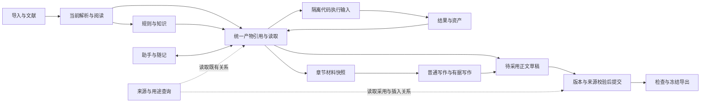

# 模块协同通信与数据流方案

日期：2026-11-03。实施对象：当前砚台论文工作台源码，在既有 31 类产物互通基础上增量修改。

## 现有结构与依赖

前端使用 React/Tiptap；所有业务操作经 `api/client.ts` 访问统一认证的 FastAPI API。SQLite 是唯一项目数据源，原件及不可变内容以哈希保存在对象目录。后台长任务由现有 `tasks` Worker 调度。该部署属于同一进程体系内的模块化单体，模块通信应通过应用服务函数和现有 HTTP/任务契约完成。

| 模块 | 主要实现与存储 | 输入 | 产出及下游 |
| --- | --- | --- | --- |
| 导入与文献 | parsers、reference_service、literature_connectors；files、bibliography | 原件、书目、链接 | 页面/原文、书目 → 阅读/检索/规则 |
| 阅读与解析 | content_view、reading_service、parsing_service、document_reading | 当前原文及解析版本 | 批注、译文、导读、问题阅读、解析候选 → 随记/知识/写作 |
| 知识与规则 | knowledge_*、rules | 有版本的原文、证据、规则决定 | Wiki、论断、规则包 → 两种写作/检查 |
| 助手与随记 | assistant_service、research_records | 文献、资产、产物、当前正文 | 消息、随记、改写候选 → 执行/写作 |
| 资产与执行 | asset_service、execution_service、controlled_execution | 画布、代码、原始文件 | 富文本资产、图片、原生表格、实际执行结果 → 正文/助手 |
| 产物流转 | product_service、product_sources、product_adapters、resource_refs | type/id/version | 转换到已有研究记录、资产、草稿、计划、修改待办 |
| 写作 | tasks、writing_agent.context/adoption、document_commands、documents | 规则、证据、原文、章节材料 | 待采用候选 → 不可变正文版本及依赖 |
| 检查与交付 | reviews、export_service、export_checks | 当前正文及其冻结依赖 | 检查意见、文件、交付快照 |
| 同步与恢复 | research_sync、knowledge_transfer、resource_registry | 现有记录/关系/对象 | 增量合并或隔离完整恢复 |

主要数据流：原件 → 当前解析 → 阅读/总结/规则/知识 → 随记或资产 → 章节材料/对话 → 代码执行或正文候选 → 人工采用 → 检查与导出。修改通过来源依赖传递复查状态。前端跨页传递资源身份，内容由后端重新读取。

## 本轮确认的断点

1. 执行服务只读取 `file_ids`，助手所选总结、随记、表格和分析结果无法真正成为代码输入。
2. 产物转换能力由前端和后端分散判断；缺少统一的输入/结果与版本校验边界。
3. 写作只检查原有材料的版本，不比较材料集合。写作期间新增、移走或取消材料时，旧候选仍可能被采用。
4. 写作材料面板查询最近 500 份随记后再过滤，项目积累很多记录时可能隐藏旧的有效材料。
5. 当前来源查询以向上跳转为主，没有统一展示某产物已流向哪些随记、资产、章节或插入待办。

## 通信与共享方案

不增加独立消息中间件、复制数据库或服务间直连。同步查询使用应用服务函数；前端使用现有 v2 HTTP；耗时执行仍使用任务队列。更新后发布既有 `paper-resource-changed` 通知，通知只负责刷新；版本与项目归属仍由后端权威检查。

统一资源引用继续使用 `{project_id,type,id,version}`，原件可附加 parse_id/locator。共享传输只传引用，禁止客户端提交虚构的来源正文。富文本保持现有结构化节点。各消费端自行声明支持的用途，执行前读取指定版本，结束后校验相同版本。

### 接口与调用关系

| 接口/服务 | 请求 | 响应或调用 |
| --- | --- | --- |
| `product_service.content/selection` | 有版本引用列表，remote 标志 | 真实文本/文档/图片及原件权限，原规则兼容 |
| `product_materials.snapshot` | project_id、section_id、remote | 材料集合指纹、明确来源、实际模型输入 |
| `product_materials.validate` | 保存的材料快照 | 比较集合及来源；新增/删除/移走/修改/权限变化返回 409/403 |
| `POST .../studio/execution`（v2 继续按注册表映射） | 原有 code/file_ids，新增可选 product_refs | 现有 task；Worker 把真实产物生成为 `products.json` 及必要原件/资产输入 |
| `POST /projects/{pid}/products/relations` | 一个 SourceRef，可选 limit | 直接上游与下游、关系类型、当前/失效状态、实际页面位置；结果有上限并报告截断 |
| 既有正文采用 | 候选保存的 resource_refs + section_materials | 在提交事务中重查材料集合，保留历史/锁定/未核验身份 |

执行输入使用固定安全文件名，每项包含类型、版本和未核验身份；原有 `file_ids` 名称和 `/input` 挂载约定不变。远端执行遵守原件和资产的外发设置，本地执行继续只在隔离引擎中运行。任务结果/图像记录全部输入来源及代码哈希。用户仍需点击执行，不自动运行模型代码。

关系查询读取现有 research_links、资产 metadata、dependencies、workspace_intents，限定当前项目和记录当前版本；不会把旧记录关系算作新版本的实际输入。它用于定位复用和复查，不把关系推断为证据支持。

## 兼容与验证要求

- 原 v1/v2、file_ids、任务观察器、数据库表结构和完整包格式继续使用；可选字段不影响旧调用。
- 普通写作、有据写作共享材料服务；原 product_service.section_inputs 保留兼容委托。
- 不重置用户数据，不迁移密钥，不修改运行中的用户论文。
- 验证实际产物进入执行输入、执行输出保留来源、远端权限拦截、执行中来源变更、写作期间材料集合变更拒绝采用、旧候选兼容、跨项目关系隔离、长项目材料检索，以及原互通流程回归和前端构建。
