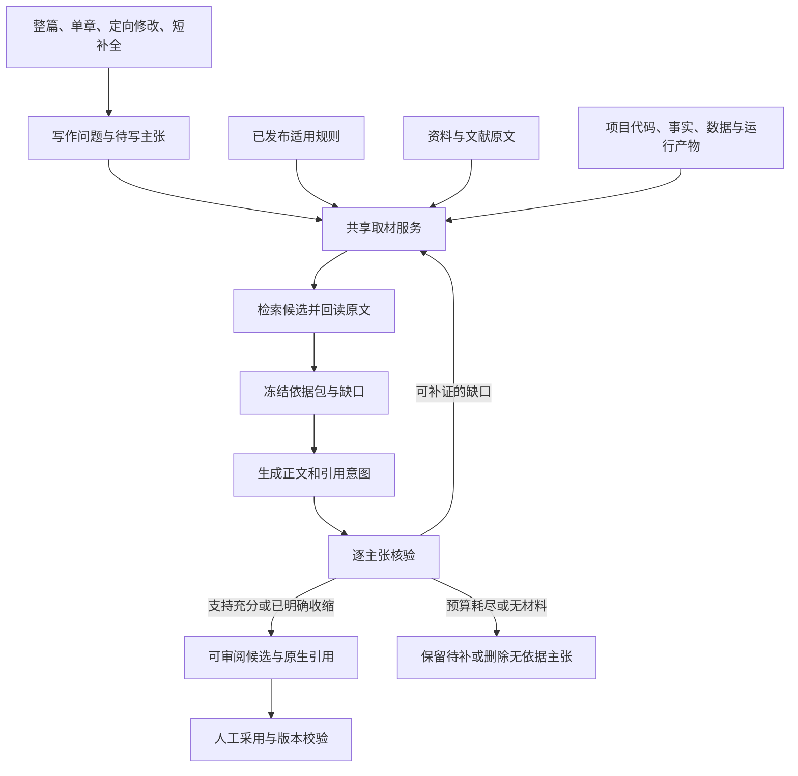

# 素材驱动AI写作闭环改造方案

日期：2026-11-03。适用对象：砚台论文工作台当前工作区。

本方案补充[核心写作能力深度优化方案](D:/桌面/论文/paper-workbench/docs/核心写作能力深度优化方案_2026-11-03.md)，专项解决资料、规则、文献和毕业项目数据如何在写作中被自动发现、实际读取、正确使用并生成可追溯引用。

本轮为源码静态审计和方案设计，仅新增此文档；未改业务代码、未读取用户真实论文或凭据、未调用收费模型。指标均为待基线验证的验收目标。

## 1. 结论：应贯通自动取材和补证闭环

用户感受到的素材与正文脱节有具体实现原因，但当前系统并非所有素材仅用于页面展示。源码已经具备写前自动取材、部分运行时工具调查、原生引用和来源版本机制。真正缺口是：入口不统一、发现的材料不一定实际读入、引用主要挂在段落末尾，以及缺证后没有自动补读和修复。

目标行为：用户提出章节或整篇写作任务后，AI围绕待写问题自动查询授权素材，读取必要原文，区分规则和事实，根据证据起草内容，在对应论断处插入引用；核验发现缺证、引用不支持或成果等级不符时，自动补读或局部修订。用户主要处理资料确实不存在、材料冲突和需要作者判断的少数事项。

“实时”采用可执行定义：每个写作单元开始及发现证据缺口时，按有效来源和权限检索、补读；单次生成使用冻结的依据包。不是每输出一个token都重新扫描素材库，也不在同一论断中悄悄混用多个来源版本。

## 2. 已核实的接入现状与断点

| 写作入口/能力 | 当前真实实现 | 改造重点 |
| --- | --- | --- |
| 普通单章与整篇 | [tasks.py:480](D:/桌面/论文/paper-workbench/backend/app/tasks.py:480)加载适用规则；489—495行准备项目证据及文献；594—599行加载章节材料；715行调用模型 | 已有写前取材，但正文生成没有检索工具循环，缺少核验后的定向补证 |
| 有据写作 | [coordinator.py:115](D:/桌面/论文/paper-workbench/backend/app/writing_agent/coordinator.py:115)调查阶段已有原生工具调用/JSON动作循环，默认6轮、24次工具上限 | 抽成共享取材服务，接到普通单章和整篇；不把整篇绑定到完整会话状态机 |
| 原文自动阅读 | [document_preparation.py:15](D:/桌面/论文/paper-workbench/backend/app/document_preparation.py:15)先查本章阅读记录；41行仅在完全没有记录时自动读新候选 | 旧记录空、失效或不相关时仍应按当前缺口增补，而不是因“曾经读过”停止取材 |
| 指导素材 | [guidance_preparation.py:14](D:/桌面/论文/paper-workbench/backend/app/guidance_preparation.py:14)优先读取既有指导阅读；29行仅无sessions时检索新范例 | 同样按有效性、当前写作问题和缺口判断是否补读 |
| 章节素材 | [section_materials.py:6](D:/桌面/论文/paper-workbench/backend/app/section_materials.py:6)只接当前章节use_for_writing=1的note | 保留手动固定材料，增加对授权项目素材的自动发现，不能把固定材料集合当全库检索 |
| 工具权限与上下文 | [tools.py:58](D:/桌面/论文/paper-workbench/backend/app/writing_agent/tools.py:58)在任何工具分发前都要求代码快照及代码外发许可；[context.py:9](D:/桌面/论文/paper-workbench/backend/app/writing_agent/context.py:9)也要求选择代码快照 | 文献、规范和笔记不应依赖代码仓库；按任务所需通道装配上下文并核验来源 |
| 项目代码 | [writing_live.py:96](D:/桌面/论文/paper-workbench/backend/app/writing_live.py:96)读取合同证据，必要时按路径/符号选择少量代码观察 | 改为问题驱动定位实现和调用关系；实测结果另查运行记录和原始数据 |
| 自动引用 | [tasks.py:786](D:/桌面/论文/paper-workbench/backend/app/tasks.py:786)把段落关联文献建成段尾引用；809—814行无已读来源时跳过引用并留缺口 | 增加原子主张绑定；跳过引用后不能让正文主张直接留作有据结论，应补读、收缩或删减 |
| 采用追溯 | [documents.py:137](D:/桌面/论文/paper-workbench/backend/app/documents.py:137)已保存书目、原文定位和阅读版本；[adoption.py:67](D:/桌面/论文/paper-workbench/backend/app/writing_agent/adoption.py:67)统一事务提交 | 扩展现有引用及依赖，避免重建正文提交系统 |
| 短补全 | [assistant_service.py:226](D:/桌面/论文/paper-workbench/backend/app/assistant_service.py:226)核验版本和锁定，234行主要发送prefix/suffix | 补轻量规则、章节任务及绑定证据；涉及新事实或引文时进入快速检索 |

统一产物目录和在线/离线查询也不等同于写作语义检索：product_service当前目录筛选主要是子串匹配，workspace_query复用查询投影；可用来发现资源身份，不能直接代替原文读取和支持核验。

## 3. 目标架构：共享取材服务加写作补证循环

沿用FastAPI、现有任务Worker、SQLite、对象存储、resource_refs和知识检索，不新增独立向量数据库或消息中间件作为前提。



建议内部增加WritingRetrievalBroker和EvidenceGapResolver，分别负责跨通道取材及缺口补救；抽取现有investigate循环、账本、工具观察和恢复机制。正文编排仍由paper_writing/tasks承担，采用仍由adoption/documents承担。

复用还需处理现有外键：tool_observations绑定writing_steps，document_analyses绑定writing_candidates或正文revision。最小接法是为普通单章及整篇中的章节登记轻量writing_session、writing_step和candidate记录，复用同一候选文档blob/hash，不提前写正文，也不启动coordinator全部阶段。无代码通道时target_snapshot_id可为空，共享取材上下文不能沿用必须有代码快照的前置条件。所有模型调用保留同一generation_runs记录，由顶层任务和会话共同引用，按run身份计量，避免漏计或重复记费。

工具调用兼容原生function calling与现有JSON动作模式。能力选择以当前配置和实际协议能力为准，不能因为服务标记为兼容接口就假定所有工具特性可用。DeepSeek官方function calling说明也采用“模型请求工具→应用执行→将结果回填→模型继续”的过程，应用仍需实现真实数据访问及控制，见末尾方法依据。

## 4. 四类素材按用途进入写作

| 素材通道 | 获取方式 | 如何作用于论文 | 不能替代的内容 |
| --- | --- | --- | --- |
| 规则约束 | rules.applicable获取已发布且适用的完整强制规则；按需回读出处解释条件 | 控制章节结构、用语、引用和格式；可程序执行的格式继续由排版/导出处理 | 学校规范不是研究结果证据；不能被TopK排序淘汰 |
| 资料与文献 | 复用knowledge_service、knowledge_router、document_reading的混合检索和范围读取 | 为背景、综述、方法选择、比较及局限提供原文依据；生成外部文献引用 | 检索预览、摘要或同一文件内任意片段不能证明具体主张 |
| 毕业项目代码与设计 | 在明确授权的当前代码快照中查路径、符号、调用及接口，读取实际行范围 | 描述项目结构、实现和设计取舍，保留内部代码证据定位 | 代码存在或测试定义存在，不能证明测试通过、部署完成或性能提升 |
| 项目事实、数据与运行结果 | 检索已登记事实、原始表格、图表、执行/导入记录及版本；读取具体数据范围 | 形成结果与讨论，按实际指标、对象、单位、条件和统计口径引用结果 | 普通笔记、未核查事实或名为“结果”的文件不能自动升级成实测结论 |

写作范例、Wiki、图谱、随记和资料摘要作为guidance或derived_context通道，协助检索导航、组织表达和作者观点整理；若需支撑事实，应沿来源链回读原件。用户明确固定的材料优先保留，明确排除或不可外发的材料不进入远端模型上下文。

规则是约束，文献是外部依据，项目数据是本项目依据；三者分别记录。不是每种内部依据都要生成公开参考文献：代码行号和运行记录通常作为内部追溯，外部文献生成书目引用，项目数据在正文中按实际表图或结果说明引用。

## 5. 一次写作任务的自动取材过程

### 5.1 写前规划需要什么

从研究问题、章节任务书、已有正文及本次指令生成取材计划。每项包含待写主张、需要的支持类型、查询词、材料通道、适用条件和缺口优先级。

例如写“系统实现与测试”时：系统模块结构查代码和设计资料；相关方法比较查文献；响应时间查真实测试记录及原始统计；学校对图题的要求读适用规则。不能用一次宽泛检索代替这些不同证据需求。

系统自动选择查询通道，用户不必逐条挑文献。现有固定证据/章节材料作为必须考虑的输入，自动检索为其补足缺口；若固定材料不支持当前主张，也需如实报告。

### 5.2 检索候选并实际读取

检索层复用现有BM25、向量召回、RRF和Cross-Encoder。按主张分别查询，合并重复来源，并考虑对象、方法、时间、实验条件及来源多样性。项目代码继续使用现有符号/路径能力，再补需要的调用关系。

搜索结果只返回候选身份、定位、相关性和下一步阅读建议；读取器获取原文必要范围，连同条件、否定、表注、方法和局限一并读取。长文按结构定位，不要求把整篇材料全部塞进每次请求，也不能把截断片段冒充完整论据。

修复document_preparation与guidance_preparation的历史记录分支：依据“记录是否有效、是否已读、是否相关、是否覆盖本次问题”决定复用；仍有缺口时继续读新命中候选。不得只根据存在记录就停止。

对新导入但索引未完成的素材，先检测解析可用性；必要时使用原文关键词回退并报告覆盖范围，或进入解析/索引准备任务。失败和未覆盖要可见，不能用一个空结果表示“素材库里没有”。

### 5.3 构造冻结依据包

建议EvidenceBundle分为四组：constraints、primary_evidence、guidance、derived_context，并附unresolved_claims、source_manifest和retrieval_trace。

每条可用依据至少包含：

| 字段组 | 内容 |
| --- | --- |
| 身份与版本 | 复用source_ref的project_id/type/id/version；evidence_id、reference_id按实际存在情况附加 |
| 实际原文 | exact_text、locator、read_scope；文件hash、parse_id、unit_hash或代码快照/行范围 |
| 用途与等级 | material_use、evidence_kind、事实核查状态、允许支持的结论类型 |
| 条件与缺口 | 适用对象、方法、时间、单位、限制、冲突及缺失主题 |
| 使用关系 | 对应claim_id、support_status及其判定方法；默认not_checked，不把相关性当支持 |
| 追溯与运行 | 权限戳、查询/读取记录、耗时、实际输入token估算与来源链 |

对规则使用确定性适用性计算，完整强制约束不参与相似度TopK淘汰。强制规则无法提供或关键原文因容量不足未读时，应保留缺口或阻止相应任务，不能静默省略。

### 5.4 依据驱动正文和引用

模型只使用本次实际读取并进入依据包的材料ID。输出正文时，同时输出每项主张使用的依据和引用意图。多个文献用于综合比较时，应说明各自支持的部分，而不是把所有文献统一挂到整段末尾。

服务端复用sentences分析生成句子/主张身份，在规范化正文中确定范围。新增claim_spans与citation_intents作为现有段落契约的兼容扩展，不再另造一套草稿格式。

citation_intents关联主张ID、实际reference_id/evidence_id、原文片段、引用方式和支持范围。模型不能自己编造作者、年份、DOI或来源ID。服务端核对ID归属、实际读取、原文摘录、版本和权限后，将引用节点插到对应句末或明确的主张范围末尾。

定位使用后端Unicode码点范围及text_hash，前端需要转换时复用一致的偏移规则；引用节点插入或润写之后重新建立范围映射，不能沿用已经偏移的旧索引。采用后映射到正式nodeId、sentence_spans和claim_evidence_links。

复用documents现有书目快照、citations、citation_knowledge_links、citation_reading_links、定位和导出编号，并关联既有claim_evidence_links。原件已有可确定书目信息但未登记时，可在冻结前形成有出处的书目候选；未知元数据保留缺口。最终编号由程序统一计算。

### 5.5 缺证后自动补读与局部修复

复用verification逐句提取主张和证据关系的能力，对未采用候选检查支持性、条件和结论强度。将现有整段support_check抽成共享核验器，接到普通章节与整篇候选。

| 核验结果 | 自动动作 |
| --- | --- |
| 已有足够原文，但引用遗漏 | 补建精确引用，复查主张与来源对应 |
| 有相关候选但未实际读原文 | 按问题补读，再核验；不能直接挂引用 |
| 原文仅部分支持 | 收缩结论、恢复条件或拆分主张，保留真实支持范围 |
| 出现冲突 | 读取双方原文及条件，在正文中保留争议或限定；无法消解则进入待审事项 |
| 没有材料或仍不支持 | 删除无依据断言、改成明确的研究计划/待验证问题，或保留待补；不能编造引用 |
| 超预算、工具失败或来源失效 | 保存已完成单元和明确缺口，停止新增收费动作，不标为检查通过 |

补证结束后仅重写受影响句段，再检查原问题、引用支持和数值/条件保真。初期最多2轮补证修订，并按章/任务共享总工具额度和预算；可复用现有6轮调查、24次工具上限作为初期上界，不能为每段重新发满额配额。

## 6. 工具、权限和版本的具体改造

### 6.1 工具边界

复用现有工具：文献搜索与范围阅读、代码搜索与读取、证据读取、图谱/Wiki导航、正文读取。补充两个共享入口search_writing_materials和read_writing_materials，由后端按用途分发；必要时提供规则解释与项目实测记录的专用读取接口。

项目ID和权限来自任务身份，不接受模型任意切换项目。代码工具才校验snapshot/repository；文献和材料检查自己的来源权限；运行数据检查对应记录及证据等级。拆开tools.py的统一代码门槛，但保留各通道实际权限守卫和缓存命中复查。

工具缓存的权限epoch也需按通道构建，不能让文献缓存继续依赖repository.scope_revision，或仅删除快照检查后遗留未定义的repository变量。context装配、预检与工具分发应共同采用所需通道判断，纯文献任务不强制拥有代码基线。

默认只读取已有授权库与保存的执行产物。模型要求读实测数据不等于授权执行代码或测试；当前库缺少真实运行记录时记为缺口，复用系统既有执行功能另行取得真实产物后再纳入写作。

### 6.2 实时检索与稳定版本并存

任务固定正文基础版本、适用规则包和代码研究基线；每个论证单元取材后冻结实际来源版本、读取范围和依据包hash。动态补读取自任务允许的来源范围。发送前、读取返回后和采用事务内重验必要版本与权限。

当前writing_live使用全局live_input_versions，任意资料/书目/产物变化都可能让候选失效。不能简单在不一致时把manifest改成最新值继续写，否则可能吞掉并发变更。

分两步演进：首期保留现有保守冲突检查，动态取材主要读取既有素材，阅读阶段完成后再冻结并起草；新增资料或实质修改触发明确重建。随后将纯检索/阅读观察与实质来源更新分开计时，按实际依赖定向失效：新增无关材料不使整篇重做，撤回权限、修改已用来源或规则仍立即阻断相关发送/采用。内部新增来源在单元边界纳入，影响旧结论时重查对应单元。

“纯观察”仅指不改变内容、阅读范围或判断的访问日志。新增原文范围、record_document_findings及人工复核会改变reading_version，不能作为无害日志豁免；补读完成后创建新版EvidenceBundle，对受影响主张及引用重核，旧依据包保留，不原地覆盖版本。

原文读取使用短事务和不可变对象，不跨整个外部模型请求保持数据库事务。检索/观察记录可追加，不能自动把模型阅读结论标为人工确认。

### 6.3 项目成果适用判定

复用evidence.py已有的code_observation、test_definition、test_run、deployment、data_result及author_statement分类，但不能只看kind。登记事实或产物成为data_result，并不自动证明已经实测。

生成实测断言前，按证据类型检查事实status、verification、真实执行或导入记录、原始输入输出、数据版本、指标和统计口径。平台执行结果核对run_id，涉及代码实验时核对代码版本；真实导入的实验或调查数据可使用可核验的导入记录、仪器/调查原始记录及数据hash，不统一强求平台run_id。条件不足时按实际状态描述。关键数字按“指标—对象—数值—单位—条件—时间”对照，不让一个正确数字掩盖其他错误。

表格/数据依据增加实际文件版本与sheet/行列/单元格范围，图表绑定来源数据与生成记录，截图注明证明范围。所有新增locator都应沿用resource_refs和原始产物身份，不建立第二套来源编号体系。

## 7. 接入模块与接口建议

| 模块 | 实施内容 |
| --- | --- |
| tasks.py、paper_writing.py | 生成前调用共享取材，写作单元后核验，缺证进入受控补证；整篇复用同一账本和计划 |
| writing_agent/coordinator.py、context.py、tools.py、provider_adapter.py | 抽取既有调查循环及恢复；上下文和工具均拆分代码门槛，按通道授权及缓存，保留协议兼容及结果未知处理 |
| document_preparation.py、guidance_preparation.py | 按有效性和缺口补读，修复已有记录阻断新材料的条件分支 |
| knowledge_service/router、document_reading、retrieval | 复用检索和阅读能力，增加命题级查询规划、主题覆盖、解析就绪诊断与读取轨迹 |
| section_materials、product_service | 固定素材保持优先；补充授权笔记、资产、事实和运行产物的统一发现与按版本读取 |
| schemas、writing_agent/models、sentences、verification | 归一段落契约，增加主张/引用意图及候选级支持检查 |
| documents、adoption、impact、provenance | 复用原生引用、采用事务和来源版本；增加精确主张关系、依据包依赖与定向失效 |
| assistant_service.completion | 补轻量章节任务、适用规则及已绑定证据；新事实走快速检索，无据不生成强事实断言 |
| PaperWriting、AgentWriting、编辑器工具 | 展示查询→已读→实际使用→未决缺口，支持原文直达与局部修订差异 |

新增接口先作为内部应用服务，再经现有v2注册表暴露，避免前后端直接访问多种库。示意契约：

```text
POST /projects/{pid}/writing-retrieval/prepare
输入：section_id、operation、question、claim_requests、channels、
      pinned_refs、base_revision、snapshot_id?、工具/时间/token/费用上限
输出：现有task身份；依据包、来源版本、取材轨迹和缺口由任务结果返回

GET /projects/{pid}/writing-retrieval/{task_id}
输出：当前阶段、EvidenceBundle、实际读取/使用范围、版本和未决事项

POST /projects/{pid}/paper-writing/{task_id}/revise
扩展已有修订接口：finding_ids、补证策略、允许修订范围和基础候选hash
```

耗时取材和核验走现有任务队列，不让HTTP请求长时间占用。缓存键包含用途、主张/查询、来源/解析/模型/规则版本和实际读取范围；命中后仍验证权限。旧候选兼容读取，缺少新映射时显示尚未执行该项检查。

## 8. 用户侧体验

用户点击“生成本章”后，系统自动完成取材和引用准备，不要求先跳转到单独页面选齐素材。

生成过程中展示真实阶段，例如：正在按章节问题查询资料、已读取相关文献范围、已核对项目实现、测试结论仍缺运行记录、正在补引和修订。候选中点击引用可看到实际支持的主张、原文定位和来源版本。

取材报告分别展示“检索命中、实际阅读、实际使用、支持核验、尚未覆盖”，不能用命中数量冒充证据使用率。保留作者固定或排除材料的能力，但默认由系统完成相关素材发现。

整篇、单章和补全共享依据政策，深度不同：普通写作执行完整闭环，短补全优先复用当前依据包；若需要新事实才触发轻量取材。润写只核对和保护已有引用，不因自动检索擅自改变作者结论，需要补充事实时转入明确的局部修订模式。

## 9. 验收指标与验证方法

先建立固定基线，再在相同材料、任务、目标篇幅和最终质量门槛下比较。开发集和保留验收集按论文/材料来源隔离，近似段落不跨集；保留集由两名评审盲评并裁决分歧。

| 指标 | 定义 | 初期目标 |
| --- | --- | --- |
| 强制规则装配 | 对成功进入生成的任务，适用强制规则在实际上下文和manifest中完整存在 | 100%；未能提供时明确阻断或不完整 |
| 引用可追溯率 | 自动引用可定位到实际已读原文、来源身份和冻结版本 | 100%；未知ID、越项目引用测试全部拒绝 |
| 引用支持精确率 | 人工确认支持所挂主张的自动引用/抽样自动引用；部分支持、夸大、未知不计通过 | ≥95%，外部文献和本项目成果分层统计 |
| 应引主张覆盖率 | 需要依据且库内有充分材料的主张中，准确建立依据关系的比例 | ≥95%；另报所有需依据主张的缺口率，防止隐藏无材料情况 |
| 自动补证成功率 | 可由现有授权库解决的缺口中，无人工找来源即可完成原文读取、核验与修复的比例 | ≥85%；材料不存在、权限受限、预算不足分别报告 |
| 成果与数值保真 | 计划/代码定义不能升级实测结果；关键指标、单位、对象、条件对应正确 | 固定关键反例集零错误放行；实际样本报告错误率和不确定性 |
| 人工修正负担 | 从候选到相同验收质量所需的找来源/补引/修引次数及实际人工用时 | 相对基线下降≥40%，两项分别测量 |
| 效率与费用 | 检索、读取、生成、补证及失败重试的总耗时/费用；按合格千字归一 | 先建立基线；缓存命中本地取材P95争取下降≥30%，不能靠少查证换速度 |
| 边界可靠性 | 工具次数、总预算、权限撤回、来源更新和远端结果未知 | 测试中不产生越权发送、错误采用、漏记费用或伪装通过 |

专门覆盖以下真实断点：已有空/过期阅读但新文献可用；没有代码仓库仍能查文献；相关片段不支持结论；一个段落有多个主张；无依据引用被剥离后正文仍有强断言；笔记与实测冲突；data_result实为计划；引用插入和润写后范围偏移；新来源纳入时出现全局版本冲突；补证超预算及恢复不重复计费。

离线测试验证取材和引用契约、版本及权限行为；真实模型小样本验证是否主动补读并正确使用；人工盲评和操作用时验证是否减少后期工作量。三类证据分别报告，不用模拟测试代替真实写作效果。

## 10. 实施批次

| 批次 | 交付范围 | 完成标准 |
| --- | --- | --- |
| P0：先修现有漏口 | 建立基线；修复阅读记录分支；文献工具取消代码前置依赖；普通单章接共享取材；记录实际来源轨迹 | 不手选文献也能读取库内相关原文；既有空阅读不阻断新取材；规则和来源权限回归通过 |
| P1：形成写作闭环 | 整篇逐单元取材与补证；候选原子主张核验；精确引用意图；项目成果等级判定；局部修订 | 无依据引用不再只被跳过，能够补读/收缩/留缺口；引用和主张映射可追溯 |
| P2：覆盖全部入口并优化 | 短补全和定向修改共用依据包；笔记/资产/结果发现；按依赖缓存和定向失效；前端解释与规模验证 | 在相同质量下明显减少人工补引；预算、恢复、权限和版本不退化 |

首期聚焦当前库内素材，不把自动全网找文献、自动运行整个毕业项目、全库重建或更换模型作为前置条件。每批以独立开关灰度，保留原候选、原文和历史来源链。所有写入继续走既有事务和幂等机制。

## 11. 方法依据

1. DeepSeek官方《Function Calling》：模型提出工具请求，应用执行并回填结果，再继续生成；支持工具协议并不等于应用已经接通素材访问。2026-11-03检索，用于兼容性和调用循环设计，不预设用户中转站具备相同能力。
2. Gao等，《Enabling Large Language Models to Generate Text with Citations》，EMNLP 2023，ACL Anthology编号2023.emnlp-main.398：区分内容、引用正确性和引用完整性。用于设计支持率和覆盖率，不能把论文中的实验效果直接视为本项目收益。
