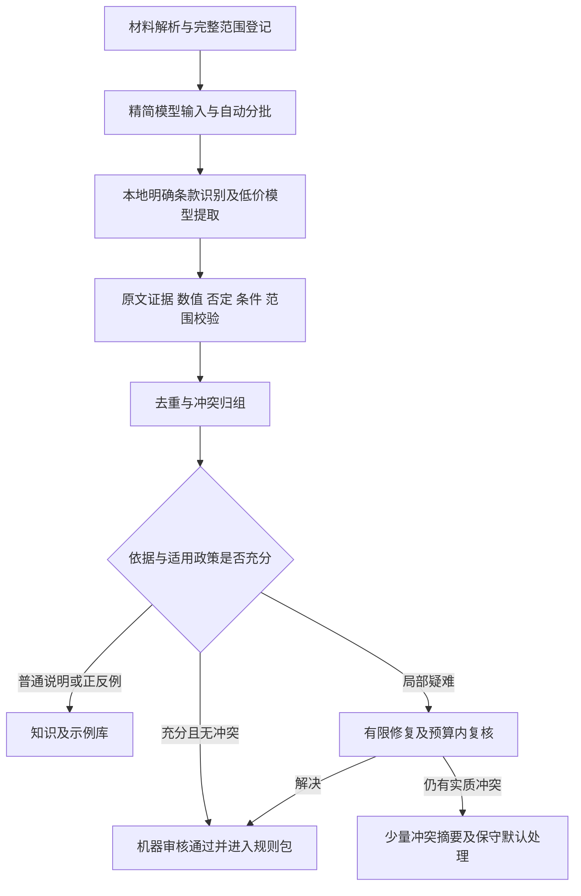

**规则整理可靠性与成本治理方案（基于当前代码和真实任务记录）**

审计日期：2026-10-22，时区 Asia/Shanghai。对象：论文工作台 0.3.5。本文是根因审计和实施方案，业务代码改造尚未实施。本次读取本地数据库时使用 SQLite 只读连接，没有发起新的付费模型调用，没有调整预算或候选状态。所有金额来自本地保存的 USD 账单记录及预留记录，未重新查询远端账单。

要交付的结果是：用户选择材料、设定总费用上限后，系统自动完成整批材料的规则识别、证据校验、分类、归并和适用范围整理，产出可使用且可回滚的规则包。材料可以有上千个片段，不要求用户维护片段偏移量，也不要求用户逐条审核上千条候选。真实歧义按冲突组集中展示，其他材料继续处理。

**1. 已查清的失败原因及证据**

当前激活且可整理的规则资料有 24 份、1,068 个来源片段，正文合计 236,641 字符，定位信息合计 9,333,933 字符。定位信息中的 OCR 识别详情正在被当作模型输入发送。

| 发现 | 本地证据 | 影响 |
| --- | --- | --- |
| 批次限制没有覆盖实际请求 | `rule_ai.batches()` 仅限制正文至约 3,500 字符、最多 4 个片段；`extract_ai()` 随后序列化完整 `locator` | 正文虽短，请求仍可超过上下文检查阈值 |
| OCR 定位信息包含完整识别结果 | `local_ocr.py` 将 `recognition: [result]` 写入首个 OCR 片段的 locator | 识别块、坐标等本地溯源资料大量重复进入模型上下文 |
| 截图对应任务连续两次卡在第 3 批 | 22:00:05 和 22:00:52 创建的 DeepSeek 任务均处理 8/84 片段后报“上下文超过本次接口快照的预算” | 原样续接会再次撞上相同输入 |
| 部分 DeepSeek 调用没有输出规则正文 | 两条截断记录的 output_tokens 和 reasoning_tokens 均为 8,192，应用快照记录 thinking_enabled=false | 应用发送关闭参数不足以证明链路实际关闭了推理；不能仅靠加大输出上限解决 |
| 模型切换会扩散到后续批次 | `prefer_gpt` 在一批无效后被设为 true；续接时也会读取历史 GPT 路由并延续 | 一批异常可导致后续材料全部使用昂贵路线 |
| 预算显示混合了账单和预留 | 截图对应 22:01:01 的任务在 5/21 批、20/84 片段时预算阻塞 | 界面的 19.09 不能等同于已实际消费 19.09 |
| 自动提取后仍有逐条确认门槛 | AI 新条款一律写入 candidate；发布仅接受 confirmed 的强制要求和建议 | 即使提取完成，也没有解决大量规则自动整理的问题 |

截图对应文件为《文献检索与利用C-第二章 文献检索基础与检索策略2.pptx》。按当时选中的 84 个来源片段、相同顺序和现有分批算法进行本地序列化测量，结果如下。测量未调用模型；“精简后”仅去掉无需发给模型的定位详情，正文逐字保留。

| 批次 | 正文字符 | 当前请求正文字符 | 精简定位后的请求正文字符 |
| --- | ---: | ---: | ---: |
| 第 2 批 | 918 | 45,060 | 1,471 |
| 第 3 批 | 1,026 | 81,466 | 1,632 |
| 第 4 批 | 2,126 | 138,342 | 2,806 |
| 全部 21 批合计 | 23,624 | 1,087,091 | 35,363 |

当时 DeepSeek 调用快照的 context_limit 为 32,000，应用用“上下文字符数不超过 context_limit × 2”检查请求。第三批仅请求正文已超过 64,000 字符，因此在本地拦截。该报错并非远端声称 DeepSeek 只能读取几条规则。当前保存的主配置已经是其他上下文上限，不能把当前配置倒推为失败时的配置。

对该文件，去除 OCR 定位冗余可使请求正文字符量减少约 96.75%；第三、第四批分别减少约 98%。这只是输入字符量测量，不能直接宣称总费用同步减少 96.75%，因为输出、推理、计价方式和缓存仍会影响实际费用。

预算占用的准确分解为：

| 占用来源 | 本地记录金额（USD） | 解释 |
| --- | ---: | --- |
| 已保存账单归并金额 | 1.088917 | DeepSeek 0.803335，加 GPT 0.285582；是已保存核对快照，不覆盖全部近期调用 |
| 4 次已完成但未归并对账的调用 | 8.000000 | 每次固定预留 2，实际单次费用未知 |
| 5 次远端结果未知的历史调用 | 10.000000 | 4 次旧 Gemini、1 次 GPT，每次预留 2 |
| 合计占用 | 19.088917 | 界面四舍五入为 19.09 |
| 项目总预算 | 20.000000 | 下一次仍要求预留 2，因此拒绝发送 |

结论：实际收费确有不确定性，但当前中止主要同时涉及输入膨胀、路由扩散和固定预留。旧未知费用确实不能凭空清零；应由系统继续追查归属，并将“已核对”“待对账”“远端结果未知”分开显示。

当前有 676 条规则，其中 675 条 candidate、1 条 confirmed；候选中 425 条 modality=pending。不能通过把这些记录一键批量改成“人工确认”解决问题，需要增加真正的自动判定流程和独立的机器审核状态。

**2. 先修复模型输入，建立统一的发送契约**

增加统一的来源发送转换函数，供规则整理及其他发送来源的任务复用。模型需要的字段限制为：source_id、source_version、part_id、正文、页码或幻灯片编号、必要的标题路径、片段在原文中的字符范围。完整 OCR 结果、识别坐标、图片对象、原始识别 JSON、内部路径和历史诊断留在本地，使用 ID 关联。

采用字段白名单生成发送对象，不能先序列化整个来源对象再删除几个已知大字段。白名单以后的新增诊断字段也不会自动进入请求。

批次规划必须基于最终序列化后的 system、user、协议开销、必要邻接上下文及输出预留。正文条数只能作为辅助限制。优先使用与实际模型匹配的 tokenizer 或服务商提供的计数能力；模型别名无可靠 tokenizer 时，使用经过样本校准的保守估算，并明确其估算性质，不再使用“字符数直接乘二”作为通用准确判断。

超限时，系统先缩减不参与本批判断的上下文，再沿段落、列表、表格行等边界自动拆分。单个长段落才按字符窗口兜底，保留适量邻接上下文、稳定范围和去重标识，避免拆掉否定词、条件和表格表头。正文不因省费用被截断丢弃。

模型返回依据须绑定到本次实际发送的片段范围。当前校验能在完整来源 text 中查找 quote，新流程还应防止模型引用此次未发送的部分。只允许明确的空白排版归一化，不用近似匹配放行被改动的数字和否定词。

**3. 把“整份材料任务”改为持久化工作队列**

一个用户任务覆盖选定材料的完整范围，服务端自动规划窗口、推进下一批并保存进度。现有“最多 120 个片段”“起始来源片段”可以保留为高级诊断选项，普通使用不再依赖它们。

建议增加三个独立实体：

| 实体 | 核心职责 |
| --- | --- |
| rule_jobs | 文件版本、选定范围、模型政策、总预算、阶段进度、完成度和最终规则包 |
| rule_work_items | 稳定来源范围、内容指纹、处理状态、重试次数、下次尝试时间、结果引用 |
| rule_extraction_results / rule_decisions | 结构化提取、证据、分类、自动判定理由、版本、人工覆盖与撤回记录 |

工作项状态至少区分 queued、running、completed_with_rules、completed_empty、retry_wait、unresolved_remote、needs_resolution、cancelled。必须区分“已检查且没有规则”和“没有成功检查”，防止把失败当成空结果。

持久化幂等键应覆盖项目、来源内容和版本、片段范围、相关上下文、提取/校验版本、必要的来源权威政策。重用前再次检查当前项目归属和外发权限。不能只依赖最多追溯 30 层的 resume_task_id 链；批次大小调整后，也应能复用相同来源范围的已验证结果。

工作项完成记录、通过校验的条款和进度必须在同一事务内提交。一个批次有部分条款无效时，已完整返回且独立通过验证的条款可保留；无效部分进入修复队列。对于截断 JSON，只保存已完整解析、字段齐全且证据已校验的独立对象，其余保持未完成，不能拼造缺失字段或引用。

网络异常按执行状态处理：未发送失败可以有限重试；明确限流可遵循 retry-after 并做有上限的退避；已提交且是否执行未知的工作项先查询 request_id、远端任务和账单。服务商支持的幂等保证才可作为重发依据，不能假设随意添加 Idempotency-Key 就能避免收费。

结果未知的项可以暂时隔离，让无关联材料在剩余预算内继续执行；不能自动跨供应商重发同一项。若远端无法查结果，则维持未决状态，或按用户预先设定的有限重复费用政策重试。重试预算耗尽后停止这一项，而不是无限增加收费或卡死整份材料。

**4. 使用便宜模型完成主流程，昂贵模型只解决局部疑难**

建议默认顺序：本地结构化处理 → 通过兼容检测的低价模型提取 → 本地证据和结构校验 → 低价模型修复少数失败条款 → 预算允许时将疑难片段交给 GPT。

首先给每个实际“服务商地址 + 模型 ID + 协议”建立能力记录。以小型真实业务请求验证：能否稳定得到最终文本、JSON 约束是否生效、输出上限是否按预期工作、是否支持 SSE 和用量返回、关闭或降低推理后能否得到可用正文。记录 reasoning_tokens、可见正文长度、finish_reason、延迟和实际账单。

现有记录只能证明：应用快照中写了 thinking_enabled=false，服务商仍报告 8,192 个推理 token。不能仅凭这些记录断言具体是模型、别名映射还是中转站忽略了哪个参数。应按实际链路做兼容探测，不照搬其他接口或官方页面的配置认定该中转站兼容。

GPT 路由必须按工作项决定，去掉“一批切 GPT，后面都保持 GPT”的粘滞逻辑，续接也不继承历史昂贵路线。GPT 只接收失败条款和必要原文上下文；修复完成后，下一个普通工作项重新使用低价路线。

模型政策同时限制：GPT 是否允许、GPT 子预算、单项最大尝试次数、整任务最大额外修复费用、单条可用结果的成本。当低价路线连续出现推理耗尽等相同错误时熔断该路线，避免拿所有剩余片段重复验证同一失败配置。熔断后可换已验证的低价路线或使用本地可确定的结果，未解决内容明确列账。

初始并发建议从 1 开始，确认服务商限制和实际稳定性后再提高到 2。并发控制、限流退避与预算占用要共用任务调度器，不依赖用户反复点击续接。

**5. 预算使用逐请求账本和动态预留**

将“单次最大允许费用”和“本次预计占用”拆成两个字段。现在 max_request_cost 同时承担两种职责，导致极短调用也一律占用 2。

价格已验证、币种一致且收费项目明确时，可按如下方式计算预留：

```text
本次保守费用上界 =
    输入 token 上界 × 有效输入费率
  + 输出 token 硬上限 × 有效输出费率
  + 已知的其他收费项

允许发送条件 =
    已核对费用 + 待核对费用的保守占用 + 未决调用占用
    + 所有正在执行调用的占用 + 本次预留
    <= 用户总预算
```

费率单位统一换算；使用实际中转站费率，明确币种、缓存 token、推理计费和价格生效时间。推理 token 若已包含在 completion_tokens 中，不能重复相加。原子事务完成预算检查和占位，避免并发请求同时通过而透支。

用量齐全时先形成标注清楚的估算费用，对账取得可归属的账单后更新为核对费用并释放差额。估算不能伪装成账单。若第三方价格、收费规则或输出限制无法验证，就不能声称程序有可证明的远端费用硬上限；保留明确的未知费用占用或暂停相关外发请求，继续执行无需付费的部分。

新请求优先按 request_id 或远端流水逐笔对账；有可信时间窗口和稳定匹配证据时，再采用区间核对。当前整把 key 的累计模型请求必须完全匹配的方式保留为兜底，不能是唯一途径。对账操作自动重试、有退避，并向界面展示具体失败原因，例如“远端少 1 条流水”或“币种缺失”。

历史迁移要区分三个动作：核对并更新真实费用；把无法归属的历史未知调用登记为未决负债；在预算内继续新任务。仅把旧调用移到新预算类别，不会减少总风险占用，不能通过换任务或换项目假装腾出了真实预算。

GPT 子预算可先采用总预算的 10%—20% 作为可配置起点；这是产品策略建议，不是模型费率或当前已实施设置。最终比例要由材料抽样和成功率测量调整。没有有效费率前，不给出“千条规则只需多少钱”的承诺。

**6. 自动整理必须包含自动判定和可发布状态**

把以下维度分开记录：规则性质（强制、建议、正例、反例、知识说明、无法判断）；适用范围；条件；来源权威性；证据是否完整；机器验证结果；人工覆盖记录。模型自报“置信度高”不能单独决定启用。

建议流程如下：



自动审核由系统完成以下检查：

- 结构和来源：字段完整，来源属于当前材料，依据逐字存在于已发送范围，原文版本未失效。
- 忠实性：数字、上下限、百分比、单位、否定词、例外条件和章节范围不得与原文冲突；复杂语义需要模型或独立复核，不能声称正则就能证明全部语义正确。
- 条款性质：课件里的研究案例、检索知识、评分等级介绍和错误示范不能直接变成当前论文的硬约束；范例中的研究事实也不能成为用户事实。
- 权威和适用：材料被设为 rules 仅代表它是待分析来源，不能据此把所有内容认定为学校正式要求；出现“必须”也不自动证明该要求适用于当前论文。
- 去重：先按条款类型、适用范围、结构化键、数值和条件分组，再做语义归并；保留所有来源。不能因为语义相似就合并“至少 20 篇”和“至少 30 篇”，也不能对上千条规则两两进行付费比较。
- 冲突：上下限不同但区间相交的要求可合并为共同可满足的范围；适用章节、论文类型或语言不相同时不能误报冲突。真正不相容的要求进入同一冲突组。

来源优先级建立在可追溯的来源政策上。例如，已明确适用的学院模板可高于普通课程建议；但文件修改时间较新不代表它必然替代旧要求。只有确认版本替代关系、适用范围和权威层级时才自动覆盖。证据不足时先归入建议或待解决项，不冒充确定的硬约束。

新增 `machine_verified` 等独立审核状态，或建立独立 decision 表；保留决策算法版本、证据、处理理由和撤回入口。对写入规则包的机器审核结果使用明确标记，不设置为 human_confirmed。发布诊断、冲突检测、重复检测、写作取规则和导出都必须采用同一状态解释，不能只改前端标签。

自动启用优先覆盖有明确证据、性质和适用范围的条款。低置信度不等于要立刻交给用户逐条处理：先自动修复、归组和复核；剩余非关键内容可作为建议保留。影响硬性要求的真实未决问题显示为少量决策卡，例如“两个来源给出不同参考文献下限”，一次决定适用于整组。

未解决问题只影响相关规则或章节，不应阻止其他来源的整理。但发布时必须显示剩余未决硬性要求，不能把“已有可用规则包”宣称为“所有约束已完整确定”。OCR 质量不够时也须保留明确缺口，不要给出虚假的完整覆盖率。

**7. 正确处理空结果和知识型课件**

《文献检索基础与检索策略》里的部分段落确实可能没有论文规范，返回空列表可以是正确结果。为防止空结果掩盖漏提，每个来源片段都要有处理结论：找到要求、示例、知识说明、非规则内容或无法判断，并保留最小依据和版本。

低价模型初筛应覆盖全部来源，不能只把包含几个关键词的行交给模型、其余默认无规则。明确的目录、页眉页脚等可以按可靠结构规则排除并记账。对判定无规则但存在否定、量化要求或规范性表达的片段，以及空结果异常集中的材料，自动触发低价复核；对普通知识说明做有预算上限的抽样检查。

覆盖率按来源范围统计，提取质量另行统计。1068/1068 个片段经过处理，并不自动证明所有规则都提取正确。页面上同时显示“已处理范围”“自动审核条数”“不含规范内容”“未解决项”，避免用单个进度条混淆这些含义。

**8. 用户界面收敛为一次启动与异常汇总**

普通用户只需：选择一份或多份材料；设定本次总预算和是否允许预算内疑难复核；点击“自动整理全部材料”。这些设置可记为项目偏好，无须每次重设。

界面自动显示当前材料、完成来源数、可用规则数、已归并数、示例数、未决冲突组、费用账单/估算/预留，以及剩余费用能否覆盖下一阶段。来源片段偏移、批次大小和路由诊断移到高级面板。

任务暂停时必须说明具体原因和自动采取的措施。例如“该模型连续三次耗尽推理输出，已暂停这条路线，其他工作项继续”；或“当前总预算中有 10 USD 历史未知占用，自动对账尚缺 5 条流水”。只显示“失败”“改用 GPT”会继续把排错和成本决策转交给用户。

完成时展示统一摘要和规则包预览，可一键应用机器审核通过的结果；允许用户选择自动应用政策。默认工作流不要求打开每条候选卡片。高影响冲突按组展示，附推荐选择及依据；用户可以稍后处理，相关未决约束保持清楚标记。

**9. 迁移现有数据，避免再次付费重做**

迁移前创建本地数据库备份，并保存原有规则内容及审核状态的校验值。现有 1 条人工确认结果优先保留；675 条候选先进行本地证据检查、来源归并、类型分组，再只对需要语义判定的部分调用低价模型。

当前成功批次不得因为输入白名单变化就整份作废。兼容迁移必须逐一核对来源范围、正文指纹和提取版本；已提取成功且证据未变的结果仍可使用。对于本次 84 个片段中的 20 个已处理片段，保留原有空结果并判断其是否需要针对性复核，余下 64 个自动安排处理，不要重新读取全部材料付费一遍。

新审核状态通过数据库迁移引入，升级发布和写作等消费端后再启用。保留旧规则包，生成新版本；每次自动归并、裁决和应用都能恢复到前一版本。源材料重新解析、移出范围或撤销外发权限后，只使相关结果失效并再次检查发送权限。

**10. 实施顺序与代码落点**

| 顺序 | 需要完成的改造 | 主要位置 | 完成后的直接效果 |
| --- | --- | --- | --- |
| 第一阶段：修复当前阻塞 | 统一来源白名单、按最终请求自动分批、按项选择路由、记录结束原因及真实输入规模 | `backend/app/rule_ai.py`、`tasks.py`、`provider.py`、`provider_stream.py`、`model_routing.py` | 解决 OCR 元数据导致的上下文超限；不再把后续全部切 GPT |
| 第一阶段：修复预算占用 | 独立价格快照、动态预留、并发原子预算检查、逐笔和区间对账、分开展示费用状态 | `summary_billing.py`、预算迁移、供应商适配 | 小请求不会固定占用 2；未决费用透明可追查 |
| 第二阶段：自动完成整个材料范围 | 工作项表、持久化队列、自动续接、有限重试、异常隔离、全范围覆盖台账 | 新规则任务服务、`tasks.py`、API 和迁移 | 上千来源无需维护片段窗口或反复点击续接 |
| 第二阶段：自动规则治理 | 证据/数字/条件检查、分类、权威政策、去重、冲突归组、机器审核状态及版本化发布 | `rule_workspace.py`、`rule_duplicates.py`、`rule_engine.py`、`rules.py` | 解决提取后仍需逐条确认的问题 |
| 第三阶段：界面与现有数据迁移 | 一次启动、预算细分、异常摘要、批量应用、回滚及旧任务兼容 | `Completion.tsx`、`RulesWorkspace.tsx`、`RuleEditor.tsx`、相关 API | 用户只关注最终规则包和少量实际决策 |

第一阶段与第二阶段共同构成本问题的完整交付。只做输入裁剪或增加“继续”按钮，仍不能满足无需逐条整理的要求。

写作阶段也应同步检查：当前 `tasks.writing()` 会把所有适用内容规则拼接进提示词。新规则包应把格式、字数、参考文献数量等确定性约束交给检查器，将适用条件明确化；写作提示携带紧凑但不丢条件的约束，示例和建议按相关性提供。适用的硬性要求必须有完整检查覆盖，不可为了省 token 直接只取 top-k。否则整理费用降下来后，后续每次写作仍可能重复花费大量上下文。

**11. 验收不能只证明“某份 PDF 能跑完”**

至少覆盖以下独立场景，先用本地或模拟供应商测试确定错误处理，再按预算进行小规模真实链路验收：

1. 使用当前带大型 OCR locator 的真实 PPT，确保完整请求满足预算和上下文限制；81,466、138,342 字符批次不再带 recognition 外发。正文、来源范围和证据逐字保持。
2. 24 份材料、1,068 个来源片段可由单个用户任务自动规划；无需用户选择下一批或维护起始位置。所有片段最终具有可审计的完成或未决状态。
3. 中途关闭进程、取消、限流、远端超时后，已验证结果可复用；没有静默重复入库。结果未知的请求不会无条件自动重发。
4. 注入 DeepSeek 推理耗尽和无效 JSON，只有局部疑难进入允许的备用路线；下一普通工作项返回低价路线。GPT 子预算不能被自动绕过。
5. 价格缺失、账单延迟、旧 Gemini 未决费用、并发预留、跨币种和核对快照过期都单独验证；界面的金额能与账本分解相加一致。预算内保证仅在收费规则和上限可验证的条件下成立。
6. 数据包含强制要求、建议、正反例、知识说明、否定和例外、数值范围冲突、OCR 数字错误、表格跨页及纯无规则段落。开发方建立并复核评测标注，不把生成评测数据的负担转交给用户。
7. 自动启用精确率可设为至少 99% 的发布目标，并披露样本量和置信区间；关键数字/否定/单位错误在验收样本中为 0。另测强制规则召回率，不能用保守到几乎不启用规则来换取高精确率。达不到目标时限制自动硬约束范围，而不是隐藏错误。
8. 旧 676 条规则、原人工审核状态、已有来源和已保存批次均可追溯；机器审核不伪装成人工确认；可回滚新规则包及自动归并结果。
9. 完成界面明确显示覆盖范围、可用条款、仍未解决的高影响要求和费用。不使用“全部完成”覆盖真实未决项，也不以“请逐条核对全部候选”作为交付出口。

成本与质量目标必须经真实材料测量后给出结果。当前可以确认的收益是消除已测得的大量无用请求输入，并修复明确的批次和路由错误；不能预先保证每个来源都能被模型正确理解、所有歧义自动消失或任意预算都能完成全量任务。

**12. 可核查位置**

- `backend/app/local_ocr.py:190`：完整 OCR 结果写入 locator.recognition。
- `backend/app/rule_ai.py:18`：现有正文批次限制。
- `backend/app/rule_ai.py:89`：续接继承 GPT 路由。
- `backend/app/rule_ai.py:111`：完整 locator 被序列化到模型输入。
- `backend/app/rule_ai.py:124`：单次失败后保持 GPT 路由。
- `backend/app/rule_ai.py:134`：新结果全部写为 candidate。
- `backend/app/tasks.py:56`：上下文字符近似检查；下一行固定预留。
- `backend/app/summary_billing.py:62`：累计请求范围必须完全匹配才能核对。
- `backend/app/rules.py:65`：发布只选择 confirmed 的强制要求与建议。
- `backend/app/rule_workspace.py:27`：发布诊断采用相同确认门槛。
- `docs/rule-ai-20261022-audit.json`：本次脱敏审计数据和测量口径。

截图和本地历史说明用于定位当前实现，不视为新的用户指令。方案依据用户提出的自动处理大量规则、避免高价路线拖垮预算的目标制定。
